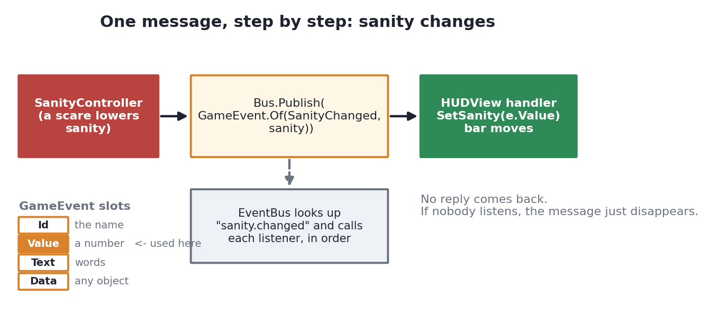
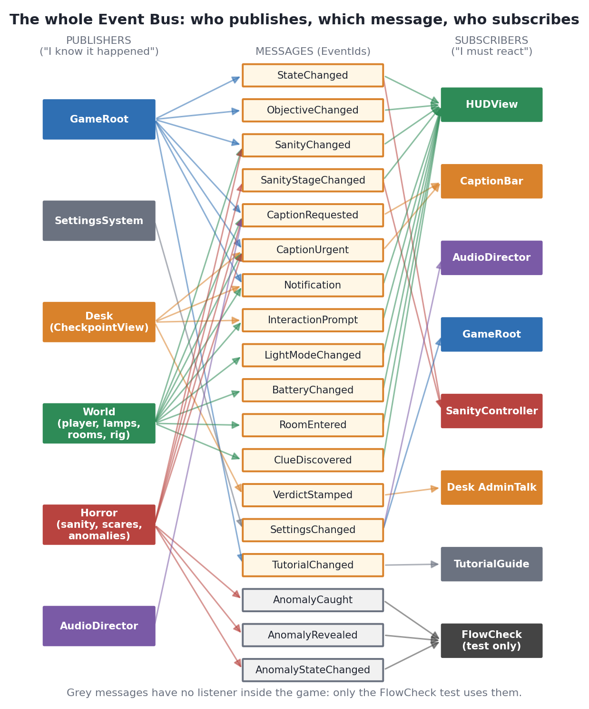
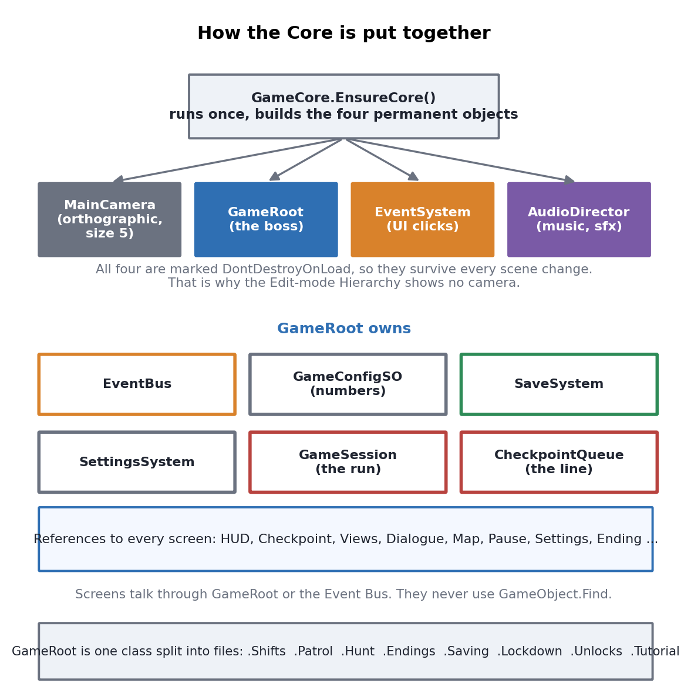
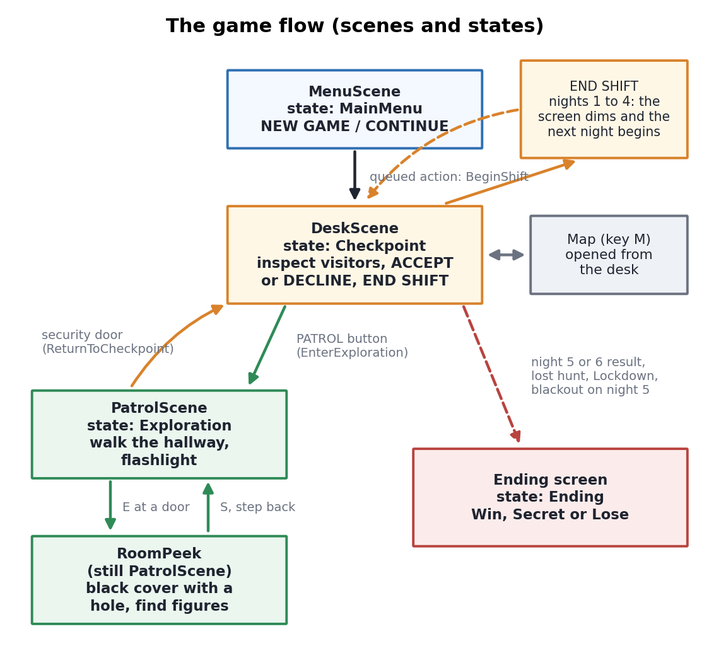
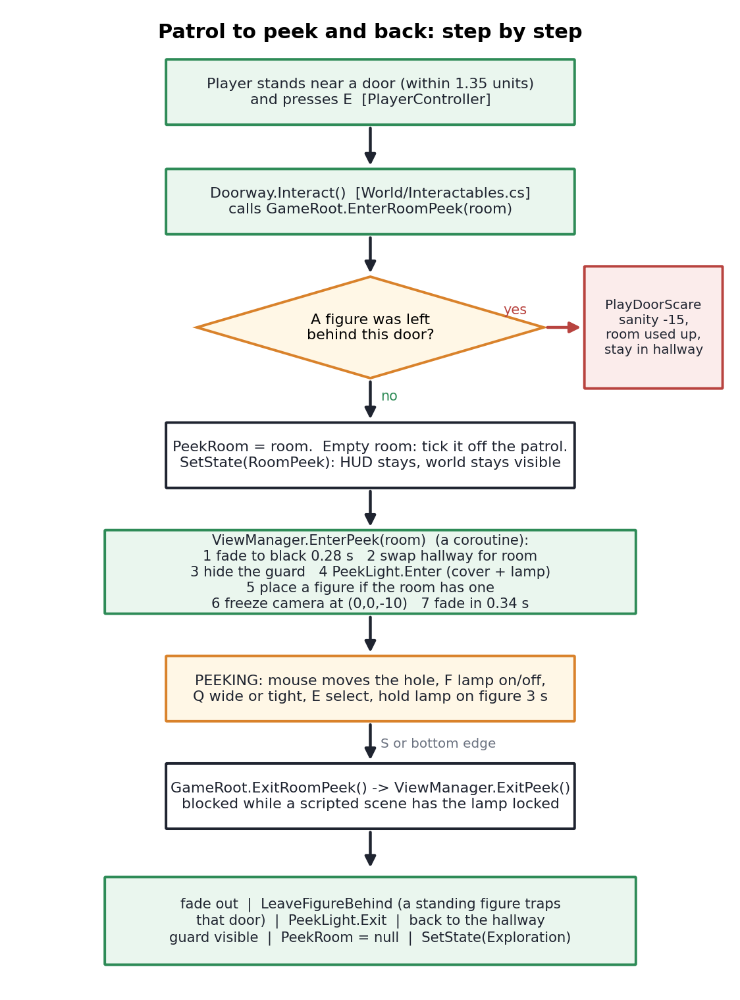
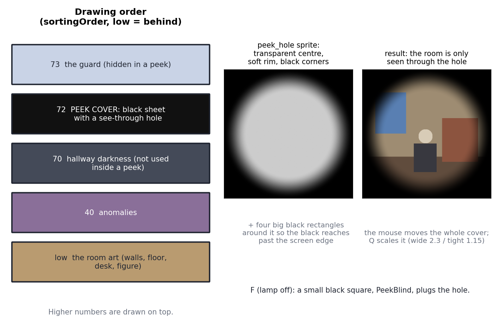

# Show Me Your ID!: the Script Guide ("what not to remove")

This guide is for the day a professor deletes one line of any script and asks "what happens now?". It lists every script in the project: where it is, what it is for, which parts must not be removed, what happens if they are, and whether it publishes or subscribes to the Event Bus.

How to read it:

- **Where** is the path inside the Unity project (`Assets/_Project/...`).
- **Purpose** is the job of the script in plain words.
- **Do not remove** lists real methods, fields and lines, with the symptom you would see if they were gone.
- **Pub/Sub** says which Event Bus messages the script sends (publishes) or listens to (subscribes).

A word you may need: a **compile error** means Unity refuses to build because some other file still uses what you deleted. A **silent bug** means the game still runs but behaves wrongly. A professor's favourite is the silent bug, so those are marked in the lists.

---

## Part 1: Publish and Subscribe (the Event Bus)

### Is publish the back end and subscribe the front end?

Not exactly, but your feeling has a reason. The honest rule is:

- **Publish** means: "Something just happened, and I am the one who knows."
- **Subscribe** means: "When that happens, I need to react."

It does not matter whether the sender is logic or a screen. Here are real cases from the code that break the "back end / front end" idea:

| Who publishes | Is it back end? | Who subscribes | Is it front end? |
|---|---|---|---|
| `SettingsSystem` (settings logic) | back end | `AudioDirector` and `GameRoot` | back end |
| `CheckpointView.Decision` (the desk screen stamps a verdict) | **front end** | `CheckpointView.AdminTalk` | front end |
| `PeekLight` and `PlayerController` (mouse and keys in the world) | **front end** | `HUDView` (the prompt text) | front end |
| `GameRoot` (the boss) says `StateChanged` | back end | `HUDView` and `SanityController` | one front, one back |

It often looks like back end to front end because most messages are "the game state changed" and the screen reacts, for example sanity changes and the HUD bar moves. But the real picture is simply: **the one who knows tells, the ones who care listen**. Neither has to know the other exists.

### Why does the game use it at all?

1. **No tangled wires.** The scare code does not call the HUD. It says "sanity changed". If the HUD is deleted, the scare code still works. If a new thing wants to know about sanity, it subscribes and nothing else changes.
2. **Many listeners, one sender.** `Notification` is sent from 15 files and the HUD alone shows it. `SettingsChanged` is sent once and two listeners react.
3. **The message carries what the listener needs.** A `GameEvent` has four slots: `Id` (the name), `Value` (a number), `Text` (words) and `Data` (any object). The sender fills only the slots it needs. The listener reads the same slots. There is no reply: it is one way.

{width=6.2in}

### Why not use it for everything?

When there is **one known receiver**, the code just calls it. For example `GameRoot.ApplyVisibility` calls `Checkpoint.Show()` directly. The bus is for "many may care" and "I should not know who".

### What happens if a line is removed (the exam answers)

| If this is removed | Result |
|---|---|
| A `Bus.Publish(...)` line | No error. Everybody who listens for it just never hears it, so that part of the screen never updates (a silent bug). |
| A `Bus.Subscribe(...)` line | No error. The message is sent but nobody reacts (a silent bug). |
| The `Dispose()` of a subscription when a screen closes | The old listener stays. It can run on an object that is gone, which gives errors and wasted memory. |
| An `EventIds` constant | Compile error in every file that used it. |
| The wrong slot is read (`e.Text` where the sender used `Value`) | The listener gets an empty value and nothing crashes. |
| The `try/catch` in `EventBus.Publish` | One listener's bug stops all the later listeners. |

### The complete Event Bus map

This chart and the table under it were made from the real code (a search of every `Publish` and `Subscribe`). It is the whole traffic of the game.

{width=6.4in}

| Event (in `EventIds.cs`) | Carries | Published by | Subscribed by |
|---|---|---|---|
| `StateChanged` | `Data`: the new `AppViewState` | `GameRoot` (in `SetState`) | `HUDView`, `SanityController` |
| `ObjectiveChanged` | `Text`: the objective line | `GameRoot.Hunt`, `.Patrol`, `.Shifts` | `HUDView` |
| `VerdictStamped` | `Data`: the outcome | `CheckpointView.Decision` | `CheckpointView.AdminTalk` |
| `RoomEntered` | `Data`: the room | `ViewManager` | `HUDView` |
| `LightModeChanged` | `Data`: lamp on or off | `LightController`, `PeekLight` | `HUDView` |
| `ClueDiscovered` | `Data`: the clue result | `Interactables` | `HUDView` |
| `InteractionPrompt` | `Text`: "Peek into Room 101 [E]" or "" | `CheckpointView.Speech`, `PeekLight`, `PlayerController` | `HUDView` |
| `SanityChanged` | `Value`: 0 to 100 | `AdminHuntDirector`, `GameRoot.Patrol`, `SanityController`, `ScareSystem`, `WanderingAnomaly` | `HUDView` |
| `SanityStageChanged` | `Data`: the stage | `SanityController` | `HUDView`, `SanityController` |
| `CaptionRequested` | `Text`: words, `Value`: seconds | `AudioDirector`, `GameRoot.Patrol`, `HallucinationSystem`, `PeekAnomaly`, `WanderingAnomaly` | `CaptionBar` |
| `CaptionUrgent` | same, always shown | `AdminHuntDirector`, `CheckpointView.Lockdown`, `FlashlightRig`, `GameRoot.Patrol`, `GameRoot.Shifts`, `WanderingAnomaly` | `CaptionBar` |
| `SettingsChanged` | `Data`: the settings | `SettingsSystem` | `AudioDirector`, `GameRoot` |
| `Notification` | `Text`: a short toast | 15 files (desk, patrol, `GameRoot`, `GameCore`) | `HUDView` |
| `BatteryChanged` | `Value`: 0 to 1 | `FlashlightRig` | `HUDView` |
| `TutorialChanged` | `Value`: the step | `GameRoot.Tutorial` | `TutorialGuide` |
| `AnomalyCaught` | `Text`: the kind | `WanderingAnomaly` | **only the FlowCheck test** (`Tools/FlowCheck/Program.cs`) |
| `AnomalyRevealed` | `Data`: the kind | `WanderingAnomaly` | **only the FlowCheck test** |
| `AnomalyStateChanged` | `Text`: the state name | `WanderingAnomaly` | **only the FlowCheck test** |

Two things stand out:

- **`HUDView` is the biggest listener.** It subscribes to 10 messages, which is why it is the screen that "just updates itself".
- **The last three events have no listener inside the game.** They are hooks that only the test program uses. Removing their `Publish` lines changes nothing you can see in the game, but the FlowCheck test would fail. A professor may ask this.

---

## Part 2: The big picture

{width=5.6in}

How the pieces connect:

- `GameCore` (in Scenes) builds the permanent objects once: the camera, `GameRoot`, the EventSystem and the `AudioDirector`. All are marked `DontDestroyOnLoad`, so they survive every scene change. That is why the Hierarchy shows no camera in Edit mode.
- `GameRoot` is the boss. It owns the services (the Event Bus, the config, the save system, the settings, the audio), the run (the `GameSession`), and a reference to every screen.
- `GameLogic` holds the rules with no Unity objects, so the 120,438 tests can run without the editor.
- The views (`Checkpoint`, `UI`, `World`, `Horror`) show things and read the keys. They talk to each other through `GameRoot` and the Event Bus.

{width=5.8in}

The desk is called the **checkpoint** because it is the security checkpoint of the school gate. It is not a save point. Saving is done by `PersistRun` and `SaveSystem`.

---

## Part 3: How the patrol, the peek and the flashlight work

This is the part professors love, because the black screen with a hole feels like magic. It is not magic: it is a stack of pictures drawn in a fixed order.

### 3.1 From the door to the peek

{width=4.5in}

Notes on the chart:

- **You do not click the door.** On patrol the mouse only aims the flashlight. You walk to a door and press **E**. Each frame `PlayerController` picks the nearest door or item within `interactRange` (1.35 units, from `GameConfigSO`).
- **`EnterRoomPeek` is the gate.** It first checks the door scare (a figure you left standing last time). Only then does it set the state to `RoomPeek`.
- **`SetState(RoomPeek)`** matters: the HUD stays on, the world stays visible (`ApplyVisibility` lists `RoomPeek` with `Exploration`), and the shift clock and sanity keep running.
- **`ViewManager.EnterPeek` is a coroutine.** A coroutine is a method that can pause with `yield return` and continue on a later frame. That is how "fade to black, swap, fade back in" works without freezing the game.
- **`Transitioning = false` comes before the fade-in ends**, so the player can already act. The fade is only looks.

What happens if a professor removes a line here:

| Removed line | Result |
|---|---|
| `SetState(AppViewState.RoomPeek)` in `EnterRoomPeek` | The camera peeks but the game still thinks it is patrolling. Pause and sanity use the wrong rules. |
| `Views.EnterPeek(room)` | The state says "peeking" but nothing changes on screen. |
| `SetPlayerVisible(false)` in `PeekTransitionRoutine` | The guard sprite is drawn in the middle of the peek. |
| `SetPlayerVisible(true)` in `ExitPeekRoutine` | After the first peek the guard is invisible in the hallway. |
| `_gameRoot.PeekRoom = null` | The game thinks you are still peeking a room. |
| `_gameRoot.SetState(AppViewState.Exploration)` | You are back in the hallway but the state stays `RoomPeek`, so patrol keys and prompts stay wrong. |
| `LeaveFigureBehind(...)` in `ExitPeekRoutine` | A standing figure no longer traps its door, so doors are always safe. |
| `Transitioning = true` in `EnterPeek` | You can press S in the middle of the fade and the two coroutines fight each other. |

### 3.2 The black screen: how can we see under it?

{width=6.4in}

The key idea: **the black is not the camera background, and nothing is "lighting" the room.**

- Unity draws sprites in **sorting order**. A bigger `sortingOrder` is drawn on top. The cover is at **72** (`WorldLayers.PeekCover`), above the room art.
- The cover is built in `PeekLight.Init`:
  - **`PeekHole`**: a 256 x 256 sprite made in code (`MakePeekHole`). Each pixel has an *alpha* (0 = see-through, 1 = solid black). The middle is alpha 0, and it fades to black from 65 % of the radius out, using a smooth curve.
  - **Four big black rectangles** (`CoverLeft`, `CoverRight`, `CoverTop`, `CoverBottom`) placed around it, 16 times as wide as the hole, so the black always reaches past the screen edge.
  - **`PeekBlind`**: a small black square over the hole. It is switched **on** when the lamp is off (`F`), plugging the hole.
- Because the hole pixels are transparent, the room's own sprites below are what you see. It is a window, not a lamp.
- **Moving it:** every frame `PeekLight.Tick` turns the mouse position into a world point (`ScreenToWorldPoint`) and moves the whole cover there.
- **Size:** `transform.localScale = EffectiveRadius * 2`. The hole sprite is one unit wide, so its scale is its diameter. `Q` switches between radius 2.3 (wide) and 1.15 (focus).
- **What you can select:** `FindNearestUnderCursor` only works while the lamp is lit. In the dark there is nothing to select with **E**.

| Removed line | Result |
|---|---|
| `transform.position = wp;` in `PeekLight.Tick` | The hole stays in the middle and ignores the mouse. |
| `mouse.z = -_cam.transform.position.z;` | `ScreenToWorldPoint` gets the wrong depth and returns the camera position, so the hole sticks at one point. |
| `AddCover("CoverLeft", ...)` (any of the four) | One side of the screen is not covered, so you see the whole room there. |
| `_blind` (`PeekBlind`) | The F key does nothing visible: the hole stays open in a dark room. |
| `ApplyFocusVisual()` | Q changes the flag but the hole does not change size. |
| the `Lit` check in `FindNearestUnderCursor` | You can select things in the dark. |
| `EnsurePeekLight()` in `PeekTransitionRoutine` | `_peekLight` is null, so entering a peek crashes with a NullReferenceException. |

### 3.3 The hallway flashlight (a different method)

In the hallway the same idea is done differently, by `FlashlightRig` and `BeamCover`:

- `BeamCover` is a small texture (192 x 108 pixels) the size of the screen. It is **repainted every frame**: as dark as the room is, but fully clear inside the beam cone.
- The beam cone is plain math in `GameLogic/BeamGeometry.cs`. The same math decides whether an anomaly is inside the beam. The picture and the rule use the same numbers, so what you see is what counts.
- `FlashlightRig` has three modes (`Off`, `Sweep`, `Focus`). The beam follows the mouse, and the displayed aim is smoothed so it never snaps.
- **One battery for both lamps.** The rig owns it. The peek lamp reads `rig.BatteryDead` and drains the same battery (`BatteryMode`), so a dead battery also puts out the peek lamp. The HUD learns about it through the `BatteryChanged` event.

| Removed line | Result |
|---|---|
| `_cover.Init()` | The beam cover has no texture, so it errors or draws nothing: the beam no longer clears the dark. |
| `cone.enabled = false` | A visible cone sprite would be painted over the lit area, which the design avoids on purpose. |
| `Bus.Publish(BatteryChanged ...)` in `FlashlightRig` | The battery bar in the HUD never moves (a silent bug). |
| `BatteryDead` checks | The lamp never dies, so the battery has no meaning. |

---

## Part 4: Every script, folder by folder

The rest of this guide covers all 130 or so scripts. Each entry has the same four lines: **Where**, **Purpose**, **Do not remove** and **Pub/Sub**. The folders come in this order: Core, GameLogic, Checkpoint, UI, World, Horror, Scenes, Audio, Generated and Editor.

How to use the "Do not remove" lines on the day: find the file the professor opened, find the removed line in the list, and say the result in one sentence. If the removed line is not in the list, use the three-question method in Part 5 at the end of this guide.

## Part 4a: Core (the central system)

`Assets/_Project/Scripts/Core/` has 17 files and about 2,200 lines. It holds the boss object (`GameRoot`), the Event Bus, saving, settings and a few small helpers. Only `GameRoot` and `AspectMatchGuard` are MonoBehaviours (scripts placed on a GameObject that Unity calls every frame). The rest are plain C# classes.

### EventBus.cs
- **Where:** Assets/_Project/Scripts/Core/EventBus.cs
- **Purpose:** The message board. It also defines `GameEvent` (the message with `Id`, `Data`, `Value`, `Text`) and `EventSubscription` (the receipt you get from `Subscribe`, used to unsubscribe).
- **Used by:** `GameCore` makes the one bus, `GameRoot.Bus` hands it out, and every screen that publishes or subscribes.
- **Do not remove:**
  - The `try/catch` inside `Publish`: without it, one listener that crashes stops every later listener (a silent bug for the others).
  - `var snapshot = list.ToArray();`: the loop would run over the live list. A listener that unsubscribes while being called makes C# throw "collection was modified".
  - `EventSubscription.Dispose` and `Remove`: screens could no longer unsubscribe. Old listeners would stay and run on destroyed objects.
  - The `string.IsNullOrEmpty(e.Id)` check: a message with no name would look up a null key and crash.
- **Pub/Sub:** it is the bus itself, so it neither publishes nor subscribes.

### EventIds.cs
- **Where:** Assets/_Project/Scripts/Core/EventIds.cs
- **Purpose:** The list of every message name as constants (for example `SanityChanged = "sanity.changed"`). Constants stop typing mistakes. The comments say which slot each message uses.
- **Used by:** every publisher and subscriber.
- **Do not remove:** any constant. Each one is used somewhere, so removing it is a compile error in those files. The three anomaly events (`AnomalyCaught`, `AnomalyRevealed`, `AnomalyStateChanged`) are used only by `Publish` in `WanderingAnomaly` and by the FlowCheck test.
- **Pub/Sub:** none (it only holds names).

### GameRoot.cs
- **Where:** Assets/_Project/Scripts/Core/GameRoot.cs
- **Purpose:** The boss of the game. It holds the services, the current run, the state (`AppViewState`) and a reference to every screen. It also runs the shift clock, sanity ticking, pause and quit.
- **Used by:** nearly every other script, through `GameRoot.Instance`.
- **Do not remove:**
  - `Instance = this;` in `InitServices`: every `GameRoot.Instance` becomes null and the game crashes with NullReferenceException.
  - `DontDestroyOnLoad(gameObject)`: `GameRoot` is destroyed on the first scene load and the whole run state is lost.
  - `SetState` calling `ApplyVisibility(s)`: the state changes but no screen switches, so the old screen stays up.
  - `ClampedDelta` (`Mathf.Min(deltaTime, 0.5f)`): after alt-tab, the first frame carries a huge time step and the night jumps forward.
  - `OnApplicationFocus` auto-pause: alt-tab no longer pauses.
  - `CheckSceneHandshake` in `Update`: if a scene fails to start, the player stares at a dead screen. The comment says "Do not remove".
  - `Time.timeScale = 1f` in `OnDestroy`: the game can stay frozen after it is destroyed while paused.
  - `TickShiftClock` and `TickSanity`: the night clock and the sanity drain stop.
- **Pub/Sub:** publishes `StateChanged` (in `SetState`) and `Notification`. Subscribes to `SettingsChanged` (to resize the text and refresh the HUD).

### GameRoot.Shifts.cs
- **Where:** Assets/_Project/Scripts/Core/GameRoot.Shifts.cs
- **Purpose:** Starting a new game, continuing a save, beginning each night, building the queue and the roster, and counting each verdict.
- **Used by:** the main menu buttons and `FinishShift`.
- **Do not remove:**
  - `QueueSceneAction(() => BeginShift(first))` in `StartNewGame`: the new scene loads but nothing begins the night, so the handshake times out and sends the player to the menu.
  - `Queue = new CheckpointQueue();` in `StartNewGame` and `ContinueGame`: the last run's waiting line would leak into the new one.
  - In `BeginShift`, `Session.BeginNight()` and the clears: last night's penalty is not paid and old state carries over.
  - `RememberNightStart(isResume)`: a failed night has no clean copy to go back to.
  - In `OnVerdictResolved`, the `_resolvedVisitorIndices.Add(...)` guard: a verdict that fires twice counts twice (score, breaches), a silent bug.
  - `Session.EvaluateEnding()` and `TriggerEnding`: mid-shift lose conditions never fire.
- **Pub/Sub:** publishes `Notification` and `CaptionUrgent`; subscribes to nothing.

### GameRoot.Patrol.cs
- **Where:** Assets/_Project/Scripts/Core/GameRoot.Patrol.cs
- **Purpose:** Leaving the desk for the patrol, peeking into a room, stepping back, the door scare, the map, and returning to the desk.
- **Used by:** `Doorway.Interact`, `PeekLight`, `CheckpointView`, `HUDView`.
- **Do not remove:**
  - In `EnterRoomPeek`, `SetState(AppViewState.RoomPeek)` and `Views.EnterPeek(room)`: either the game does not know it is peeking, or nothing changes on screen.
  - `DoorScareWaiting`/`PlayDoorScare`: a figure left standing no longer jumps you on return.
  - `LeaveFigureBehind`: leaving a peek never marks the figure, so doors are always safe.
  - In `EnterExploration`, the `SceneRouter.Load(...)` line: the queued action is never consumed, and after 3.5 seconds the handshake sends you to the menu.
  - In `ReturnToCheckpoint`, `Checkpoint.ResumeRun()`: you return to a desk with no queue running.
  - `RepelPeekAnomaly`: driving a figure out with the lamp no longer clears the room for the patrol.
- **Pub/Sub:** publishes `SanityChanged`, `ObjectiveChanged`, `CaptionUrgent`, `CaptionRequested`, `Notification`.

### GameRoot.Hunt.cs
- **Where:** Assets/_Project/Scripts/Core/GameRoot.Hunt.cs
- **Purpose:** Night 5 and Night 6, the Principal's hunt: getting ready at the desk, the tuning numbers, and the result.
- **Used by:** `EnterExploration`, `AdminHuntDirector`, `CheckpointView.AdminTalk`.
- **Do not remove:**
  - `BuildHuntTuning`: the hunt gets default numbers and ignores `GameConfig.asset`; Night 6 loses its harder numbers.
  - The `n6` lines (`DodgesLamp`, `ScaleSwapWaits`): Night 6 plays like Night 5.
  - `HuntActive` and `HuntReady`: the Patrol click no longer starts the hunt.
- **Pub/Sub:** `SetObjective` publishes `ObjectiveChanged`.

### GameRoot.Endings.cs
- **Where:** Assets/_Project/Scripts/Core/GameRoot.Endings.cs
- **Purpose:** END SHIFT, failing a night (a breach or a blackout), saving the lost night, finishing a shift and showing the endings.
- **Used by:** the END SHIFT button, `SanityController`, `FinishShift` callers, `EndingView`.
- **Do not remove:**
  - In `RequestEndShift`, the `Session.RecordShiftFailure(ShiftFailure.Breach)` branch: nights 1 to 4 no longer fail for letting an anomaly in.
  - `ReplayFailedNight` using `_nightStart`: Continue would carry on from the failed state instead of replaying the night.
  - In `FinishShift`, `Queue = new CheckpointQueue();` and `Session.QueueState = null;`: the finished night's line leaks into the next save.
  - `Loading.DimThen(...)`: nights stop running on from one to the next without the dim.
  - `TriggerEnding`: `Records.EndingsSeen.Add(key)` (endings are never remembered), `MarkNight6Beaten()` (Lockdown never unlocks), `Session.RunFinished = true` (the save still looks continuable).
- **Pub/Sub:** none directly (it calls other classes).

### GameRoot.Saving.cs
- **Where:** Assets/_Project/Scripts/Core/GameRoot.Saving.cs
- **Purpose:** Erasing data (`ResetAllData`, `RequestDataReset`) and writing the save (`PersistRun`).
- **Used by:** the menu, the settings reset button, shift and run endings, quit.
- **Do not remove:**
  - `if (Session.Mode != GameMode.Normal) return;` in `PersistRun`: Night 6 and Lockdown would overwrite the story save.
  - `Session.ShiftClockMinutes = _shiftMinutes;`: Continue rewinds the clock to 22:00.
  - The `Queue.BuildSnapshot()` lines: Continue loses the waiting line.
  - The hunt lines (`HuntCatches`, `HuntSecondsLeft`): quitting becomes a way out of a hunt.
  - `Confirm.Ask` in `RequestDataReset`: one click erases the save with no warning.
- **Pub/Sub:** publishes `Notification`.

### GameRoot.Lockdown.cs
- **Where:** Assets/_Project/Scripts/Core/GameRoot.Lockdown.cs
- **Purpose:** Counts mistakes in Lockdown mode and ends the night on the third, or when the last face has gone.
- **Used by:** `OnVerdictResolved`, `OnVisitorTaken` (called by the desk).
- **Do not remove:** `AddLockdownStrike` (mistakes are never counted); `CheckLockdownEnd` (the mode never ends); the `_resolvedVisitorIndices.Add` guard in `OnVisitorTaken` (a taken visitor counts twice).
- **Pub/Sub:** publishes `Notification` ("MISTAKE n OF 3").

### GameRoot.Unlocks.cs
- **Where:** Assets/_Project/Scripts/Core/GameRoot.Unlocks.cs
- **Purpose:** Which hidden modes are open. They are stored in `PlayerPrefs`, not in the story save.
- **Used by:** the main menu and `TriggerEnding`.
- **Do not remove:** `ClearUnlocks` in the data reset (the unlocks survive a "erase all data"); `Night6Unlocked` (Night 6 never opens after finishing the story); `PlayerPrefs.Save()` calls (the unlock is lost if the game crashes).
- **Pub/Sub:** none.

### GameRoot.Tutorial.cs
- **Where:** Assets/_Project/Scripts/Core/GameRoot.Tutorial.cs
- **Purpose:** The Night 1 lesson. It is switched off right now (`TutorialSteps.Enabled = false`), so every game reads as "Done".
- **Used by:** `Update` in `GameRoot` (`TickTutorial`), `Doorway`.
- **Do not remove:** `SetTutorialStep` (publishes the step, so the guide never updates when it is on). With the tutorial parked off, removing the file's other methods is a compile error because `GameRoot.Update` and the patrol call them.
- **Pub/Sub:** publishes `TutorialChanged`; `TutorialGuide` subscribes.

### GameConfigSO.cs
- **Where:** Assets/_Project/Scripts/Core/GameConfigSO.cs
- **Purpose:** A ScriptableObject (a data file you edit in the Inspector). All tunable numbers: queue timing, flashlight battery, hunt times, canvas size 1280 x 720.
- **Used by:** `GameCore.EnsureCore` loads it; `GameRoot.Config` hands it out.
- **Do not remove:** `LoadOrDefault` (no fallback if the asset is missing, so null errors); `canvasReferenceWidth/Height` (UI scaling breaks); each number is read somewhere, so removing one is a compile error at its users.
- **Pub/Sub:** none.

### SaveSystem.cs
- **Where:** Assets/_Project/Scripts/Core/SaveSystem.cs
- **Purpose:** Reads and writes `hollowbrook_save.txt` (and the night-start copy) in `Application.persistentDataPath`.
- **Used by:** `GameRoot` (`Saves`).
- **Do not remove:**
  - The `.tmp` then `File.Replace` steps in `WriteTo`: a crash during writing leaves half a file and the save is lost.
  - The `.bak` and `.tmp` fallbacks in `ReadFrom`: one bad write means "no save".
  - `.bak` and `.tmp` in `Delete`: a "deleted" save comes back from the backup.
  - The `try/catch` blocks: a locked folder crashes the game instead of returning "no save".
- **Pub/Sub:** none.

### SettingsSystem.cs
- **Where:** Assets/_Project/Scripts/Core/SettingsSystem.cs
- **Purpose:** Volumes, text size, fullscreen and accessibility options, kept in `PlayerPrefs`. It also applies the screen mode.
- **Used by:** `GameCore` makes it; `AudioDirector`, `SettingsView`, `GameRoot`.
- **Do not remove:** `Notify()` in `Apply` (sliders move but nothing reacts, a silent bug); the `sfxExplicit` check (a stored volume of 0 stays silent); `ApplyStoredDisplay` (the screen mode is not restored); the `try/catch` in `LoadFromPrefs` (unreadable prefs crash the start).
- **Pub/Sub:** publishes `SettingsChanged`.

### InputGate.cs
- **Where:** Assets/_Project/Scripts/Core/InputGate.cs
- **Purpose:** One owner per key per frame for Esc and M, so several screens do not all act on the same press.
- **Used by:** `PeekLight`, `PlayerController`, `CheckpointView`, `MapView`, `SettingsView`, `ConfirmationPopup`.
- **Do not remove:** the `_escFrame` check in `TryEscape`: one Esc closes Settings and also unpauses the game. `NextFrame()` is for the tests.
- **Pub/Sub:** none.

### IScreenView.cs
- **Where:** Assets/_Project/Scripts/Core/IScreenView.cs
- **Purpose:** The contract every screen follows: `Init(GameRoot)`, `Show()`, `Hide()`.
- **Used by:** `GameCore.CreateView<T>` and every view class.
- **Do not remove:** any of the three methods: every screen class stops compiling.
- **Pub/Sub:** none.

### AspectMatchGuard.cs
- **Where:** Assets/_Project/Scripts/Core/AspectMatchGuard.cs
- **Purpose:** Keeps the UI scale right when the window shape changes. A MonoBehaviour on every canvas.
- **Used by:** `GameCore.NewCanvas` adds it; `MapView`, `MapSheetLayout`, `MainMenuView` and `UIFactory` use `VisibleReferenceSize`.
- **Do not remove:** the `Update` size check (resizing the window leaves the UI cropped or stretched); `matchWidthOrHeight = aspect > ReferenceAspect ? 1f : 0f` (the UI does not fit wide or tall screens); `VisibleReferenceSize` (the map sheet is no longer centred).
- **Pub/Sub:** none.

---

## GameLogic, part 1 (pure rules)

The GameLogic folder (namespace `Hollowbrook.Logic`) holds the rules of the game written as plain C# with no UnityEngine objects (no GameObject, no Transform, no MonoBehaviour). Because of that, the headless tests in Tools/LogicTests can run them without the Unity editor. The views and GameRoot call into these files, ask "what should happen?", and then show the answer on screen. Terms used below: a **static class** is a class you never create with `new`, you just call `ClassName.Method()`. A **struct** is a small bundle of values copied around by value. An **enum** is a named list of choices (like `Verdict.Allow`). A **partial class** is one class split over two or more files. A **seed** is a number that makes random numbers repeat the same way.

### AdminHunt.cs
- **Where:** Assets/_Project/Scripts/GameLogic/AdminHunt.cs
- **Purpose:** Runs the Night 5 and Night 6 chase where the administrator stalks you until dawn. It holds the hunt's phases (Stalking, InRoom, Behind, Loose, Retreat, Won, Lost), its timers, and the rules for catches and repels. It also holds two small helpers: `AdminHuntDodge` (how he circles in a room on night 6) and `AdminHuntMotion` (how his picture drifts on night 5).
- **Used by:** World/AdminHuntDirector.cs (creates `new AdminHunt(tuning, seed)` and ticks it), Core/GameRoot.Hunt.cs, World/ViewManager.cs.
- **Do not remove:**
  - In `Tick`, the lines `SurviveLeft -= dt;` and the `if (SurviveLeft <= 0f) { ... Phase = HuntPhase.Won; ... }` block are the dawn clock. Without them nothing ever ends the hunt by time, so the player cannot win (the "nobody gets stuck" rule in the file header breaks).
  - `if (Finished || dt <= 0f) return HuntEvent.None;` at the top of `Tick`: without it a finished hunt keeps running and can fire `Won` or `Caught` again, and a zero-length frame would still advance timers.
  - In `Catch()`, `if (Catches >= Tuning.CatchesToLose)` sets `Phase = HuntPhase.Lost`. Remove it and the player can be caught forever and never loses (the server door ending never comes).
  - `TickInRoom`: `if (looking && _leftHim) return Catch();` is the "that door is now a trap" rule. Remove it and the player can peek, leave, and peek again for free. `GiveFairChance()` is the opposite safety: remove it and he can catch you on your very first look into the room.
  - `Start(...)` clamps with `Math.Min(catches, Tuning.CatchesToLose - 1)` and `Math.Min(surviveLeft, ...)`. Remove the clamps and a resumed save could start the hunt already lost or with more time than a fresh night.
- **Pub/Sub:** none (pure logic; the caller publishes). It only returns `HuntEvent` flags and the director reacts.

### AdminTalk.cs
- **Where:** Assets/_Project/Scripts/GameLogic/AdminTalk.cs
- **Purpose:** The script and rules for talking to the administrator at the window on night 5 and 6. It is a tree of "nodes" (what he says) with "options" (what you can say back), a hub of topics, and a small state string that is saved with the run.
- **Used by:** Checkpoint/CheckpointView.AdminTalk.cs, Checkpoint/CheckpointView.Window.cs, Checkpoint/CheckpointLayout.cs, Core/GameRoot.Hunt.cs.
- **Do not remove:**
  - `LiesExposed(AdminTalkState st)` counts the `press_` options that are set in `UsedMask`. GameRoot uses it to shorten the night that follows, so removing it is a compile error in the caller, and a wrong bit index silently gives the player the wrong shortening.
  - `OneShotIndex` gives each non-repeatable option its bit number from the script order. If you reorder or delete topics in `BuildScript`, old saved `UsedMask` numbers point at different lies (silent wrong result after Continue).
  - `AdminTalkState.Decode` ends with `if (AdminTalk.NodeById(st.Node) == null) st.Node = "";` and returns a fresh state when `p.Length < 4`. Remove these and a torn or old save string can crash or leave the player on a node that no longer exists.
  - In `OptionsFor`: `if (list.Count == 0) list.Add(StepBack());   // never a dead end`. Remove it and a node whose options are all hidden would trap the player in the panel.
  - `Resolve` fills the `{badge_name}`, `{memo_num}` and other tokens. Remove a `.Replace(...)` and the player sees the raw text `{badge_name}` on screen; `ValidateScript` (used by tests) lists these tokens too, so tests would fail.
- **Pub/Sub:** none (pure logic; the caller publishes).

### AnomalyBehaviorRules.cs
- **Where:** Assets/_Project/Scripts/GameLogic/AnomalyBehaviorRules.cs
- **Purpose:** Holds the numbers and rules for how the four roaming anomaly types move: Blink, Slide, Sprint and CoverHug. `BehaviorTuning` is the speeds and timers, `BehaviorProfile.For(kind, tuning)` turns one kind into its final rules (speed, spawn height, catch time). The file does not contain a class called `AnomalyBehaviorRules`; the types are `BehaviorTuning` and `BehaviorProfile`.
- **Used by:** Horror/WanderingAnomaly.cs (`BehaviorProfile.For`, `BehaviorTuning.Default`, `NearestDoorX`, `DoorXs`), Horror/ScareSystem.cs, Core/GameRoot.Endings.cs, Generated/ProceduralArt.cs (picture sizes and `ArtKey`).
- **Do not remove:**
  - `BeamPace = t.BeamPace > 0f ? t.BeamPace : 1f` in `BehaviorProfile.For`: if a tuning is left at 0, removing this check makes the anomaly speed multiplier 0 and it freezes whenever a beam touches it (the comment says "an unset tuning must never freeze an anomaly").
  - `case AnomalyBehaviorKind.Blink: ... p.FreezesWhenObserved = true;` is what makes Blink stop when watched. Remove it and Blink moves while you look at it and the "creeping" feel is gone.
  - `p.CeilingLurker = true;` in the `default:` (CoverHug) case: remove it and the ceiling hanger no longer needs the Focus beam to be seen clearly.
  - `DoorXs` must match the door positions in `FloorPlan` (`HallX`). If a value is wrong, the CoverHug spawns above empty wall instead of a door. `GroundCentreY = CrouchedHeight * 0.5f` and the other `...Y` constants decide where feet touch the floor; change them and anomalies float or sink.
  - `BehaviorTuning.Default` values (like `RetreatSpeed = 9f`): remove the field and WanderingAnomaly fails to compile; set it to 0 and a repelled anomaly vanishes instead of visibly running backwards.
- **Pub/Sub:** none (pure logic; the caller publishes).

### AnomalyEncounter.cs
- **Where:** Assets/_Project/Scripts/GameLogic/AnomalyEncounter.cs
- **Purpose:** The state machine for one real anomaly meeting the player: Roaming, Stalking, Detected, Exposed, Repelled, Recovering. Each call to `Step` returns the next state and flags such as "just repelled".
- **Used by:** Horror/WanderingAnomaly.cs (the only caller found).
- **Do not remove:**
  - `else if (!focused || !batteryOk) { r.State = AnomalyState.Detected; ... }` in the `Exposed` case: remove it and losing Focus or battery no longer drops the anomaly back to Detected, so it stays "exposed" with a dead flashlight.
  - `bool leaves = stateTimer >= t.RetreatMaxSeconds || (...)` in the `Repelled` case: the `RetreatMaxSeconds` timeout stops a repelled anomaly from getting stuck on screen forever. Remove it and one that cannot leave the screen blocks the whole encounter.
  - `r.Threatening = (r.State == ... ) && distanceToPlayer <= t.ThreatRange;` is judged on the NEW state. If you judge on the old `state`, the tick that repels the anomaly can also count as a catch frame (silent unfair catch).
  - `else if (meter > 0.05f) r.State = AnomalyState.Stalking;`: remove it and Stalking never happens (the anomaly goes straight between Roaming and Detected, so the "presses in" cue is lost).
  - The `Recovering` case with `RecoverSeconds`: remove it and a repelled anomaly never comes back to Roaming (and `JustRecovered` never fires).
- **Pub/Sub:** none (pure logic; the caller publishes).

### BatteryModel.cs
- **Where:** Assets/_Project/Scripts/GameLogic/BatteryModel.cs
- **Purpose:** The flashlight battery maths: drain while the beam is on, recover while it is off, die at 0, and reboot at a set charge.
- **Used by:** World/FlashlightRig.cs (calls `BatteryModel.Tick` every frame).
- **Do not remove:**
  - `bool on = beam != LightMode.Off && !s.Dead;` removes the "drain only while a beam is really on" rule. Without `&& !s.Dead` a dead battery would keep draining and the reboot never reaches `RebootFraction`.
  - `if (c <= 0f && !dead) { dead = true; justDied = true; }`: `justDied` is the one-time signal the rig uses for the "battery dead" feedback. Remove the `!dead` check and the death signal repeats every frame.
  - `else if (dead && c >= p.RebootFraction) { dead = false; justRebooted = true; }`: remove it and once dead the flashlight stays dead for the whole run.
  - `if (c < 0f) c = 0f; else if (c > 1f) c = 1f;` keeps charge between 0 and 1. Remove it and charge can go negative or above full (a battery bar drawn outside its box, and an over-full battery).
  - `float rate = roomLit ? p.RecoverLitPerSecond : p.RecoverDarkPerSecond;` decides recharge speed from the ROOM, not from the beam. Swap it and standing in a lit room stops recharging faster.
- **Pub/Sub:** none (pure logic; the caller publishes).

### BeamGeometry.cs
- **Where:** Assets/_Project/Scripts/GameLogic/BeamGeometry.cs
- **Purpose:** The real maths for "is this point inside the flashlight cone?". The drawn light picture is only a copy of this result. `BeamParams` holds range and half angle.
- **Used by:** World/FlashlightRig.cs, Core/GameConfigSO.cs (the default beam numbers).
- **Do not remove:**
  - `if (p.Range <= 0f) return false;` in `Covers`: this is how `LightMode.Off` lights nothing (Off gets Range 0 from `ParamsFor`). Remove it and an "off" beam could still count as covering things.
  - `if (len < 1e-6f) return false;` guards against dividing by zero when the aim direction is (0,0). Remove it and the maths produces NaN (not-a-number) and the cone silently covers nothing or everything.
  - `float limit = Math.Max(0f, fwd) * p.HalfTan + targetRadius;` is the cone width at that distance, plus the target's own size. Remove `+ targetRadius` and grazing the body of an anomaly no longer lights it.
  - `ParamsFor` `case LightMode.Focus` uses the narrow angle and longer range. Swap Sweep and Focus and the two modes behave backwards.
  - `DefaultSweepRange` and the other `Default...` constants are read by GameConfigSO as starting values; removing one is a compile error there.
- **Pub/Sub:** none (pure logic; the caller publishes).

### BeamProfile.cs
- **Where:** Assets/_Project/Scripts/GameLogic/BeamProfile.cs
- **Purpose:** The curves that say how bright the flashlight is at each spot (bright in the middle, fading with distance and toward the sides). One set of curves feeds the cone picture, the reveal mask and the soft edge, so they always agree.
- **Used by:** Generated/ProceduralArt.Props.cs (bakes the cone picture from it).
- **Do not remove:**
  - `Smooth(lo, hi, v)` is the helper every other curve uses. Remove it and `Side`, `Reach` and `Halo` all fail to compile.
  - `Reach(t)` ends at 0 near the end of the range (`1f - Smooth(0.45f, 1.0f, t)`). Change it so it does not reach 0 and the beam shows a bright hard wall at the end of the cone.
  - `Light(t, uNorm)` ends with `Math.Min(1f, ...)`. Remove the cap and painted brightness goes above 1 (wrong colours or clipping in the baked picture).
  - The comment on `Halo` says it is kept under the stencil cutoff. Raise `0.5f` or `0.30f` too far and the faint halo starts cutting the reveal mask, so the lit area looks bigger than the real cone.
- **Pub/Sub:** none (pure logic; the caller publishes).

### CaptionPolicy.cs
- **Where:** Assets/_Project/Scripts/GameLogic/CaptionPolicy.cs
- **Purpose:** Decides if a caption (the white text at the bottom) may be shown now. Ordinary captions wait out a quiet gap and are dropped if they just repeat; urgent captions always show.
- **Used by:** UI/CaptionBar.cs.
- **Do not remove:**
  - `if (urgent) return true;`: remove it and hunt and warning captions can be silenced by the quiet gap, so the player misses important text.
  - `if (now - lastShownAt < QuietGapSeconds) return false;`: remove it and captions spam the screen back to back (the 9 second rule is gone).
  - `return !(text == lastText && now - lastShownAt < RepeatSeconds);`: remove it and the same sentence repeats every 9 seconds.
  - Constants `QuietGapSeconds` and `RepeatSeconds` are `const`; deleting one is a compile error in this file only (CaptionBar calls `Allow`).
- **Pub/Sub:** none (pure logic; the caller publishes).

### CheckpointQueue.cs
- **Where:** Assets/_Project/Scripts/GameLogic/CheckpointQueue.cs
- **Purpose:** The line of visitors at the window: who is waiting, who is at the window, when the next one arrives, when the line is too long (pressure and collapse), and the "missing student" event. It also saves and restores itself.
- **Used by:** Checkpoint/CheckpointView.cs, Core/GameRoot.cs, Core/GameRoot.Shifts.cs, Core/GameRoot.Endings.cs.
- **Do not remove:**
  - `TryArrive`: the strict FIFO branch (`_waiting.Enqueue(v); ... if (Active == null) { Active = _waiting.Dequeue(); ...}`). Change it so a newcomer takes a free window and the head of the line is skipped (a silent unfairness bug).
  - `EvaluatePressure`: `if (Collapsed) return; Collapsed = true; r.Overwhelmed = true;`. This sets the "line overran" loss once. Remove it and `QueueOverwhelmed` never happens, so the "overwhelmed" ending cannot trigger. The `_warned` flag makes the warning fire only once per shift.
  - `ShiftComplete` requires `SourceExhausted && _waiting.Count == 0 && Active == null`. If you drop the last two checks the shift can end while someone is still waiting.
  - `CommitActiveResolution` and `CompleteActive` together count `ProcessedCount` exactly once (`ResolutionPending`). Remove the `ResolutionPending` check and a visitor is counted twice, or a quit during the banner lets the resolved visitor be stamped again after loading.
  - `BuildSnapshot` / `RestoreFromSnapshot` plus the `WaitingIdx.Sort()` calls: they restore the exact line order from sorted `VisitorIndex` values. Remove the sort and the line order after Continue changes.
- **Pub/Sub:** none (pure logic; the caller publishes). It returns a `QueueTickResult` and the desk view reacts.

### ClueRegistry.cs
- **Where:** Assets/_Project/Scripts/GameLogic/ClueRegistry.cs
- **Purpose:** The list of the ten findings (clues) and the `ClueTracker` that records which were found, whether they were found in order, and which rooms were investigated. Finding all ten in order unlocks the Secret ending.
- **Used by:** World/RoomBuilder.cs and World/Interactables.cs (`ClueRegistry.TokenKey`, building clues), GameLogic/GameSession.cs (owns the `ClueTracker`).
- **Do not remove:**
  - The `Order` numbers (1 to 10) in `Build()`. `Discover` compares `def.Order == _nextInSequence`; changing or duplicating them breaks the "in order" check, so the Secret ending can become impossible or too easy.
  - `Key` strings like `"light"`, `"chalkboard"`: they are the save keys (`SaveFound`). Rename one and older saves silently lose that clue (`LoadFound` skips unknown keys).
  - `Discover`: `res.BrokeSequence = OrderIntact; OrderIntact = false;`. Remove the `OrderIntact = false` and finding clues out of order no longer blocks `SecretConditionsMet`.
  - `MarkRoomInvestigated` ignores `RoomId.Security`. `SecretConditionsMet` needs Hallway, Classroom1 and Classroom2 investigated. Remove those checks and the Secret can unlock without walking the building.
  - `TokenKey = "token"`: RoomBuilder and Interactables use it to spawn and remove the pocket watch pickup; removing the const is a compile error in both.
- **Pub/Sub:** none (pure logic; the caller publishes).

### ContentData.cs
- **Where:** Assets/_Project/Scripts/GameLogic/ContentData.cs
- **Purpose:** The data types and fixed text of the game: `Portrait` (a face recipe), `StudentIdentity`, `VisitorData` (everything printed on one visitor's papers), `ClueDef`, `ShiftDef` (one night), and the static `Content` class (course names, year names, status words, admin lines).
- **Used by:** Checkpoint/CheckpointView.Papers.cs and CheckpointView.Window.cs (`Content.Courses`, `StatusName`, `RoomName`), GameLogic/RosterFactory.cs, Core/GameRoot.Lockdown.cs.
- **Do not remove:**
  - `Portrait.operator ==` compares hair, face and accessory but NOT `Distorted`. That is on purpose: `PhotoMatches` uses it so the scoring rules ignore the glitch overlay. Add `Distorted` there and distorted legit-looking anomalies change their scoring.
  - `VisitorData.DisplayedFacesMatch` adds `!IsAnomaly` and the `Distorted` check. It only drives the desk cue; remove the extra checks and the cue shows "match" for a glitched face.
  - `Content.YearNames` has five entries (index 4 = "Professor") and `Courses` has three. `YearString` uses `YearLevel - 1`; shorten the array and a professor row crashes with an index error.
  - `Content.StatusName` / `StatusWord` handle `faculty` first. Remove that line and a professor prints "Regular" on the card and file.
  - `VisitorData.DescribeDefects()` has a `case` for each `DefectType`; remove a case and that defect shows no explanation line in the results.
  - `ShiftDef.Copy()` uses `MemberwiseClone` so edits to a night cannot change the shared table. Remove it and callers that call `.Copy()` fail to compile.
- **Pub/Sub:** none (pure logic; the caller publishes).

### CreditsData.cs
- **Where:** Assets/_Project/Scripts/GameLogic/CreditsData.cs
- **Purpose:** The credits text in one place. `Build()` turns the team list and thanks lines into one block of text.
- **Used by:** UI/CreditsView.cs.
- **Do not remove:**
  - `Build()`: CreditsView calls it, so removing it is a compile error there (and the credits screen is empty if it returns nothing).
  - The `Team` array: `Build()` loops over it. Remove it and the names disappear (compile error inside `Build`).
  - The `Thanks` array holds the third party font credits (Bahnschrift, Chiller, Barlow Condensed, Special Elite, Caveat Brush) and "Made with Unity". Removing lines drops those credits, which the font licenses expect to be shown.
  - `return sb.ToString().TrimEnd('\n');`: remove it and the credits end with a blank line (cosmetic only).
- **Pub/Sub:** none (pure logic; the caller publishes).

### DisplayPolicy.cs
- **Where:** Assets/_Project/Scripts/GameLogic/DisplayPolicy.cs
- **Purpose:** Rules for the screen resolution list in Settings: which sizes are allowed, which few to show in the menu, and the safest fallback if a size is not supported.
- **Used by:** Core/SettingsSystem.cs.
- **Do not remove:**
  - `MinWidth = 1024` and `MinHeight = 600` in `Supported`: remove the `continue` line and tiny resolutions appear, where the desk UI does not fit.
  - `seen.Add(m)` in `Supported` removes duplicate sizes (Unity lists the same size at several refresh rates). Remove it and the menu shows the same resolution many times.
  - `while (outList.Count > max) outList.RemoveAt(...)` in `MenuChoices` keeps the menu to 5 entries. Remove it and the list can overflow the settings panel.
  - `Fallback` picks the closest aspect ratio; `if (supported == null || supported.Count == 0) return preferred;` stops a crash on an empty list.
  - `RevertSeconds = 15` is the countdown to undo a resolution change. Delete it and the code in SettingsSystem that reads it fails to compile (if it is used there), or the safety revert is lost.
- **Pub/Sub:** none (pure logic; the caller publishes).

### DrawerMotion.cs
- **Where:** Assets/_Project/Scripts/GameLogic/DrawerMotion.cs
- **Purpose:** The animation maths for the floor-files drawer: how far it slides out, how the file rows lag behind, and the shadow depth, all from one 0 to 1 "pull" number. It is a quick ease-out with no bounce.
- **Used by:** Checkpoint/CheckpointView.FileDrawer.cs, Checkpoint/CheckpointLayout.cs (sets `TravelPx`).
- **Do not remove:**
  - `Advance(pull, dt, opening)` ends with `Clamp01(...)`: remove it and a held click pushes `pull` past 1 or below 0 and the drawer runs away off screen.
  - `EaseOut` uses `1f - inv * inv * inv`: change it to something with overshoot and the drawer bounces, which the design rule forbids.
  - `TravelPx` (`{ get; set; } = 150f`) is set by CheckpointLayout. Remove the setter and the layout fails to compile; remove the value and the drawer travels 0 px and never shows.
  - `RowReveal` with `RowLag` makes the files appear after the body. Remove `RowLag` and the files are pasted on the body instead of emerging.
  - `Finished(pull, opening)` lets the view snap to the exact end. Remove it and the view loses its stop test (compile error), or small drift remains.
- **Pub/Sub:** none (pure logic; the caller publishes).

### EndingRules.cs
- **Where:** Assets/_Project/Scripts/GameLogic/EndingRules.cs
- **Purpose:** Looks at the finished run (`GameSession`) and decides the ending: Win, Lose, Secret, or "continue". It also gives the text and a stable reason key.
- **Used by:** Core/GameRoot.Endings.cs, Core/GameRoot.Lockdown.cs, UI/ShiftResultsView.cs, UI/EndingView.cs.
- **Do not remove:**
  - `bool losesCount = s.CurrentShift >= ShiftPlan.TotalShifts;` makes the lose rules apply only on the final night. Remove it and a bad night 2 ends the whole game instead of only costing the next night.
  - The order in `EvaluateLosses`: `AdminAllowed` first, then `Hunt == HuntState.Lost`, then breaches and false rejections. Reorder them and the player sees the wrong ending text.
  - `EvaluateOutcome`: `if (!s.AdminRejected || s.Hunt != HuntState.Won)` returns `"admin_unresolved"`. Remove it and a player who never faced or survived the administrator still gets a Win.
  - `if (s.Clues.SecretConditionsMet) return Result(EndingType.Secret, ...)` placed BEFORE the `win` result. Swap them and the Secret ending can never be reached.
  - `LoseThreshold => GameRules.Current.LoseThreshold` (value 3 in GameRules). Replace with a fixed number and the Game Config setting stops affecting when the player loses.
- **Pub/Sub:** none (pure logic; the caller publishes).

### Enums.cs
- **Where:** Assets/_Project/Scripts/GameLogic/Enums.cs
- **Purpose:** All the shared named lists (enums) of the game: `GameMode`, `Verdict`, `EndingType`, `SanityStage`, `LightMode`, `HuntState`, `AnomalyBehaviorKind`, `RoomId`, `DefectType`, `AppViewState`.
- **Used by:** Almost every script (examples: GameLogic/EndingRules.cs, GameLogic/BatteryModel.cs, GameLogic/FloorPlan.cs, World/FlashlightRig.cs).
- **Do not remove:**
  - Any enum value that is used elsewhere (for example `LightMode.Focus`, `RoomId.ComfortRoom2`): the compile error shows up in every file that names it.
  - Order of `RoomId` and `DefectType`. Enums are stored as numbers (0, 1, 2...). `ClueTracker.SaveRooms` saves the NAME, but other saves or arrays may rely on the number. Inserting a value in the middle shifts the numbers and can silently change old saved values or arrays indexed by the enum.
  - `DefectType.None = 0` is the default value; removing it or moving it changes what an unset defect means.
  - `HuntState { None, Active, Won, Lost, Ready }` is saved with the run (the comment says so). Reorder it and a saved "Won" loads as a different state.
  - `AppViewState` values drive which screen is open; removing one (like `RoomPeek`) breaks the view manager code that switches on it.
- **Pub/Sub:** none (pure logic; the caller publishes).

### FaceAssets.cs
- **Where:** Assets/_Project/Scripts/GameLogic/FaceAssets.cs
- **Purpose:** Turns a student number into the name of the face picture to use: normal, anomaly, or scared. It follows the owner's rule that the ID card shows the real face, an anomaly wears the "_anomaly" art, and a scared visitor wears "_scared" art whoever they are.
- **Used by:** Core/GameRoot.Hunt.cs, Horror/ScareSystem.cs, World/AdminHuntDirector.cs, Generated/FaceArt.cs.
- **Do not remove:**
  - `WindowKey(int faceIndex, bool anomalyVariant, bool scared)`: the line `if (faceIndex >= 0 && scared) return ScaredKey(faceIndex);` is what hides the monster art on scared visitors. Remove it and a scared anomaly shows its monster face and gives itself away (breaks the fairness rule).
  - `IdKey` always returns the student key, never the anomaly one. Change it and the ID photo would also look monstrous.
  - `Mod(faceIndex, StudentFaceCount)` in `StudentKey` wraps the number. Remove it and an out-of-range index makes a key like `char_student_14` that has no picture.
  - `StudentFaceCount => GameRules.Current.Students.Length`: if hard-coded, adding a student row would not update the face count.
  - `AdminKey` and `AdminWindowKey` (`"char_admin"`, `"char_admin_glitch"`): the administrator has no student row, so these names are the only way to find his art.
- **Pub/Sub:** none (pure logic; the caller publishes).

### FlashlightInput.cs
- **Where:** Assets/_Project/Scripts/GameLogic/FlashlightInput.cs
- **Purpose:** Turns one frame of key and mouse input into the flashlight mode (Off, Sweep or Focus), with "latched" keyboard toggles and temporary mouse holds.
- **Used by:** World/FlashlightRig.cs.
- **Do not remove:**
  - `if (batteryDead) { newLatches = default; return LightMode.Off; }`: this clears the latches. Remove it and when the battery recharges the light switches itself back on, which the header says must never happen.
  - `if (holdFocus) return LightMode.Focus;` placed BEFORE `if (holdSweep)`: it makes Focus win when both buttons are held. Swap the two lines and Sweep wins.
  - `toggleFocusKey` sets `newLatches.Sweep = false` (and the reverse for Sweep): remove it and both modes can be latched and the Focus/Sweep keys stop being mutually exclusive.
  - `if (offKey) newLatches = default;` is the L key. Remove it and there is no keyboard way to turn the light off once latched.
  - `FlashlightLatches` struct: the rig stores it between frames; removing it is a compile error there.
- **Pub/Sub:** none (pure logic; the caller publishes).

### FloorPlan.cs
- **Where:** Assets/_Project/Scripts/GameLogic/FloorPlan.cs
- **Purpose:** The one table that describes the school's ground floor: each room's position, size, door and name. The big map, the small desk map and the walkable hallway are all built from it.
- **Used by:** UI/MapView.cs, World/RoomBuilder.cs, Checkpoint/CheckpointView.Decision.cs.
- **Do not remove:**
  - `HallX` values (-13.8, -8.8, 0.4, 8.6, 11.0, 13.3): RoomBuilder places the hallway doors from them, and `BehaviorProfile.DoorXs` in AnomalyBehaviorRules.cs copies the same numbers. Change one side only and a door and its trigger or an anomaly's ceiling spot no longer line up.
  - The sealed server room row (`Sealed = true`, `Room = null`): this keeps it on the map but not walkable. Give it a `Room` and the map makes it clickable.
  - `LayoutIsSane` checks no rooms overlap and all fit in the plan area. A test uses it; remove it and tests that call it do not compile (and a broken layout goes unnoticed).
  - `ForRoom(RoomId id)` and `TryMarkerPos`: the "YOU ARE HERE" marker and clue dots use them. Remove them and MapView does not compile; a room missing from `Rooms` gives no marker.
  - `FitScale` takes the smaller of the width and height ratios. Use the wrong one and the plan is clipped on narrow windows.
- **Pub/Sub:** none (pure logic; the caller publishes).

### GameRng.cs
- **Where:** Assets/_Project/Scripts/GameLogic/GameRng.cs
- **Purpose:** The game's own random number maker, started from a seed. The same seed gives the same sequence, so a saved run rebuilds the same nights.
- **Used by:** Checkpoint/CheckpointView.cs, Core/GameRoot.Shifts.cs, Horror/HallucinationSystem.cs, Horror/WanderingAnomaly.cs, World/AdminHuntDirector.cs (and AdminHunt, CheckpointQueue, Portrait in GameLogic).
- **Do not remove:**
  - `_rand = new Random(seed);` in the constructor: if this became `new Random()` with no seed, runs stop being repeatable, so Continue would build different visitors than the save expects (the queue's `VisitorIndex` mapping breaks) and the headless tests stop being repeatable.
  - `NextInt`: `if (maxExclusive <= minInclusive) return minInclusive;` prevents a crash when a list is empty. Remove it and `Random.Next` throws.
  - `Chance(float probability) => NextFloat() < probability`: remove it and AdminHunt, CheckpointQueue and others fail to compile; flip the `<` and "25 percent" becomes "75 percent".
  - `Shuffle` runs from the end (`for (int i = list.Count - 1; i > 0; i--)`): changing the loop alters the order produced by a seed and so silently changes every roster.
  - `Pick<T>` throws on an empty array by design; remove the check and you get a vaguer crash.
- **Pub/Sub:** none (pure logic; the caller publishes).

### GameRules.Tables.cs
- **Where:** Assets/_Project/Scripts/GameLogic/GameRules.Tables.cs
- **Purpose:** The second half of the `GameRules` class (a **partial class** means one class written in two files). It holds the tables: the five normal nights, the Challenge night, the Lockdown night, and the students list with how each one talks when wearing an anomaly. It also defines `StudentRow` and `AwkwardSpeech`.
- **Used by:** GameLogic/GameRules.cs (fields `Nights`, `ChallengeNight`, `LockdownNight`, `Students` call `DefaultNights()` etc.), GameLogic/ShiftPlan.cs, Content.BuildStudentRoster (ContentData.cs), FaceAssets.
- **Do not remove:**
  - `DefaultStudents()` and `AllStudents()`: `GameRules.Students = DefaultStudents()` will not compile without them. `Content.TotalStudents` and `FaceAssets.StudentFaceCount` read `Students.Length`, so the number of students and faces follows the table.
  - The ORDER of the student rows: row N wears `char_student_NN`. Reorder rows and each student gets the wrong face picture on ID and window (silent wrong result).
  - `Off = true` on Izzy Neckerman: `DefaultStudents()` drops `Off` rows (its art is missing). Set `Off` to false without the art and the Lockdown roster has a student with no face (the count changes from 13 to 14).
  - The `Awkward` blocks use `{0}` as the slot for the fact. Remove a `{0}` and that anomaly line no longer states the fact, which hides the clue the papers should decide on.
  - The nights: `HasAdministrator = true` on Night 5 and the Challenge night starts the administrator encounter. `ScaredCount` and `AnomalyCount` set how many visitors are scared or fake. Change `VisitorCount` and the night length changes.
- **Pub/Sub:** none (pure logic; the caller publishes).

### GameRules.cs
- **Where:** Assets/_Project/Scripts/GameLogic/GameRules.cs
- **Purpose:** Every designer number of the game in one class (lose threshold, sanity values, patrol spawn chances, hunt timings). Other code reads `GameRules.Current` instead of keeping its own number. The Game Config asset holds the live copy.
- **Used by:** Core/GameRoot.cs, Core/GameRoot.Hunt.cs, Core/GameRoot.Patrol.cs, Horror/SanityController.cs, and inside GameLogic (AdminHunt, EndingRules, Content).
- **Do not remove:**
  - `public static GameRules Current = new GameRules();`: almost every rule reads this. Remove it and dozens of files fail to compile; if GameRoot did not set it to the config asset, Inspector changes would be ignored (the defaults would be used).
  - `NewRunSeed()` uses `RandomSeed ? new Random().Next() : FixedSeed`. Remove the branch and every run is the same, or the "fixed seed" for testers does not work.
  - `[Serializable]` on the class: Unity can only show and save the rules in the Game Config asset if it is serializable. Remove it and the rules disappear from the Inspector and edits are lost.
  - Hunt fields such as `HuntLooseSeconds`, `HuntAmbushPatienceSeconds` and `HuntFollowSeconds`: AdminHunt reads them. `HuntAmbushPatienceSeconds` is what stops the ambush wait lasting forever.
  - `LoseThreshold = 3`: EndingRules uses it for the loss on 3 breaches or 3 false rejections; change it and the game's lose point moves.
  - `partial class`: the class also exists in GameRules.Tables.cs. Remove `partial` from one file and the compiler reports a duplicate class.
- **Pub/Sub:** none (pure logic; the caller publishes).

---

## GameLogic, part 2 (pure rules)

Words used below. A **static class** is a class you never create with `new`; you call its methods by name (`IdRules.IsFormatValid(...)`). A **struct** is a small value type that is copied when passed around. An **enum** is a named list of choices (like `Verdict.Allow`). A **const** is a value fixed at compile time. A **bit mask** stores many yes/no flags inside one int (room 3 is bit `1 << 3`). A **namespace** (`Hollowbrook.Logic`) is the folder-like name that groups the code.

### GameSession.cs
- **Where:** Assets/_Project/Scripts/GameLogic/GameSession.cs
- **Purpose:** This is the one object that holds everything about the current run: shift number, score, sanity, breaches, tonight's records and the patrol state. It also holds `ShiftSummary` (one line of the results history) and `SettingsData` (volume, text size, accessibility toggles), plus `RecordsData` (endings seen).
- **Used by:** GameRoot.cs (and its partials GameRoot.Shifts.cs, GameRoot.Saving.cs), SanityController.cs, ShiftResultsView.cs, SaveFormat.cs.
- **Do not remove:**
  - `RecordVerdict(...)`: after every stamp this adds to `Processed`, `CorrectDecisions`, `Streak`, `Breaches` and the night log. Remove the `Breaches++`/`ShiftBreaches++` lines and letting an anomaly in is never counted: nights never fail and the ending is wrong, and nothing shows an error.
  - `if (Warnings % 3 == 0) { Fines++; Score = Max(0, Score - 100); }`: the "every third mistake is a fine" rule. Remove it and wrong calls cost no score at all.
  - `ApplySanity(float delta)` with `if (delta < 0) delta *= Stacks.Multiplier;`: without that line wrong calls no longer make sanity drain faster, silently.
  - `EvaluateEnding()` with the `PoolFolded` flag: adds the anomalies still outstanding to `Breaches` exactly once. Remove the flag and every call to the ending screen counts them again (the ending changes each time you look). Remove the whole fold and patrol results stop affecting the ending.
  - `BeginNight()`: pays last night's penalty (less starting sanity, drain stacks, a roaming anomaly) and clears `ShiftBreaches` and `NightRecords`. Remove it and failing a night costs nothing, and breaches carry into the next night.
  - `LoseThresholdReached`: the "you lose" check. Remove it and GameRoot gets a compile error where it reads it.
- **Pub/Sub:** none (pure logic; the caller publishes)

### HallwayDarkness.cs
- **Where:** Assets/_Project/Scripts/GameLogic/HallwayDarkness.cs
- **Purpose:** Holds the numbers for how dark the hallway is: a small clear pool of light around the guard, fading smoothly to near black farther away. It also holds the size of the dark overlay quad so the art, the room and the light all agree.
- **Used by:** RoomBuilder.cs, LightController.cs, ProceduralArt.Rooms.cs, GameConfigSO.cs.
- **Do not remove:**
  - `BaseAlpha`, `DepthAlpha`, `ClearRadius`, `DepthRadius`: delete one and every caller that reads it fails to compile. Change `DepthAlpha` to a small number and the far hallway stops being black (the horror feeling is silently lost).
  - `DepthAt(...)`: the smoothstep (a smooth S-shaped blend) from "clear" to "deep". Remove the `NaN` guard `!(worldDistance > ClearRadius)` and a bad distance could give a broken alpha.
  - `ShroudWorldW` / `ShroudWorldH`: the size of the dark quad that follows the player. If it is too small, the edge of the darkness shows on screen as a visible rectangle.
  - `FloorY`, `HallwayHalfWidth`, `PlayerTravel`: shared with RoomBuilder and PlayerController so they cannot drift apart. Edit one number here and the room and the player move together.
- **Pub/Sub:** none (pure logic; the caller publishes)

### IdRules.cs
- **Where:** Assets/_Project/Scripts/GameLogic/IdRules.cs
- **Purpose:** Decides what is wrong with a visitor's papers. It checks the ID number format (`HB-YYYY-NNN`), expiry, the database lookup, and compares the card against the student's file and slip.
- **Used by:** CheckpointView.Papers.cs, CheckpointView.Window.cs, CheckpointLayout.cs, PresentationLog.cs, VisitorData (for defects).
- **Do not remove:**
  - `IsFormatValid(...)`: the year range `year < 1990 || year > 2027` and `serial < 1` checks. Loosen them and fake IDs pass as valid; the game still runs and anomalies become unfair to catch.
  - `EvaluateDocuments(...)`: builds the list of `DefectType`s. Delete the `YearMismatch`, `CourseMismatch` or `StatusMismatch` line and that whole kind of anomaly can no longer be found by the rules, silently.
  - The `if (v.IsAdministrator)` early block: the administrator has his own two defects. Remove it and the administrator is judged by student rules.
  - `playLog.WasPresentedWithDifferentCard(...)` (adds `DuplicateId`): remove it and a cloned ID shown twice is never flagged.
  - `DatabaseLookup(...)`: removing it breaks `NotInDatabase` for ghost IDs, and `EvaluateDocuments` no longer compiles.
- **Pub/Sub:** none (pure logic; the caller publishes)

### InspectionRules.cs
- **Where:** Assets/_Project/Scripts/GameLogic/InspectionRules.cs
- **Purpose:** Turns one stamp (Allow or Reject) on one visitor into an `Outcome`: was it right, was it a false rejection, or did an anomaly get in.
- **Used by:** CheckpointView.Decision.cs, GameRoot.Shifts.cs, GameRoot.Lockdown.cs, GameSession.cs (`RecordVerdict`).
- **Do not remove:**
  - `ExpectedVerdict(v)`: `IsAnomaly ? Reject : Allow`. Flip it and the whole game is inverted: correct calls count as wrong.
  - `AnomalyBreach = verdict == Verdict.Allow && v.IsAnomaly`: remove it and `GameSession.Breaches` never rises, so no night fails and no ending is lost.
  - `FalseRejection = verdict == Verdict.Reject && !v.IsAnomaly`: remove it and the false-rejection lose count stays at 0 forever.
  - `RevealedDefects = v.DescribeDefects()`: remove it and the Security Log "why" text and the tutorial wording go empty (no crash).
- **Pub/Sub:** none (pure logic; the caller publishes)

### Lockdown.cs
- **Where:** Assets/_Project/Scripts/GameLogic/Lockdown.cs
- **Purpose:** The rules of the Lockdown mode: 35 seconds per visitor, three strikes and you lose. `LockdownClock` is the countdown on the face at the window.
- **Used by:** CheckpointView.Lockdown.cs, CheckpointView.Sticky.cs, GameRoot.Lockdown.cs, EndingView.cs.
- **Do not remove:**
  - `IsStrike(wasAnomaly, verdict)`: what counts as a mistake. Break it and the mode becomes unwinnable or unloseable without any error.
  - `MaxStrikes = 3` and `Lost(strikes)`: `strikes >= MaxStrikes` is the lose rule. Remove `Lost` and GameRoot.Lockdown.cs fails to compile.
  - `TakenIsStrike(wasAnomaly) => !wasAnomaly`: when time runs out, losing a real student is a strike but taking away an anomaly is not. Return `true` always and an anomaly vanishing would punish the player.
  - `LockdownClock.Tick(dt)`: returns true on the one tick the time runs out. Remove `Running = false` there and it would report "time up" every frame after.
- **Pub/Sub:** none (pure logic; the caller publishes)

### MapSheetLayout.cs
- **Where:** Assets/_Project/Scripts/GameLogic/MapSheetLayout.cs
- **Purpose:** Does the maths for the paper map: how big the sheet is, where the CLOSE button goes, and how big the text is, for any window size. It is a `struct` (a small copied value holding numbers).
- **Used by:** MapView.cs (and the headless tests and the Tools/Preview mirror).
- **Do not remove:**
  - `Fit(visibleW, visibleH)`: the only way MapView gets its numbers. Remove it and MapView does not compile.
  - `CloseFromBottom = visibleH / 2 - SheetH / 2 - CloseGap - CloseH / 2`: the CLOSE button position. Change the sign or drop `CloseGap` and CLOSE overlaps the sheet or goes off screen at some resolutions.
  - `ToAnchoredY(...)` returns `-designY * planScale`: the y flip (drawing y goes down, Unity UI y goes up). Remove the minus and the map draws upside down.
  - `FitsIn(...)`: the "never clipped" proof used by the tests. Remove it and the logic tests stop compiling.
  - `TypeSize(...)` with `Math.Max(9f, ...)`: the 9 keeps text readable. Remove it and small windows get tiny text.
- **Pub/Sub:** none (pure logic; the caller publishes)

### NightLog.cs
- **Where:** Assets/_Project/Scripts/GameLogic/NightLog.cs
- **Purpose:** The Security Log rules. `NightRecord` is one visitor seen tonight. `NightLogRules` builds the three numbers on the sheet and decides if the player's one report was right or wrong.
- **Used by:** CheckpointView.Overlays.cs, GameSession.cs (`ToggleReport`, `SettleReport`, `RecordVerdict`), SaveFormat.cs.
- **Do not remove:**
  - `CanReport(...)`: `records[index].Allowed` means only someone you let in can be reported. Remove the check and you can report a person you rejected, which exploits the cancel rule.
  - `Resolve(...)`: `if (r.WasAnomaly) { o.Cancels = true; ... }` is the right-report reward that removes one breach. Remove it and the report feature does nothing good.
  - `SanityLossPerWrongReport = 5`: the cost of a wrong report. Set to 0 and reporting is free guessing.
  - `[Serializable]` on `NightRecord` plus its four fields: SaveFormat writes exactly Name, WasAnomaly, Allowed, Why. Rename a field and SaveFormat no longer compiles.
  - `Boxes(...)` counts `!r.Allowed` for the middle box, not `WasAnomaly`: change it and the sheet gives away which visitors were anomalies.
- **Pub/Sub:** none (pure logic; the caller publishes)

### PatrolCycle.cs
- **Where:** Assets/_Project/Scripts/GameLogic/PatrolCycle.cs
- **Purpose:** Defines tonight's patrol goal: peek into Room 101, Room 202 and one comfort room (CR). It also decides, from the seed and the night, which peek rooms hold a standing anomaly.
- **Used by:** GameRoot.Patrol.cs, CheckpointView.Speech.cs, TutorialSteps.cs.
- **Do not remove:**
  - `Bit(room) => 1 << (int)room`: rooms are stored as bits in one int (`ClearedRooms`, `PeekAnomaliesGone`). Change it and saved room progress reads back as the wrong rooms.
  - `Done(cleared)`: needs 101, 202 and either CR (`HasComfort`). Edit it and the patrol "finished" gate opens too early or never.
  - `StandingIn(seed, shift, room)`: deterministic roll. Remove the `any ? mine : index == rng.NextInt(...)` line and a night can have zero anomalies in the peek rooms. Change the seed mixing `seed ^ (shift * 6151)` and the same save shows different anomalies after Continue.
  - `if (shift == 1) return room == RoomId.Classroom2;`: the Night 1 lesson layout (101 clean, 202 holds one). Remove it and the tutorial's rooms become random.
- **Pub/Sub:** none (pure logic; the caller publishes)

### PatrolPool.cs
- **Where:** Assets/_Project/Scripts/GameLogic/PatrolPool.cs
- **Purpose:** The list of hallway anomalies still waiting tonight. It deals them out in turn and can be saved and loaded.
- **Used by:** GameSession.cs (the `Pool` field), GameRoot.Shifts.cs, RoomSpawner.cs, SaveFormat.cs.
- **Do not remove:**
  - `HallwayKinds`: the four kinds (Slide, Sprint, CoverHug, Blink). Remove one and that anomaly never appears in the hallway, and `Decode` rejects it from old saves.
  - `PeekKind(rng)` with `if (kind != _lastMet)`: stops the same kind twice in a row. Remove it and patrols can repeat one anomaly (a feel problem, no error).
  - `Resolve(kind)`: removes one pending kind when driven out. Remove it and `Pending` never goes down, so the end-of-game fold in `EvaluateEnding` adds too many breaches.
  - `Decode(...)` with `v >= 0 && v <= 3`: guards loading a save. Remove the guard and a corrupt save can hold a non-hallway kind.
  - `[Serializable]` plus `Encode()`: the save writes `pool=` through it; without it the pool is lost on Continue.
- **Pub/Sub:** none (pure logic; the caller publishes)

### PeekSpots.cs
- **Where:** Assets/_Project/Scripts/GameLogic/PeekSpots.cs
- **Purpose:** Says where a figure stands in each peek room, how big it is (smaller toward the back of the room), and which kind appears tonight. `PeekClear` in the same file says how fast the flashlight clears it.
- **Used by:** GameRoot.Patrol.cs, PeekAnomaly.cs.
- **Do not remove:**
  - `HeightAt(...)`: `FrontHeight * (horizon - feetY) / (horizon - FrontFeetY)` is the perspective shrink. Remove it and far figures look giant and wrong in the flat picture.
  - `Mirrored(room)` and the `X = -X` flip in `For` / `CeilingXs`: Room 202 art and CR-2 are mirrored. Remove it and figures stand on desks or outside the room.
  - `KindIn(...)`: `(start + Slot(room)) % kinds` guarantees different kinds in the four rooms. Remove `Slot` and several rooms would show the same figure.
  - `Roll(...)` uses a seed mix so the same night always gives the same answer. Replace it with `UnityEngine.Random` and Continue reshuffles the figures.
  - `PeekClear.Advance(...)`: fills the bar when `onBody`, drains by `DrainPerSecond` otherwise. Remove the drain and a quick sweep of the light would clear any figure.
- **Pub/Sub:** none (pure logic; the caller publishes)

### PresentationLog.cs
- **Where:** Assets/_Project/Scripts/GameLogic/PresentationLog.cs
- **Purpose:** Remembers which ID numbers were shown tonight and with which photo, so a second card with the same number but a different face can be caught as a duplicate.
- **Used by:** IdRules.cs, GameSession.cs (`TonightLog`), GameRoot.Shifts.cs, RosterFactory.cs, SaveFormat.cs.
- **Do not remove:**
  - `Record(...)` with `|| _firstCardPhoto.ContainsKey(id)) return;`: only the FIRST card photo is kept. Remove that guard and the second (fake) card overwrites the first, so duplicates are never found.
  - `WasPresentedWithDifferentCard(...)`: the check IdRules calls for `DuplicateId`. Remove it and IdRules does not compile.
  - `RecordFrom(...)` with `IdRules.IsFormatValid`: junk IDs are not logged. Remove the test and invalid numbers pollute the log.
  - `Encode()` / `Decode()`: saved as `seen=` in the save file. Remove or change the separators `|`, `:`, `,` and a Continue forgets who has been seen tonight.
  - `Clear()`: called at the start of a shift. Remove the call site's effect and last night's IDs would trigger false duplicates.
- **Pub/Sub:** none (pure logic; the caller publishes)

### Questions.cs
- **Where:** Assets/_Project/Scripts/GameLogic/Questions.cs
- **Purpose:** The four questions you can ask at the window (course, year, status, classroom): button texts, spoken lines, which are locked, and how many you may ask per student.
- **Used by:** CheckpointView.Interview.cs, CheckpointView.Decision.cs, CheckpointView.Speech.cs, RosterFactory.cs.
- **Do not remove:**
  - `Budget => GameRules.Current.QuestionBudget` and `CanAsk` / `Remaining`: remove the budget check and you can ask all four every time, so choosing questions is no longer a decision.
  - `Unlocked(...)`: Year needs `idFlipped`, Status needs `fileOpened`. Remove it and the player can ask without inspecting the papers.
  - `Bit(q)` / `Asked(mask, q)`: the asked questions are a bit mask saved as `queueMask`. Change `Bit` and the saved mask reads wrong after Continue, so a question looks unasked.
  - `Count = 4`: RosterFactory loops `q < InterviewRules.Count` to fill answers. Change it and the answer array is the wrong size.
  - `Fill(line, fact)` (`line.Replace("{0}", fact)`): awkward anomaly speech needs the `{0}` slot. Remove it and the line shows a literal `{0}`.
- **Pub/Sub:** none (pure logic; the caller publishes)

### RecordSearch.cs
- **Where:** Assets/_Project/Scripts/GameLogic/RecordSearch.cs
- **Purpose:** Builds the file cabinet folders: students sorted by floor (101 = 1st floor, 202 = 2nd), A to Z inside each folder.
- **Used by:** CheckpointView.FileDrawer.cs.
- **Do not remove:**
  - `BuildFloorFolders(canon)`: the whole drawer. Remove it and the file drawer view does not compile.
  - The `f.Indices.Sort(... FullName ...)` step: without it, files are in roster order, not alphabetical, so they are hard to find (no error).
  - `FloorOf(room)` and `FloorLabel(floor)`: decide the folder and its label ("1ST FLOOR · ROOM 101"). Break them and students are filed in the wrong folder.
  - `if (canon == null) return folders;` and `if (s == null) continue;`: protect against missing data. Remove them and an empty roster throws a NullReferenceException.
- **Pub/Sub:** none (pure logic; the caller publishes)

### RosterFactory.cs
- **Where:** Assets/_Project/Scripts/GameLogic/RosterFactory.cs
- **Purpose:** Creates the night's line of visitors from a seed: who is real, who is an anomaly, who is scared, and what defects they carry. Also builds the administrator.
- **Used by:** GameRoot.cs, GameRoot.Shifts.cs, CheckpointView.Window.cs.
- **Do not remove:**
  - `new GameRng(seed)` in the constructor: the roster is replayed from the seed, so Continue gets the same people. Use a random seed and a saved game shows different visitors.
  - `PickLeastUsed(...)` with `_timesAnomaly`: students take turns being anomalies (the `Turns` / `CountTurn` helpers). Remove it and the same few students are anomalies every night.
  - `impostors = shift.VisitorCount - honestSlots`: when a night is longer than the roster, extra visitors wear a real name. Remove it and `GetRange` throws an out-of-range exception on long nights.
  - `PickScared(...)`: runs BEFORE the defects, because a scared face changes what an anomaly can be caught by. Move it after and scared flags and defects disagree.
  - `BuildAdministrator(...)`: `v.VisitorIndex = shift.VisitorCount` gives the admin the last index. Remove it and the admin clashes with visitor 0 in saves and the Security Log.
  - `v.SlipName = v.ClaimedName` in `BuildLegit`: real students always have matching slips. Remove it and real students get a `SlipMismatch` (false rejections look "correct").
- **Pub/Sub:** none (pure logic; the caller publishes)

### SanityStacks.cs
- **Where:** Assets/_Project/Scripts/GameLogic/SanityStacks.cs
- **Purpose:** Tracks the "drain stacks" a wrong decision adds: up to 3, each making sanity loss bigger for 10, 20 or 30 seconds.
- **Used by:** GameSession.cs (`Stacks`), SanityController.cs (calls `Tick`), ShiftFailureRules.cs (`MaxStacks`).
- **Do not remove:**
  - `Add()`: `if (Count < MaxStacks) Count++; SecondsLeft = LevelSeconds[Count];`. Remove the cap and `LevelMultiplier[Count]` goes out of the array and throws an IndexOutOfRange error.
  - `Tick(dt)`: counts the timer down and calls `Clear()`. Remove it (or its call in SanityController) and one mistake keeps draining sanity forever.
  - `Multiplier => LevelMultiplier[Count]`: the factor used in `GameSession.ApplySanity`. Remove it and ApplySanity does not compile.
  - `LevelMultiplier = { 0.85f, 1.25f, 1.75f, 2.25f }`: index 0 is the slow baseline (0.85, less than 1). Change it to 1 and the baseline drain is faster.
  - `Clear()`: used by `GameSession.BeginNight`. Without it stacks carry into the next night.
- **Pub/Sub:** none (pure logic; the caller publishes)

### SaveFormat.cs
- **Where:** Assets/_Project/Scripts/GameLogic/SaveFormat.cs
- **Purpose:** Turns a `SaveGame` into a text file and back. The format is one `key=value` per line, with a version header and a checksum so a damaged or edited file is thrown away.
- **Used by:** SaveSystem.cs (reads and writes the file), GameRoot.Saving.cs.
- **Do not remove:**
  - `Version = 4` and the `ver != Version` check: older saves are refused. Change the number and every existing save is dropped, silently ("no save").
  - `Checksum(...)` and the `Checksum(body) != stored` test: detect corrupt or hand-edited files. Remove the check and edited saves load (cheating works).
  - `try { ... } catch (System.Exception) { return null; }` in `Deserialize`: a malformed value returns "no save". Remove it and one bad line crashes the game on Continue.
  - A key such as `KV(sb, "pool", ...)` written in `Serialize` but not read in `Deserialize` (or the reverse): that field silently resets on Continue. Example: skip `shiftBreaches` and a failed-night check forgets the breaches.
  - The `queueStarted` check (`if (map.ContainsKey("queueStarted"))`): old saves without a queue fall back to `visitorAtSave`. Remove it and old saves crash or reset the line.
  - `Int(map, key, default)` helpers: provide defaults for keys missing from older saves. Remove them and new fields break old files.
- **Pub/Sub:** none (pure logic; the caller publishes)

### ShiftFailureRules.cs
- **Where:** Assets/_Project/Scripts/GameLogic/ShiftFailureRules.cs
- **Purpose:** Decides what a failed night (breach or blackout) costs the next night: how much starting sanity, how many drain stacks, and whether an anomaly is already roaming.
- **Used by:** GameSession.cs (`RecordShiftFailure`, `BeginNight`), GameRoot.Shifts.cs.
- **Do not remove:**
  - `Severity(...)`: `if (s < 1) s = 1;` means a failed night is never free, and the `MaxSeverity` cap keeps it bounded. Remove the floor and a failed night can cost 0.
  - `StartSanityLoss(...)`: scales with the night number and stops at `MaxStartSanityLoss`. Remove the cap and a late failure could start the night with sanity 0 or less.
  - `StartStacks(...)`: capped by `SanityStacks.MaxStacks`. Remove the cap and `Stacks.Add()` is called too often (harmless but wasteful, the cap in `Add` protects).
  - `RoamingAtStart(severity) => severity >= 1`: remove it and BeginNight does not compile.
  - The `ShiftFailure` enum (None, Breach, Blackout): saved as an int (`lastFailure`). Reorder it and old saves read the wrong failure.
- **Pub/Sub:** none (pure logic; the caller publishes)

### ShiftPlan.cs
- **Where:** Assets/_Project/Scripts/GameLogic/ShiftPlan.cs
- **Purpose:** Lists the nights (story nights, Night 6 challenge, Lockdown night) from the rules table, and holds `SanityModel`, which turns sanity numbers into stages (Stable, Uneasy, Shaken, Breaking) and gives drain and refill speeds.
- **Used by:** GameRoot.cs, GameRoot.Patrol.cs, GameRoot.Endings.cs, CheckpointView.cs; SanityModel is used by SanityController.cs, HUDView.cs, HallucinationSystem.cs.
- **Do not remove:**
  - `TotalShifts => GameRules.Current.Nights.Length`: the number of story nights. `GameSession.EvaluateEnding` and the ending check use it; hard-code the wrong number and the ending triggers on the wrong night.
  - `Night6Number => TotalShifts + 1` and `LockdownNumber => TotalShifts + 2`: the numbers of the hidden modes. Change them and `LastNight(mode)` ends the mode on the wrong night.
  - `Build()` with `night.Number = nights.Count + 1` and `row.Copy()`: copies the table so a night is not changed in the shared rules. Remove `.Copy()` and setting Number edits the original table.
  - `SanityModel.StageFor(...)`: the stage thresholds. Remove it and the HUD and hallucinations never leave "Stable".
  - `SanityModel.Clamp(v)`: keeps sanity between 0 and 100. Remove its use and sanity can go below 0 or above 100.
- **Pub/Sub:** none (pure logic; the caller publishes)

### SpeechBubble.cs
- **Where:** Assets/_Project/Scripts/GameLogic/SpeechBubble.cs
- **Purpose:** The bubble's memory (`SpeechBubbleClock`: what is shown, who says it) and the text fitting maths (`SpeechBubbleLayout`: word wrap, cut with "…", panel height).
- **Used by:** CheckpointView.Speech.cs, CheckpointLayout.cs.
- **Do not remove:**
  - `Say(who, text)`: `Generation++` tells the view something changed. Remove the increment and the view never redraws a new line.
  - `HideNow()`: the cleanup path (visitor leaves, new shift). Remove it and the old line stays on screen.
  - `Wrap(...)`: `budget = charsPerLine < 1 ? 1 : charsPerLine` stops an infinite loop in `SplitOverlong`. Remove it and a zero budget freezes the game.
  - `Fit(...)` / `Truncate(...)`: cut long text at a whole word and add the ellipsis. Remove the cut and long lines spill outside the bubble.
  - `Height(...)`: `lineCount < 1 ? 1 : lineCount` keeps an empty bubble with a body.
- **Pub/Sub:** none (pure logic; the caller publishes)

### StampPlacement.cs
- **Where:** Assets/_Project/Scripts/GameLogic/StampPlacement.cs
- **Purpose:** The maths for dropping a stamp on the paper slip: where on the slip the mouse landed (even when the slip is zoomed or tilted) and keeping the whole stamp mark inside the paper.
- **Used by:** CheckpointView.Decision.cs, CheckpointView.Window.cs, CheckpointLayout.cs.
- **Do not remove:**
  - `DeskToLocal(...)`: undoes offset, scale and tilt in that order. Swap the order and the stamp lands off the click spot when the slip is tilted.
  - `GuardScale(...)` (`MinScale`): stops a divide by zero when zoom is 0. Remove it and you get NaN positions and an invisible stamp.
  - `ClampToPrintable(...)` and `TiltedHalfExtent(...)`: keep the whole tilted mark on the paper. Remove them and stamps hang off the edge.
  - `if (hi < lo) return paper * 0.5f;` in `ClampAxis`: when the paper is smaller than the mark, centre it. Remove it and the range inverts and the stamp jumps.
- **Pub/Sub:** none (pure logic; the caller publishes)

### StudentData.cs
- **Where:** Assets/_Project/Scripts/GameLogic/StudentData.cs
- **Purpose:** A tiny record of one admitted visitor (id, name, anomaly flag, roster index) so the classroom can seat exactly those who were let in.
- **Used by:** GameSession.cs (`AdmittedStudents`), SaveFormat.cs, GameRoot.Shifts.cs (via the session list).
- **Do not remove:**
  - `VisitorIndex = -1`: the save file stores this index, and after Continue the classroom seats the same students from it. Remove it and a resumed save seats nobody or the wrong students.
  - `IsAnomaly`: books who may appear as an anomaly. Remove it and GameSession and SaveFormat fail to compile.
  - The class itself has no `[Serializable]`: the save does not use Unity's serializer; SaveFormat writes `VisitorIndex:IsAnomaly` text by hand.
- **Pub/Sub:** none (pure logic; the caller publishes)

### TrackingPolicy.cs
- **Where:** Assets/_Project/Scripts/GameLogic/TrackingPolicy.cs
- **Purpose:** The rate rules for the "repel meter" that fills when the Focus light is held on a hallway anomaly and drains when it is not.
- **Used by:** WanderingAnomaly.cs, GameConfigSO.cs.
- **Do not remove:**
  - `RatePerSecond(focus, observed, ...)`: Focus fills, being watched by plain light only holds (rate 0), darkness drains. Make `holdRate` positive and ordinary light would drive anomalies out without Focus.
  - `Advance(...)`: the `Clamp01` keeps the meter between 0 and 1. Remove it and the meter overshoots, and `IsFull` or a UI bar misbehaves.
  - `IsFull(meter)`: `>= 1f - 1e-4f`, a tiny tolerance for float rounding. Use `== 1f` and the meter can sit at 0.99999 and never finish.
  - `GraceSeconds` and `HallucinationDispelled(...)`: remove them and the grace window or the hallucination truth-check stops working.
- **Pub/Sub:** none (pure logic; the caller publishes)

### TutorialSteps.cs
- **Where:** Assets/_Project/Scripts/GameLogic/TutorialSteps.cs
- **Purpose:** The Night 1 tutorial: the order of steps, their titles and texts, and what each step locks. It is currently switched off.
- **Used by:** GameRoot.Tutorial.cs, GameRoot.Shifts.cs, TutorialGuide.cs, GameSession.cs (`TutorialStep` field).
- **Do not remove:**
  - `Enabled = false`: the master switch. Flip to true and the tutorial returns (the file says it was parked as unstable). `Start => Enabled ? First : Done` uses it.
  - `TutorialStep.Done = 0`: the first enum value. Old saves and other modes read 0 as "no tutorial". Move Done and old saves start in the middle of a lesson.
  - `Advance(...)` with its `while (true)` loop: one call can finish several steps after a Continue. Replace with a single step and a resumed save stalls.
  - `PeekAllowed(...)`: during the lesson only the room being taught opens. Remove it and the player can skip into any door.
  - `HoldsLine(...)`: the visitor line waits while lessons run. Remove it and visitors arrive while you are away.
- **Pub/Sub:** none (pure logic; the caller publishes)

### UnlockCodeReader.cs
- **Where:** Assets/_Project/Scripts/GameLogic/UnlockCodeReader.cs
- **Purpose:** Reads the secret code typed on the main menu (`wwssaaddggez`) that unlocks the hidden modes, with a 3 second limit between keys.
- **Used by:** MainMenuView.cs.
- **Do not remove:**
  - `Code = "wwssaaddggez"`: the secret itself. Change it and the real code stops working.
  - `GapSeconds` check `now - _lastKeyAt > GapSeconds`: keys too slow reset the progress. Remove it and slow typing over minutes would unlock.
  - `ProgressAfter(...)`: after a wrong key keeps any matching start (so an extra `w` does no harm). Replace with "reset to 0" and a double-typed first letter breaks the code.
  - `Keys`: the list MainMenuView watches. Remove a letter and that key is never fed, so the code cannot be finished.
  - `_progress = 0; return true;` at the end of `Feed`: resets so the next code works. Remove it and it fires again on every key.
- **Pub/Sub:** none (pure logic; the caller publishes)

---

## Checkpoint (the desk screen)

This folder is the security-booth desk: the screen where the player looks at a visitor in the window, reads the ID card and slip, asks questions, opens the floor-files drawer, drags a stamp (APPROVE or DECLINE) onto the slip and hands the ID back. It is built with uGUI (Unity's Canvas system: Image, Text, Button, RectTransform). A RectTransform is the "position and size box" every uGUI object has. `CheckpointView` is ONE big class, but it is written as a **partial class**: the keyword `partial` lets C# glue many files into one class at compile time. So all `CheckpointView.*.cs` files share the same fields (for example `_current`, `_verdictLocked`, `_desk`) and can call each other's methods freely. Each file only covers one area of the desk (top bar, window, stamps, drawer, and so on). `CheckpointLayout` is a table of where everything sits on a fixed 1280x720 grid, `DeskLayoutAudit` double-checks those positions in the Editor, and `DragPaper` makes papers and stamps draggable. The desk is created by `DeskScene` (`GameCore.CreateView<CheckpointView>`), stored in `GameRoot.Checkpoint`, and shown or hidden by `GameRoot` when the app state changes. Because every part is the same class, removing a method in one file usually breaks a call in another file (compile error), so the "silent" bugs below mostly come from removing lines INSIDE methods.

### CheckpointView.cs
- **Where:** Assets/_Project/Scripts/Checkpoint/CheckpointView.cs
- **Purpose:** The main file of the desk. It holds the shared fields, builds the whole desk in `Init`, starts and resumes a shift, ticks the visitor queue every frame and reads the keyboard shortcuts (1 to 4, F, TAB, T, M, X, Esc).
- **Used by:** `DeskScene` (creates it), `GameRoot` (`Checkpoint.Show()`, `Hide()`, `BeginRun`, `ResumeRun`), `HUDView` and `TutorialGuide` (talk to it through `GameRoot.Checkpoint`).
- **Do not remove:**
  - In `Init`, the list of `BuildTopBar(); BuildLockdownBar(); BuildFileCabinet(); ... BuildAdminTalk(); ApplyKitSkin();`. Each call builds one part of the desk. Remove `BuildStampTray()` and the stamps never exist, so `TryStampOnDrop` can never run and no verdict can be given. Remove `BuildAdminTalk()` and later `RefreshAdminTalk()` hits null fields (null error).
  - The order of those `Build...` calls matters too: `BuildFileCabinet()` is before `BuildLeftColumn()` on purpose so the pulled record sheet draws on top of the drawer. Swapping them gives no error, the file just hides behind the drawer (silent visual bug).
  - `Update()` with `AdvanceQueue(Time.deltaTime)`: without it the arrival clock never runs, so no new visitor ever steps up after the first. `TickHotkeys()` in the same method: without it the keys 1 to 4, F, TAB, T do nothing.
  - `OnDestroy()` with `foreach (var subscription in _subscriptions) subscription?.Dispose();`: this unsubscribes from the EventBus. Remove it and, after the desk is rebuilt (for example back from patrol), the OLD dead desk still listens to the bus, which can cause null errors or double reactions.
  - `PresentFromQueue(...)`: the line `_verdictLocked = false;` is what allows stamping for the new visitor. Remove it and every stamp is silently ignored (`TryStampOnDrop` returns early).
  - `GoPatrol()` with its three checks ("Finish the inspection at the window first." and so on): remove them and the player can walk off the desk with a visitor still waiting.
- **Pub/Sub:** Publishes `EventIds.Notification` (the small toast messages on the HUD: radio warnings "ROSTER DISCREPANCY" and "QUEUE PRESSURE", and the patrol refusals). Subscribes to nothing itself (the subscription list `_subscriptions` is only filled by the AdminTalk file).

### CheckpointView.AdminTalk.cs
- **Where:** Assets/_Project/Scripts/Checkpoint/CheckpointView.AdminTalk.cs
- **Purpose:** The Night-5 conversation with the District Administrator. It shows a panel of choice buttons in the right column and passes the player's pick to the game logic (`AdminTalk` class in GameLogic).
- **Used by:** Other CheckpointView files call it: `RefreshHud()` calls `RefreshAdminTalk()`, `Hide()` calls `ParkAdminTalk()`, `PlayArrivalVoices` calls `OpenAdminTalk()`, `TickHotkeys` calls `ToggleAdminTalkByKey()`, `Init` calls `BuildAdminTalk()`.
- **Do not remove:**
  - `_subscriptions.Add(_gameRoot.Bus.Subscribe(EventIds.VerdictStamped, _ => CloseAdminTalk(...)))`: this is what closes the talk for good when a stamp lands on the administrator. Remove it and nothing breaks loudly, but the conversation bar can stay available after he is already judged, and `st.Completed` is never set (silent wrong state).
  - In `ChooseAdminTalkOption`, the line `if (!_talkOpen || _talkBusy) return;` and `_talkBusy = true;`: they block a double click taking the same option twice. Remove them and a fast double click runs the answer twice.
  - In `OpenAdminTalk`, `if (!AdminAtWindow || _talkOpen || _talkBusy) return;`: without it the panel could open for a normal student (the student questions would be hidden by `ShowQuestionsPanel`).
  - `ShowQuestionsPanel(...)` with `FindChild(transform, "qpanel_border")`: this hides the four student questions while the administrator is there. Remove the `!admin` test and the player can ask the administrator student questions (`Ask` also blocks it, so the buttons would be dead but visible).
  - `PersistTalk()` calling `_gameRoot.PersistRun()`: remove it and quitting mid-conversation loses where the talk was (silent, the save is stale).
  - `Speak(...)` with `_gameRoot.Dialogue.Play(lines, () => onDone?.Invoke())`: the callback shows the options after he finishes talking. Remove the callback and the option buttons never appear (the player is stuck).
- **Pub/Sub:** Subscribes to `EventIds.VerdictStamped` (to close and finish the talk when the verdict lands). Publishes nothing.

### CheckpointView.Decision.cs
- **Where:** Assets/_Project/Scripts/Checkpoint/CheckpointView.Decision.cs
- **Purpose:** The right column and the verdict flow: the four question buttons, the map, rules and log paper props, the two draggable stamps, the stamp drop logic, and what happens after the stamp (visitor leaves, next one steps up).
- **Used by:** `Init` (calls `BuildQuestionsPanel`, `BuildToolsRow`, `BuildStampTray`), `RefreshHud` (calls `RefreshDecisionButtons`), `FinalizeIfReady` in the Window file (calls `Stamp`), `GoPatrol` (reads `PatrolOpen`).
- **Do not remove:**
  - `Stamp(Verdict verdict)` and its line `_gameRoot.OnVerdictResolved(resolved, outcome);`: this is where the score, sanity and strikes are updated. Remove the line and the stamp looks fine on screen but the night never counts the decision (silent wrong result).
  - In `Stamp`, `_verdictLocked = true;`: remove it and the same visitor can be judged again and again.
  - In `Stamp`, `_gameRoot.Bus.Publish(GameEvent.Of(EventIds.VerdictStamped, outcome));`: remove it and the administrator panel never closes (AdminTalk listens to this).
  - In `BuildStamp`, `drag.OnDropped = center => { ... TryStampOnDrop(center, verdict); };`: this connects "I let go of the stamp" to "stamp the slip". Remove it and dragging the stamp does nothing at all. `drag.ReturnsHome = true;` is what sends the stamp back to the tray; remove it and the stamp stays wherever you drop it.
  - In `TryStampOnDrop`, `_pendingVerdict = v; _slipStamped = true;`: without them the hand-back step says "STAMP THE SLIP FIRST" forever, because the mark is drawn but no verdict is recorded.
  - `AfterStamp` coroutine (a coroutine is a method that can pause with `yield return` and continue on later frames). Its `Queue.CompleteActive()` call removes the old visitor and promotes the next one. Remove it and the line freezes after the first stamp. `RunAfterStamp` starts it on `_gameRoot`, not on the view, because the view gets switched off when the map opens and Unity stops coroutines on switched-off objects.
  - `RefreshDecisionButtons()`: it works out `atWindow` and `live` and enables the Patrol and End Shift buttons. Remove the `RefreshStamps(live)` call and the stamps stay dimmed even during an inspection.
- **Pub/Sub:** Publishes `EventIds.VerdictStamped` (in `Stamp`, tells others a verdict landed, with the outcome) and `EventIds.Notification` (in `ToastDesk`, desk refusals like "MISSED - DROP THE STAMP ON THE SLIP."). Subscribes to nothing.

### CheckpointView.FileDrawer.cs
- **Where:** Assets/_Project/Scripts/Checkpoint/CheckpointView.FileDrawer.cs
- **Purpose:** The FLOOR FILES cabinet on the left and the pull-out drawer under it. The player opens the drawer, picks a room, picks a student name and the student's record sheet appears so it can be compared with the ID.
- **Used by:** `Init` (`BuildFileCabinet`), `Update` (`TickDrawer`), `TickHotkeys` (`ToggleDrawerByKey`), `ResetHandover` and `Hide` (`CloseFileDrawer`). Uses `DrawerMotion` (GameLogic) for the animation numbers.
- **Do not remove:**
  - In `OpenCanonFile`, `_fileOpened = true;` (inside the `v.FullName == _current.RecordName` check): this unlocks the STATUS question. Remove it and that question stays locked forever, with no error.
  - In `OpenCanonFile`, `FillRecordSheet(v);` and `_recordGo.SetActive(true);`: remove them and clicking a name pulls nothing, or shows an empty sheet.
  - In `PopulateDrawer`, `bg.raycastTarget = true;`: the comment in the code says without it the rows "listed files nobody could pull". Remove it and the names are visible but clicking does nothing.
  - `TickDrawer(float dt)` (called each frame from `Update`): remove it and the drawer never slides, it stays stuck shut or half way. `DrawerMotion.TravelPx = ...` in `BuildFileCabinet` sets how far it slides.
  - In `BuildFileCabinet`, `pull.onClick.AddListener(ToggleDrawer);`: this is the click on the cabinet front. Remove it and clicking the cabinet does nothing (TAB still works).
  - `CloseFileDrawer()` (called per new visitor in `ResetHandover`): remove it and the previous visitor's open drawer and highlighted file stay on screen for the next student.
  - `_fileRowGroups[i].blocksRaycasts = r > 0.85f;`: stops clicking a file that has not finished sliding in. Remove it and half-visible rows can be clicked (minor).
- **Pub/Sub:** Publishes `EventIds.Notification` ("NO RECORD - SEE ATTACHED MEMO" when a file is clicked during the administrator visit). Subscribes to nothing.

### CheckpointView.Interview.cs
- **Where:** Assets/_Project/Scripts/Checkpoint/CheckpointView.Interview.cs
- **Purpose:** The question system. `Ask` handles one question: checks it is allowed, spends from the question budget, and shows the visitor's answer in the speech bubble.
- **Used by:** The question buttons in `BuildQuestionsPanel` (`() => Ask(q)`), the number keys 1 to 4 in `TickHotkeys`, and `AskClassroom` for the admin and tests.
- **Do not remove:**
  - The method `public bool Ask(QuestionId q)` itself: the buttons and keys call it, so removing it is a compile error in `Decision.cs` and `CheckpointView.cs`.
  - `if (!InterviewRules.CanAsk(_questionMask, q)) { ToastDesk(...); return false; }`: this is the question limit. Remove it and the player can ask all four questions of every student, which breaks the game's balance (no error shown).
  - `if (!InterviewRules.Unlocked(q, _idFlipped, _fileOpened))`: this keeps YEAR locked until the ID is flipped and STATUS locked until the file is opened. Remove it and the locks do nothing even though the buttons still look locked.
  - `_questionMask |= InterviewRules.Bit(q);`: this records the question as used. Remove it and the budget never goes down (unlimited questions, counter stays "2/2").
  - `Queue.ActiveQuestionMask = _questionMask;`: this saves which questions were asked. Remove it and quitting and continuing mid-inspection forgets them, so the player gets free questions back (silent).
  - `SayLine("AT THE WINDOW", ...)`: this shows the answer in the bubble. Remove it and the player pays budget but never sees the answer.
- **Pub/Sub:** none directly (its toasts go through `ToastDesk`, which publishes `EventIds.Notification`).

### CheckpointView.KitSkin.cs
- **Where:** Assets/_Project/Scripts/Checkpoint/CheckpointView.KitSkin.cs
- **Purpose:** The "skin" pass. It covers the plain built desk with the owner's SecurityRoom artwork (booth, header board, buttons, stamps, speech bubble). It does not move anything, it only swaps pictures and colours. If the art is missing it fails soft and the plain look stays.
- **Used by:** `Init` calls `ApplyKitSkin()` last. `Window.cs` calls `RefreshWindowLayer`. `Update` calls `TickKitLight`. `Decision.cs` calls `ApplyKitPill`.
- **Do not remove:**
  - The `ApplyKitSkin()` call at the end of `Init` (in CheckpointView.cs) or the method: the desk still works but is drawn with flat plain panels (visible look change, no error).
  - `_kitOn = true;` inside `ApplyKitSkin`: other code uses `_kitOn` to pick dark ink on paper (`RefreshQuestionsPanel`, `LayoutKitBubble`, `RefreshHandle`). Remove it and question text becomes pale chalk colour on white strips, almost unreadable.
  - The loop `Fade(FindImage(_desk, n))` over `"hood1", "hood2", "sill", ...`: it hides the old plain booth pieces. Remove it and the old plain bars double-paint on top of the kit art.
  - `RefreshWindowLayer(bool visitorShown)`: this swaps the shutter pictures open or closed. Remove the `Swap(...)` lines and the shutter never opens, so the window looks closed while a visitor stands there.
  - `SkinButton(...)`: it fades the old button border so the kit pill shows. Remove the `Fade(b.GetComponent<Image>())` line and a grey rectangle shows around each pill. The button still clicks, because a faded (alpha 0) Image still catches clicks.
  - `ButtonLabel(Button b)`: used by `RefreshQuestionsPanel` and `ApplyKitPill`. Remove it and it is a compile error in `Decision.cs`.
- **Pub/Sub:** none.

### CheckpointView.Lockdown.cs
- **Where:** Assets/_Project/Scripts/Checkpoint/CheckpointView.Lockdown.cs
- **Purpose:** The Lockdown mode timer. It draws the countdown bar for the face at the window and, when time runs out, "the thing outside" takes that student, which counts as a mistake.
- **Used by:** `Init` (`BuildLockdownBar`), `AdvanceQueue` (`TickLockdown(dt)`), `PresentFromQueue` (`_lockdownClock.Start()`).
- **Do not remove:**
  - `TickLockdown(float dt)`: it is the countdown itself. Remove the call in `AdvanceQueue` and the timer never runs, so Lockdown has no time pressure (silent). Remove the method and it is a compile error.
  - In `TickLockdown`, `else if (_lockdownClock.Tick(dt)) { TakeAtWindow(); return; }`: this is what takes the student at zero. Remove it and the bar empties and nothing happens.
  - In `TakeAtWindow`, `_gameRoot.OnVisitorTaken(taken);`: this adds the strike. Remove it and a taken student costs nothing, so "three mistakes and the gate falls" never triggers from time-outs.
  - In `TakeAtWindow`, `_verdictLocked = true;` and `RunAfterStamp(taken);`: without the first, the taken student can still be stamped; without the second the next student never steps up (line freezes).
  - `RefreshLockdownBar()`: draws the "MISTAKES 1/3 28 S" text. Remove it and the player has no counters on screen.
  - `ShowLockdownBar(false)` at the end of `BuildLockdownBar`: remove it and the bar shows in normal nights too.
- **Pub/Sub:** Publishes `EventIds.CaptionUrgent` (in `TakeAtWindow`: the bottom caption "the thing outside reaches the glass and takes them"). Subscribes to nothing.

### CheckpointView.Overlays.cs
- **Where:** Assets/_Project/Scripts/Checkpoint/CheckpointView.Overlays.cs
- **Purpose:** The two reading sheets you open from the desk: the rules note and tonight's security log, plus the log's three count boxes and the REPORT buttons (names of people let in).
- **Used by:** `Init` (`BuildOverlays`), `BuildToolsRow` in Decision.cs (the prop click calls `ToggleOverlay`, `RefreshRecords`), `TickHotkeys` (`CloseOpenSheets`), `RefreshDecisionButtons`/`RefreshHandoverPrompt` (`ReportPending`).
- **Do not remove:**
  - `BuildOverlays()` assignments `_notesRoot = BuildPaperOverlay(...)` and `_recordsRoot = ...`: `Hide()` in CheckpointView.cs does `_notesRoot.SetActive(false)`. Remove them and hiding the desk throws a null error.
  - In `BuildPaperOverlay`, `dimClose.onClick.AddListener(...)`: it closes the sheet when you click outside it. Remove it and the only ways out are the CLOSE button and Esc/X.
  - `Report(int slot)` with `_gameRoot.Session.ToggleReport(_reportRecord[slot]);`: the REPORT button's whole effect. Remove it and the buttons are clickable but nothing is reported, so the end-of-night report bonus or penalty never applies (silent).
  - `ReportPending()`: used by the on-screen hint "REPORT ANYONE YOU DOUBT". Remove it and `RefreshHandoverPrompt` fails to compile.
  - `RefreshNotes()`: builds the rule text including `_shift.RuleNoteAddendum`. Remove the addendum line and each night's special rule is never shown to the player (silent).
  - `RefreshLogBoxes()` using `NightLogRules.Boxes(...)`: the three numbers on the log. Remove it and the boxes always show 0.
  - `CloseOpenSheets()`: Esc closes sheets first, otherwise pauses. Remove it and Esc pauses the game while a sheet is open (compile error too, since `TickHotkeys` calls it).
- **Pub/Sub:** none.

### CheckpointView.Papers.cs
- **Where:** Assets/_Project/Scripts/Checkpoint/CheckpointView.Papers.cs
- **Purpose:** The left-column papers: the student record sheet (form 11-C) and the visitor's ID card, how they are drawn, filled with the visitor's data, flipped and made draggable.
- **Used by:** `Init` (`BuildLeftColumn`, `BuildPapersLayer`), `TakeId` in Window.cs (`FillIdCard`, `FillAdminMemo`), `OpenCanonFile` in FileDrawer.cs (`FillRecordSheet`), `FlipPaper` in CheckpointView.cs (via `SpineHandle(stripe, FlipId)`).
- **Do not remove:**
  - `FillIdCard(VisitorData v, bool admin)`: writes name, number, year, course, status and expiry onto the card. Remove its calls and the player sees an empty card with nothing to check.
  - `FillRecordSheet(StudentIdentity v)`: fills the file from the true school roster. Remove it and the pulled file stays blank, so the player cannot compare anything.
  - In `BuildLeftColumn`, `idDrag.OnDropped = center => { if (InWindowZone(center)) HandBackId(); };`: this is how dropping the ID at the window hands it back. Remove it and the ID can never be returned, so `FinalizeIfReady` never runs and the verdict never counts (the night is stuck).
  - `idDrag.OnTapped = c => idDrag.Inspect();` and `idDrag.Inspectable = true;`: they zoom the ID when clicked. Remove them and clicking the ID does nothing.
  - `SpineHandle(stripe, FlipId);`: the black strip that flips the card. Remove it and the card cannot be flipped by mouse, so the YEAR question (which needs `_idFlipped`) can only be unlocked with the F key.
  - `_idPhoto.raycastTarget = false;` (and the card art lines): the code says only the card body is the drag target. Remove it and the photo catches clicks and the card feels sticky to drag.
  - `SetDocumentsVisible(bool on)`: the ID is shown or hidden here. Remove the body and the ID never appears on the desk.
- **Pub/Sub:** none.

### CheckpointView.Speech.cs
- **Where:** Assets/_Project/Scripts/Checkpoint/CheckpointView.Speech.cs
- **Purpose:** The centre column: the speech bubble beside the visitor's head, the PATROL HALLWAY and END SHIFT buttons, and the one-line hint at the bottom that tells the player the next step.
- **Used by:** `Init` (`BuildCenterColumn`), `Ask` and `PresentVisitor` (`SayLine`, `Say`), `RefreshHud` (`RefreshHandoverPrompt`), `Hide` and `ResetShiftState` (`HideBubbleNow`).
- **Do not remove:**
  - In `BuildCenterColumn`, `_patrolBtn = GridButton(..., GoPatrol, ...)` and `_endShiftBtn = GridButton(..., () => _gameRoot.RequestEndShift(), ...)`: remove the click handlers and the buttons show but do nothing. Remove the fields and `RefreshDecisionButtons` throws a null error.
  - `SyncBubble()`: shows or hides the bubble and re-fits the text. Remove the `SetActive(on)` line and the bubble never appears, so the player never reads any answers or greetings.
  - `SayLine`: non-window voices go to the toast instead of the bubble. Remove the `who != "AT THE WINDOW"` branch and radio lines show in the student's bubble.
  - `RefreshHandoverPrompt()`: the `if (want == _lastHandoverPrompt) return;` check means it only publishes on change. Remove it and the HUD gets the same message every frame refresh (wasteful, no visible bug). Remove the Publish and the player gets no on-screen instructions for the next step.
  - `MakeClickThrough(_bubblePanel)`: the bubble must not eat clicks. Remove it and the bubble blocks the papers and stamps behind it.
  - `RefreshWindowCue()`: lights the sill when only the hand-back is left. Remove it and the player has no hint to drag the ID back (silent usability bug).
- **Pub/Sub:** Publishes `EventIds.Notification` (in `SayLine`, for non-window voices) and `EventIds.InteractionPrompt` (in `RefreshHandoverPrompt`, the "next step" hint line for the HUD). Subscribes to nothing.

### CheckpointView.Sticky.cs
- **Where:** Assets/_Project/Scripts/Checkpoint/CheckpointView.Sticky.cs
- **Purpose:** The sticky note shown at the start of every shift. It dims the desk and nothing happens until the player clicks it ("HOW TO PLAY" on night 1, or the rules text on later nights, or "LOCKDOWN.").
- **Used by:** `Init` (`BuildStickyNote`), `RestoreQueuePresentation` in CheckpointView.cs (`RefreshStickyNote`, `_stickyRoot.SetActive(true)`).
- **Do not remove:**
  - `OnStickyClicked()` with `Queue.MarkStarted();` and `ApplyTickResult(Queue.ForceNextArrival(), false);`: these start the shift and bring the first visitor. Remove them and the player clicks the note and nobody ever arrives (stuck game).
  - `_stickyRoot.SetActive(false);` in `OnStickyClicked`: remove it and the note stays and keeps blocking the desk.
  - `_stickyButton.onClick.AddListener(OnStickyClicked);`: remove it and clicking the note does nothing, so the shift can never start.
  - `UIFactory.Dimmer(rootRt, "dim", 0.66f)` in `BuildStickyNote`: it blocks clicks on the desk behind. Remove it and the player can click papers before the shift begins.
  - `RefreshStickyNote()`: picks the title and text. Remove the `LockdownOn` line and Lockdown shows the wrong rules; remove the whole call and the note keeps its default text.
  - The tutorial guard in `OnStickyClicked`: `if (_gameRoot.TutorialHoldsLine) ... "Read the controls first, then press CONTINUE."`. Remove it and the first visitor can arrive while the tutorial is still showing keybinds.
- **Pub/Sub:** Publishes `EventIds.Notification` (the "Read the controls first" toast). Subscribes to nothing.

### CheckpointView.TopBar.cs
- **Where:** Assets/_Project/Scripts/Checkpoint/CheckpointView.TopBar.cs
- **Purpose:** The header strip: the night banner on the left, the shift clock and the PAUSE button.
- **Used by:** `Init` (`BuildTopBar`), `RefreshHud` (`RefreshTopBar`), `Update` (`TickClockText`).
- **Do not remove:**
  - `TickClockText()` and its call in `Update`: the header clock follows the game clock every frame. Remove the call and the clock text only changes when something else triggers `RefreshHud`, so it looks frozen between events (the code comment says this was a past bug).
  - `RefreshTopBar()`: writes "NIGHT 1 - ..." on the banner. Remove its call and the banner stays empty.
  - In `BuildTopBar`, `GridButton(_desk, "pause", "II  PAUSE", () => _gameRoot.TogglePause(true), ...)`: remove the handler and the PAUSE button does nothing (Esc still pauses).
  - `_topClock.rectTransform.localScale = new Vector3(0.75f, 1f, 1f);` and the banner's `0.72f` scale: they squeeze the text to a condensed look. Remove them and the text is too wide and spills past its slot (visual only).
  - `Reg("topbar", ...)`, `Reg("clock", ...)`: they register the rects for the layout audit. Remove them and only the Editor audit loses coverage, the game is unchanged.
- **Pub/Sub:** none.

### CheckpointView.Window.cs
- **Where:** Assets/_Project/Scripts/Checkpoint/CheckpointView.Window.cs
- **Purpose:** The window and the hand-over. It shows the visitor's face behind the glass, the ID card they slide over, the slip, and the hand-back step that finishes an inspection.
- **Used by:** `Init` (`BuildWindowArea`, `BuildOfferedId`), `BuildPapersLayer` (`BuildSlip`), `PresentVisitor` (`ShowVisitorPortrait`, `PlayArrivalVoices`, `ResetHandover`), `ClearWindow` (`SetVisitorVisible`).
- **Do not remove:**
  - `FinalizeIfReady()` with `Stamp(v);`: the decision counts here, only when the stamped slip is on the desk and the ID has been handed back. Remove the `Stamp(v)` call and nothing is ever scored, whatever the player does.
  - `HandBackId()`: the guard `if (!_slipStamped)` shows "STAMP THE SLIP FIRST". Remove it and a player can hand back an unstamped ID, then `FinalizeIfReady` still returns early because `_pendingVerdict == Verdict.None`, so the player is stuck with no message.
  - `ResetHandover(VisitorData v)`: resets `_slipTaken`, `_slipStamped`, `_pendingVerdict`, `_backId` for each new visitor. Remove the `_slipStamped = false;` line and the next student already counts as stamped (silent wrong result).
  - In `ResetHandover`, `TakeId(); DockIdToSlot(); TakeSlipAt(...)`: they put the papers on the desk automatically. Remove them and the desk is empty until the player drags the counter card (which still works).
  - `PaintFaces(VisitorData v)`: sets the portrait and the ID photo from `FaceArt`. Remove it and both faces stay as the grey placeholder, so the player has no photo to check.
  - `SetVisitorVisible(bool on)`: the line `if (!on) _bubble.HideNow();` clears the speech. Remove it and the last visitor's words stay in the bubble over an empty window.
  - `PlayArrivalVoices`: plays `sfx_knock` and calls `Say(v.Greeting)`. Remove the `Say` line and students never greet. For the administrator, the `Dialogue.Play(lines, () => OpenAdminTalk())` callback starts his conversation; remove it and the talk panel never opens.
- **Pub/Sub:** none directly (refusals use `ToastDesk`, which publishes `EventIds.Notification`).

### CheckpointLayout.cs
- **Where:** Assets/_Project/Scripts/Checkpoint/CheckpointLayout.cs
- **Purpose:** The position table of the whole desk. Every element has a `Region` (x, y, width, height in a 1280x720 reference space, measured from the top-left). It also has the `Place` helper that puts a RectTransform at a Region. It is a `static class`: it needs no object and everything is read like `L.Window`.
- **Used by:** Every `CheckpointView.*.cs` file (as `L`), `DeskLayoutAudit`, `HUDView`, `TutorialGuide`, `DrawerMotion`, `GameRoot` partials, `DeskScene`, `PatrolScene`, `MenuScene`, `ProceduralArt.Faces`.
- **Do not remove:**
  - `public static void Place(RectTransform rt, Region r)` (calls `UIFactory.PlaceTL`): every element is positioned with it. Remove it and almost the whole project fails to compile.
  - `DeskFrame(...)` (calls `UIFactory.FixedFrame(parent, name, RefW, RefH)`): builds the fixed 1280x720 frame the whole desk lives in. Remove it and `Init` fails to compile; if it returned a different size, everything would sit in the wrong place.
  - Any single `Region`, for example `StampAllow = new Region(900, 535, 140, 160)`: delete it and every use is a compile error. Change a number and that item moves; stamps could land on top of other buttons (silent overlap).
  - `IdCard`, `CounterSlip` and the constants `IdScale = 0.6875f`, `SlipScale = 0.825f`: the size of the clickable area equals the drawn paper. Change them and papers become the wrong size, or the click area no longer matches the picture (silent).
  - `FileDrawer = new Region(55, 255, 275, 290)`: the mouth of the drawer. Its height is also used to compute `DrawerMotion.TravelPx`. Change it and the slide distance changes with it (the drawer may not hide fully when shut).
  - `Inner.IdRules`, `Inner.RecordRules`: the y positions of the text lines on the card and sheet. Remove or change values and text lines overlap or sit off the printed lines.
- **Pub/Sub:** none.

### DeskLayoutAudit.cs
- **Where:** Assets/_Project/Scripts/Checkpoint/DeskLayoutAudit.cs
- **Purpose:** A safety checker. Each desk element is "registered" with the place it should be, and in the Unity Editor the audit compares real against expected and warns in the Console if something is off by more than 2 pixels. It does nothing to the finished game.
- **Used by:** `CheckpointView.Init` (`GetOrAdd<DeskLayoutAudit>()` and `Reg` calls), `HUDView` (its own audit for the top bar), the FlowCheck test tool.
- **Do not remove:**
  - `public void Register(string name, RectTransform rt, Region expected)`: `Reg` in CheckpointView.cs calls it. Remove it and the project fails to compile.
  - `CheckAll(float tolerance = 2f)` and `CheckEntry`: remove them and the test harness fails to compile; in a normal play the game is the same.
  - `private void Start()` with `#if UNITY_EDITOR`: this prints the "[LayoutAudit] ... elements match" line. Remove it and the game plays exactly the same, you only lose the warning if a button drifts off the grid. This is the safest file to explain: "removing it changes nothing the player sees".
  - `PlacedTopLeft(rt)`: checks anchors and pivot are top-left (0,1). Remove it and an element placed the wrong way is no longer reported (silent).
  - The `#if UNITY_EDITOR` wrapper: remove it and the audit also runs in a built game and writes log lines for nothing (harmless, slightly slower).
- **Pub/Sub:** none.

### DragPaper.cs
- **Where:** Assets/_Project/Scripts/Checkpoint/DragPaper.cs
- **Purpose:** Makes a desk object draggable like a real paper. It lifts a little when held, follows the mouse, settles with its tilt when dropped, and can be zoomed ("inspect") by a tap. It is used on the ID card, the student file, the slip, the stamps and the offered ID.
- **Used by:** `CheckpointView.Papers.cs` (file, ID card), `CheckpointView.Decision.cs` (`BuildStamp`), `CheckpointView.Window.cs` (offered ID, slip), `CheckpointView.cs` (`DockIdToSlot`, `FaceUp` helpers). It implements Unity's `IBeginDragHandler`, `IDragHandler`, `IEndDragHandler`, `IPointerClickHandler`, which Unity's EventSystem calls when the mouse drags or clicks.
- **Do not remove:**
  - `public void OnDrag(PointerEventData e) => DragBy(e.delta);` and `DragBy`: remove them and the paper lifts on mouse-down but never follows the mouse.
  - `EndDrag()`: the lines `bool home = ReturnsHome || !InsideDesk(dropCenter); if (home) _rt.anchoredPosition = _home;` send stamps back to the tray and bring off-desk drops home. Remove `ReturnsHome` handling and stamps stay stuck where dropped.
  - In `EndDrag`, `if (tapped) OnTapped?.Invoke(dropCenter); else OnDropped?.Invoke(dropCenter);`: this fires the callbacks other files rely on. Remove the `OnDropped` call and stamps can never stamp, the ID can never be handed back, because those actions are plugged into `OnDropped`.
  - `OnPointerClick(PointerEventData e) { if (!e.dragging) Tap(); }`: it lets a plain click count as a tap. Remove it and clicking the ID to zoom it, or tapping the slip to take it, does nothing.
  - `Clamp()`: keeps papers inside the desk. Remove it and a paper can be dropped half off-screen and lost.
  - `ScaleFactor`: converts mouse pixels to desk units. Remove the division by it and the paper moves faster or slower than the cursor on any screen that is not the base size (silent).
  - `OnDisable() => EndInspect();`: a hidden paper never leaves the dimmer up. Remove it and handing the ID back while it is zoomed can leave a dark screen over the desk.
- **Pub/Sub:** none (it uses plain C# callbacks `OnPickedUp`, `OnDropped`, `OnTapped`, which are `Action` fields the owner sets, not the EventBus).

---

## UI (menus, HUD and overlay screens)

This folder holds every screen the player looks at that is drawn with uGUI (Unity's Canvas system: a Canvas holds Image, Text and Button objects). Most files are "views" that implement `IScreenView` (`Init`, `Show`, `Hide`) and are connected by the scene scripts (MenuScene, DeskScene, PatrolScene). `Init` builds the screen from code once, `Show` and `Hide` turn it on and off. Two views (HUDView, CaptionBar, TutorialGuide) also listen to the EventBus: a message board where other code says "something happened" (`Bus.Publish`) and a screen reacts (`Bus.Subscribe`). `UIFactory` is the shared tool box that builds buttons, labels and panels so everything looks the same. Four tiny helpers (HotRectImage, HoverCursor, HoverSense, TutorialGuide) are not full screens.

### CaptionBar.cs
- **Where:** Assets/_Project/Scripts/UI/CaptionBar.cs
- **Purpose:** Shows the subtitle line near the bottom of the screen for important sounds and whispers (for example "*three slow knocks from inside the wall*"). It hides itself again after a few seconds.
- **Used by:** GameRoot.cs, MenuScene.cs, DeskScene.cs, PatrolScene.cs (they create and connect it). Events come from AudioDirector.cs, HallucinationSystem.cs, GameRoot.Patrol.cs, GameRoot.Shifts.cs and CheckpointView.Lockdown.cs.
- **Do not remove:**
  - `_sub = root.Bus.Subscribe(EventIds.CaptionRequested, ...)` and the `CaptionUrgent` line: without them no caption ever appears, and nothing crashes, so it is a silent bug.
  - `if (_gameRoot.Settings == null || !_gameRoot.Settings.Captions) return;`: this is the player's "captions" setting. Remove it and captions show even when the player turned them off.
  - `string words = !string.IsNullOrEmpty(e.Text) ? e.Text : e.Data as string;`: callers send the words in `Data`, not `Text`. Remove the `Data` part and you get an empty strip, because no text is found.
  - `if (!CaptionPolicy.Allow(...)) return;`: this stops the same line from spamming. Without it, repeated sounds flood the bar.
  - `Update()` with `if (_bg.activeSelf && Time.unscaledTime > _until) _bg.SetActive(false);`: without it a caption stays on screen forever.
  - `_sub?.Dispose()` in `OnDestroy` and at the top of `Init`: without it the old scene's bar keeps listening after it is destroyed, and the bus calls a dead object (errors, or a double handler after a second `Init`).
- **Pub/Sub:** Subscribes to `CaptionRequested` and `CaptionUrgent`. Uses `Text` (or `Data` as a string) for the words, `Value` as the seconds to show (default 2.5 if zero). `urgent` is true for `CaptionUrgent` and lets it skip the repeat limit. Publishes nothing.

### ConfirmationPopup.cs
- **Where:** Assets/_Project/Scripts/UI/ConfirmationPopup.cs
- **Purpose:** A small YES / NO box used before risky actions such as quitting or erasing data. Other code calls `Ask(title, body, onYes)` and the box runs `onYes` only if the player clicks YES.
- **Used by:** GameRoot.cs (as `Confirm`), PauseView.cs, MainMenuView.cs, GameRoot.Saving.cs, GameRoot.Shifts.cs; created in MenuScene, DeskScene, PatrolScene.
- **Do not remove:**
  - `_onYes = onYes;` in `Ask`: without it YES closes the box but nothing happens (quit and reset never run).
  - `var act = _onYes; Hide(); act?.Invoke();` in the YES button: it copies the action first because `Hide()` clears `_onYes`. Call `Hide()` first with no copy and YES does nothing.
  - `_onYes = null;` in `Hide()`: without it an old "yes" action could fire on a later box that was opened for something else.
  - `_root.SetActive(true);` in `Ask`: without it the question never appears.
  - `if (IsOpen && Input.GetKeyDown(KeyCode.Escape) && InputGate.TryEscape()) Hide();`: Esc stops closing the popup. Without `InputGate.TryEscape()` the same Esc press also unpauses the game behind it.
  - `public bool IsOpen`: other code asks it to know if a popup is open.
- **Pub/Sub:** none.

### ControlsView.cs
- **Where:** Assets/_Project/Scripts/UI/ControlsView.cs
- **Purpose:** A static "how to play" sheet with the mouse and key controls, opened from the pause menu.
- **Used by:** GameRoot.cs (`OpenControls`, `CloseControls`), PauseView.cs; created in MenuScene, DeskScene, PatrolScene.
- **Do not remove:**
  - `UIFactory.LeftSheet(transform, "CONTROLS", ...)`: it builds the dark side panel and dimmer. Without it the text floats over the game with no background.
  - The `body` string and `UIFactory.Label(sheet, "body", body, ...)`: remove it and the sheet is an empty panel.
  - The `"back"` `SheetButton` calling `_gameRoot.CloseControls()`: without it the player has no button to leave the sheet.
  - `gameObject.SetActive(false);` at the end of `Init`: without it the sheet is visible from the first frame.
  - `Show()` and `Hide()` (SetActive true/false): `GameRoot` calls them, so without them the sheet cannot open or close.
- **Pub/Sub:** none.

### CreditsView.cs
- **Where:** Assets/_Project/Scripts/UI/CreditsView.cs
- **Purpose:** The credits sheet on the main menu. The names and roles come from `CreditsData` (GameLogic), this file only draws them.
- **Used by:** GameRoot.cs (`OpenCredits`, `CloseCredits`), MainMenuView.cs (CREDITS button); created in MenuScene.
- **Do not remove:**
  - `string body = CreditsData.Build();` and the `Label` that shows it: without them the sheet is empty.
  - The `"back"` button calling `_gameRoot.CloseCredits()`: the player gets stuck on the credits.
  - `gameObject.SetActive(false);` in `Init`: credits would cover the menu at start.
  - `Show()` and `Hide()`: required by `IScreenView`, used by GameRoot to open and close it.
- **Pub/Sub:** none.

### DialogueView.cs
- **Where:** Assets/_Project/Scripts/UI/DialogueView.cs
- **Purpose:** The click-through story text box with a typewriter effect (letters appear one by one). `Play` takes a list of `DialogueLine` and a callback that runs when the last line ends.
- **Used by:** GameRoot.cs and GameRoot.Shifts.cs (intro dialogue); created in DeskScene and PatrolScene. `DialogueLine` is also used by ProceduralArt.Faces.cs.
- **Do not remove:**
  - `_onDone = onDone;` in `Play` and `cb?.Invoke();` in `Advance`: the callback starts the next part of the game (for example the night). Remove either and the game freezes after the dialogue ends.
  - `IsActive = true;` in `Play`: `Advance` and `Update` return early when `IsActive` is false, so clicks do nothing.
  - `if (_typing) { ... _text.text = _fullText; return; }` in `Advance`: the first click finishes the typing. Remove it and a click skips to the next line and the player misses text.
  - `bool instant = ... Settings.ReduceMotion;`: the accessibility setting. Remove it and players who asked for no motion still get the typewriter.
  - `dimBtn.onClick.AddListener(Advance)` and `clickCatcher.onClick.AddListener(Advance)`: remove these and clicking no longer advances (only Space, Enter or E would).
  - `if (_gameRoot != null && _gameRoot.Paused) return;` in `Update`: without it the player can press Space and advance the story while the game is paused.
  - `Hide()` sets `_onDone = null`: a stale callback cannot fire later.
- **Pub/Sub:** none (it is driven by direct calls to `Play`).

### EndingView.cs
- **Where:** Assets/_Project/Scripts/UI/EndingView.cs
- **Purpose:** The final result screen: a big title (win, lose or secret), a short reason, a report card with numbers, three ending tags and two buttons (MAIN MENU and PLAY AGAIN / RETRY).
- **Used by:** GameRoot.cs and GameRoot.Endings.cs (`Ending.Populate(eval, Session, Records)`); created in DeskScene.
- **Do not remove:**
  - `gameObject.SetActive(true);` at the end of `Populate` (and in `ShowLockdownEnding`): `Show()` is empty on purpose, so `Populate` is what makes the screen appear. Remove this and the game ends on a blank screen.
  - `SetAgainButton(session, lost, night6)` and its `_againAction`: it decides what the right button does (new game, retry the lost night, retry Night 6). Remove it and PLAY AGAIN does nothing useful (the default action is `() => { }`).
  - `if (session.Mode == GameMode.Lockdown) { ShowLockdownEnding(...); return; }`: Lockdown has its own card. Remove it and Lockdown shows normal-mode numbers and tags.
  - `_again.gameObject.SetActive(!night6 || lost);` : hides PLAY AGAIN after winning Night 6.
  - `ShowBadges(true, records, eval.Ending)` with `records.EndingsSeen`: lights the WIN / LOSE / SECRET tags the player already saw. Remove it and the tags stay grey.
  - The MAIN MENU button calling `_gameRoot.QuitToMenu(false)`: without it the player cannot leave the ending.
  - `SummaryText` is `internal` and only used by tests; do not delete it or the test harness stops compiling.
- **Pub/Sub:** none.

### HUDView.cs
- **Where:** Assets/_Project/Scripts/UI/HUDView.cs
- **Purpose:** The in-game heads-up display: sanity bar, flashlight battery, findings counter, room and flashlight line, objective hint, prompt strip, toast messages and the peek exit band. It listens to the EventBus and updates itself.
- **Used by:** GameRoot.cs (`HUD`), DeskScene.cs, PatrolScene.cs; `ApplyKitSanity` is called by CheckpointView.cs and CheckpointView.KitSkin.cs.
- **Do not remove:**
  - `Subscribe(EventIds.SanityChanged, e => SetSanity(e.Value))`: the sanity bar, number and stage word stop moving. They show 100 forever.
  - `Subscribe(EventIds.BatteryChanged, ... SetBattery(e.Value); RefreshRoom())`: the LIGHT bar and the flashlight text stop updating.
  - `Subscribe(EventIds.ObjectiveChanged, e => _objective.text = e.Text ?? "")`: the grey objective hint never changes.
  - `Subscribe(EventIds.InteractionPrompt, ...)`: the red prompt strip (for example "press E") stays empty.
  - `Subscribe(EventIds.Notification, e => Notify(e.Text))` and the `Update()` that turns the toast off after 3.2 s: no pop-up messages, or a toast that never goes away.
  - `Subscribe(EventIds.ClueDiscovered, ...)`: the FINDINGS 0/10 counter does not count up.
  - `Subscribe(EventIds.StateChanged, e => OnState(e.Payload<AppViewState>()))`: the HUD no longer changes between desk, patrol and peek (battery bar, room line and the STEP BACK band show in the wrong places).
  - `foreach (var s in _subs) s?.Dispose();` in `OnDestroy`: if removed, handlers of a destroyed HUD stay on the bus and run on dead objects (errors, wasted work).
  - `bandBtn.onClick.AddListener(() => _gameRoot.ExitRoomPeek())`: the bottom band no longer steps back from a room peek.
  - `SanityStageChanged` subscription: the "YOUR GRIP IS SLIPPING" warning at the Breaking stage disappears.
- **Pub/Sub:** Subscribes to `SanityChanged` (uses `Value` as the sanity number), `SanityStageChanged` (uses `Data` as a `SanityStage`, toast only for `Breaking`), `ObjectiveChanged` (uses `Text`), `InteractionPrompt` (uses `Text`), `Notification` (uses `Text`), `ClueDiscovered` (no value used, recounts findings), `BatteryChanged` (uses `Value`, 0 to 1), `RoomEntered` and `LightModeChanged` (no value, redraw room line), `StateChanged` (uses `Payload<AppViewState>()`). Publishes nothing.

### HotRectImage.cs
- **Where:** Assets/_Project/Scripts/UI/HotRectImage.cs
- **Purpose:** An `Image` that only reacts to the mouse inside one small rectangle of itself. This lets a big paper be dragged by its header while the rest of the paper lets clicks pass through to things below.
- **Used by:** CheckpointView.Papers.cs.
- **Do not remove:**
  - `public override bool IsRaycastLocationValid(...)`: this is the whole point of the class. Remove it and the paper blocks clicks on its whole area, so widgets under it stop working.
  - `if (_hotRectTopLeft.width <= 0f || _hotRectTopLeft.height <= 0f) return true;`: an empty rect means "the whole image". Remove it and an unset rect makes the image unclickable.
  - `[SerializeField] private Rect _hotRectTopLeft` and the `HotRectTopLeft` property: the desk code sets the hit area through it. Without it the code does not compile or the paper cannot be dragged by its header.
  - `float y = rt.pivot.y * rt.rect.height - local.y;`: converts to "y down from the top". Wrong maths here makes the drag zone appear upside down.
- **Pub/Sub:** none.

### HoverCursor.cs
- **Where:** Assets/_Project/Scripts/UI/HoverCursor.cs
- **Purpose:** Swaps the mouse arrow for a hand picture while the pointer is over a clickable thing (like the ID's black spine or the map CLOSE row), and puts the arrow back after.
- **Used by:** CheckpointView.Papers.cs, CheckpointView.FileDrawer.cs, CheckpointView.AdminTalk.cs, MapView.cs.
- **Do not remove:**
  - `OnPointerEnter` / `OnPointerExit` (the `IPointerEnterHandler` interfaces): the hand never appears.
  - `Cursor.SetCursor(tex, Hotspot, CursorMode.Auto)` in `Apply`: no cursor change at all.
  - `private void OnDisable() { _hovering = false; Restore(); }` and `OnDestroy() => Restore()`: if the object is hidden while the mouse is on it, the pointer exit never comes and the hand cursor stays stuck on screen (silent visible bug).
  - `if (tex == null) { Restore(); return; }`: without it a missing sprite gives a null texture, and the cursor may break.
- **Pub/Sub:** none.

### HoverSense.cs
- **Where:** Assets/_Project/Scripts/UI/HoverSense.cs
- **Purpose:** A tiny helper that tells its owner when the mouse enters or leaves one UI element (the speech bubble), using plain `Action` callbacks.
- **Used by:** CheckpointView.FileDrawer.cs (created beside the bubble).
- **Do not remove:**
  - `OnEnter?.Invoke()` in `OnPointerEnter`: the owner is never told the mouse is over the bubble.
  - `if (!Hovering) return;` in `Leave()`: stops duplicate exit calls. Remove it and the owner may be told "left" twice or without "entered".
  - `Hovering = true;` and `Hovering = false;`: the `Hovering` property is what owners check. Wrong state makes the bubble disappear while the mouse is still on it.
  - The `IPointerEnterHandler, IPointerExitHandler` list on the class: without it Unity never calls the methods.
- **Pub/Sub:** none.

### LoadingView.cs
- **Where:** Assets/_Project/Scripts/UI/LoadingView.cs
- **Purpose:** The black "NIGHT 1" title card. It fades the night name and date in, holds, fades out, then lets the game continue. It also does the fade to black between nights and the fade back to the desk.
- **Used by:** GameRoot.cs and GameRoot.Shifts.cs (`PlayNightTitle`, `RevealDesk`), GameRoot.Endings.cs (`DimThen`); created in DeskScene.
- **Do not remove:**
  - `_onTitleDone = onDone;` in `PlayNightTitle`, and `FinishTitle()`: this callback starts the intro dialogue. Remove it and the game sits on a black screen forever.
  - `var done = _onTitleDone; _onTitleDone = null; ... done();` in `FinishTitle`: makes the callback fire exactly once. Remove the `null` line and a skip click plus the normal ending would start the dialogue twice.
  - `skip.onClick.AddListener(SkipTitle)` and `if (_onTitleDone == null) return;` in `SkipTitle`: a click skips the title. Without the check, clicking the idle card would run a null callback.
  - `if (then != null) then();` at the end of `DimRoutine`: the next night never starts after the fade.
  - `Hide()` stops the coroutine and clears `_onTitleDone`: without this a hidden card can still fire a late "title done" and start things at the wrong time.
  - `WaitForSecondsRealtime` in the routines: it keeps working while the game is paused (`Time.timeScale` 0). A normal `WaitForSeconds` would freeze the fade.
- **Pub/Sub:** none.

### MainMenuView.cs
- **Where:** Assets/_Project/Scripts/UI/MainMenuView.cs
- **Purpose:** The main menu: NEW GAME, CONTINUE, NIGHT 6 and LOCKDOWN buttons, small SETTINGS / EXIT / CREDITS icons, a logo that sometimes flashes red, and the secret F2 x3 data reset and unlock code.
- **Used by:** GameRoot.cs, MenuScene.cs, SceneEdits.cs.
- **Do not remove:**
  - `WideButton(... "NEW GAME" ... _gameRoot.RequestNewGame(GameMode.Normal))`: the menu cannot start a game.
  - `RefreshContinue()` with `SetGrey(_continueBtn, _gameRoot.HasSave())`, and the NIGHT 6 / LOCKDOWN greying: without it CONTINUE is clickable with no save, and locked modes look unlocked. `Show()` calls it, so remove that call and the buttons keep stale states after a reset.
  - `if (!_gameRoot.LockdownUnlocked) return;` in the LOCKDOWN click: without it a player can enter a locked mode.
  - `Update()` with `Input.GetKeyDown(KeyCode.F2)` and `_f2Count`: removes the 3 x F2 data reset. The `F2WindowSeconds` check makes the three presses count only if they are close together.
  - `ReadUnlockCode()` and `FeedCodeKey`: the secret code for the hidden mode stops working.
  - `Hide()` calls `StopLoop(ref _glitch); StopLoop(ref _ambient);`: without it the glitch and static coroutines keep running while the menu is hidden.
  - `if (... PhotosensitivitySafe) continue;` in `LogoGlitchLoop` and `AmbientLoop`: this is the accessibility guard. Remove it and flashing effects hit players who turned them off.
  - `FitBackground()`: the corridor picture stops covering the screen on wide or tall windows (black bars).
- **Pub/Sub:** none (it calls `GameRoot` directly).

### MapView.cs
- **Where:** Assets/_Project/Scripts/UI/MapView.cs
- **Purpose:** The hand-drawn floor map opened at the security desk. It is reference only (rooms cannot be clicked). It shows a YOU marker and a red dot for every finding the player logged.
- **Used by:** GameRoot.cs (`CloseMap`, state `Map`), DeskScene.cs, PatrolScene.cs; layout numbers come from MapSheetLayout.cs and FloorPlan.cs.
- **Do not remove:**
  - `Relayout()` called in `Init`, `Show` and when `Screen.width/height` change in `Update`: without it the map is off-centre or clipped on other window sizes.
  - `close.onClick.AddListener(... _gameRoot.CloseMap())`: the CLOSE button does nothing. Note `UIFactory.Img(_closeRt, "bg", ..., true)` keeps raycast ON: the comment says with it off the button takes no clicks.
  - `Update()` with `InputGate.TryM()` / `InputGate.TryEscape()` and `if (_gameRoot.State == AppViewState.Map) _gameRoot.CloseMap();`: M and Esc stop closing the map (or one key press closes two things).
  - `RebuildClueDots()` (called from `Relayout` and `Refresh`): the red finding dots vanish. It also `Destroy`s old dots first; remove that and dots pile up on every reopen.
  - `Refresh()` setting `_hereRoom = RoomId.Security`: the YOU marker is not placed correctly.
  - `paperImg.raycastTarget = false;`: the sheet would block clicks on things behind it.
  - `Design(x, y)` negates y once: change it and the map comes out upside down.
- **Pub/Sub:** none (it reads `Session.Clues` when shown).

### PauseView.cs
- **Where:** Assets/_Project/Scripts/UI/PauseView.cs
- **Purpose:** The pause menu with RESUME, CONTROLS, SETTINGS, SAVE & QUIT TO MENU and QUIT GAME.
- **Used by:** GameRoot.cs, DeskScene.cs, PatrolScene.cs.
- **Do not remove:**
  - `Add(col.transform, "RESUME", () => _gameRoot.TogglePause(false), false)`: the player cannot unpause by clicking.
  - The two `_gameRoot.Confirm.Ask(...)` lines for quit: without `Ask` the player quits with one click and no warning (or, if `onYes` is dropped, never quits).
  - `_gameRoot.QuitToMenu(true)`: the `true` means "save first". Change it to `false` and progress is lost on quit.
  - `_gameRoot.Audio.PlaySfx("sfx_click", 0.7f)` inside `Add`: buttons become silent.
  - `gameObject.SetActive(false);` at the end of `Init`: the pause sheet would show from the start.
  - `UIFactory.Layout(b.GetComponent<RectTransform>(), 420, 46)`: the vertical list needs it to size the buttons; without it they collapse or overlap.
- **Pub/Sub:** none.

### SettingsView.cs
- **Where:** Assets/_Project/Scripts/UI/SettingsView.cs
- **Purpose:** The OPTIONS sheet with three volume sliders (master, music, SFX) and a BACK button.
- **Used by:** GameRoot.cs (`OpenSettings`, `CloseSettings`), MainMenuView.cs, PauseView.cs; created in MenuScene, DeskScene, PatrolScene.
- **Do not remove:**
  - `s.Apply(d => d.MasterVolume = v)` (and the music/SFX ones): the sliders move but sound volume does not change.
  - `if (!_refreshing)` guards and `_refreshing = true/false` in `Refresh()`: when the sheet reopens, setting the slider values would otherwise fire `onValueChanged` and re-save the same values (silent extra writes).
  - `_gameRoot.Settings.Persist();` in the BACK button: volumes work now but are forgotten after the game restarts.
  - `Show()` calling `Refresh()`: the sliders show old positions after a reset or change elsewhere.
  - `TryCloseOnEscape()` with `InputGate.TryEscape()`: Esc closes only the settings. Without the gate the same Esc also unpauses the game behind it.
  - `EventSystem.current.SetSelectedGameObject(_navOrder[0].gameObject)` and the Tab code: keyboard navigation stops working.
- **Pub/Sub:** none.

### ShiftResultsView.cs
- **Where:** Assets/_Project/Scripts/UI/ShiftResultsView.cs
- **Purpose:** The "SHIFT 1 COMPLETE" summary shown after each night: visitors processed, mistakes, sanity, findings and a district rating, with a CONTINUE button.
- **Used by:** GameRoot.cs and GameRoot.Endings.cs (`ShiftResults.Populate(Session, CurrentShiftDef)`); created in DeskScene.
- **Do not remove:**
  - `Populate(...)`: it fills the title, the number lines and the rating. Without the call the panel shows empty text.
  - The CONTINUE button calling `_gameRoot.AdvanceToNextShift()`: the game cannot move to the next night (stuck on this screen).
  - `int mistakes = session.FalseRejections + session.Breaches;` and the `_rating.text` lines: the EXEMPLARY / SATISFACTORY / UNDER REVIEW grade is wrong or missing.
  - `justFinished.HasAdministrator ? 1 : 0` in `shiftVisitors`: Night 5 would show one visitor too few.
  - `gameObject.SetActive(false);` in `Init`: the screen would show over the desk right away.
- **Pub/Sub:** none.

### TutorialGuide.cs
- **Where:** Assets/_Project/Scripts/UI/TutorialGuide.cs
- **Purpose:** The Night 1 tutorial text box with a title, a few lines, GOT IT / CONTINUE and SKIP TUTORIAL. It only draws what `TutorialSteps` says. It is not an `IScreenView`: HUDView creates it with `GetOrAdd<TutorialGuide>()` and calls `Init(root, frame)`.
- **Used by:** HUDView.cs only.
- **Do not remove:**
  - `_subs.Add(root.Bus.Subscribe(EventIds.TutorialChanged, e => Refresh()))`: the box stays on the first lesson, because the next step is never shown.
  - `_box.gameObject.SetActive(TutorialSteps.Active(step) && playing)`: hides the box when the tutorial is over or on the night card or map. Without it the lesson shows on the wrong screens or after the tutorial.
  - `SmallButton("skip", ..., root.SkipTutorial, 130)` and `"gotit"` with `root.TutorialGotIt`: players cannot skip or move on from steps that wait for a click.
  - `Layout(TutorialSteps.IsKeyList(step) ? KeysBox : LessonBox)`: the key list is cut off in the small box.
  - `OnDestroy` disposing `_subs`: a leaked handler would call `Refresh()` on a destroyed box.
  - `if (_root == null || _box == null) return;` in `Refresh()`: without it a late event after destroy throws errors.
- **Pub/Sub:** Subscribes to `TutorialChanged` (the event's value is not read; `Refresh()` reads the step from `_root.TutorialStep`). The event is published by GameRoot.Tutorial.cs. Publishes nothing.

### UIFactory.cs
- **Where:** Assets/_Project/Scripts/UI/UIFactory.cs
- **Purpose:** A static helper class that builds every label, button, panel, slider and side sheet, and holds the colours and fonts. Using it keeps the whole game one style. It also handles the text-size setting.
- **Used by:** almost every UI and Checkpoint file (about 40 files use `UIFactory.`).
- **Do not remove:**
  - `NewUI(...)` with `SceneBuild.Reuse(parent, name)`: scenes that already hold the object get it back. Without it you get duplicates of every UI element.
  - `Label(...)` with `_baseSizes[t] = fontSize` and `_texts.Add(t)`: the text-size setting (`ApplyTextScale`) stops affecting these labels.
  - `ApplyTextScale` / `PruneDestroyedTexts`: the accessibility "text size" setting does nothing, or throws on destroyed texts.
  - `StandardButton(... btn.targetGraphic = inner; ... onClick)`: buttons look dead or never run their action.
  - `SetButtonEnabled` (CanvasGroup alpha 0.45): disabled buttons (CONTINUE with no save) look normal.
  - `LeftSheet(...)` and its `Dimmer`: PauseView, SettingsView, ControlsView and CreditsView lose their background and click-blocking layer, so clicks pass through to the game behind.
  - `SliderRow` (`slider.onValueChanged` updates `val.text` and calls `onChanged`): the volume sliders show no percent or do not change sound.
  - `VisibleReferenceSize`: the map and menu backdrop no longer fit wide or tall screens.
  - `LoadFont` with the fallback to `GameFont`: if a font file is missing, text turns invisible instead of using a backup font.
  - `CreateRootCanvas` / `ConfigureRootCanvas` (`ScaleWithScreenSize`, reference resolution): the UI stops scaling with the window size.
- **Pub/Sub:** none.

---

## World (patrol, rooms, flashlight, peek)

The World folder is the patrol part of the game. It builds the hallway and the rooms, moves the guard, handles doors, runs the handheld flashlight and runs the "peek" (you look into a room through a black cover with a see-through hole that follows your mouse). Everything is drawn with a SpriteRenderer (a Unity component that draws one picture). The picture's `sortingOrder` is a number: a bigger number is drawn on top of a smaller one. The key numbers live in WorldLayers (darkness 70, peek cover 72), and the guard is 73. A MonoBehaviour is a script attached to a GameObject; Unity calls its `Update()` once per frame. A coroutine is a method that uses `yield return` to pause and continue later (used for fades).

### AdminHuntDirector.cs
- **Where:** Assets/_Project/Scripts/World/AdminHuntDirector.cs
- **Purpose:** Runs the night 5 and 6 hunt for the Administrator. The rules live in a separate pure class (`AdminHunt`); this script reads what the player does, feeds it to the rules every frame, and shows his picture and captions.
- **Used by:** ViewManager (`StartAdminHunt` creates it and calls `Begin`, `StopAdminHunt` calls `Stop`), GameRoot.Hunt.cs.
- **Do not remove:**
  - `_sprite.sortingOrder = FigureSortingOrder;` (40): his picture sits under the darkness layer (70), so only a light can reveal him. Raise it above 70 and he is visible in the dark with no flashlight, which breaks the game.
  - `if (_views.Transitioning) return;` in `Tick`: a fade is a pause for the whole hunt. Without it the hunt clock keeps running and he can catch you during a black screen.
  - `_figure.SetActive(false);` at the end of `BuildFigure` (and `HideFigure`): he starts hidden. Remove it and his face stands in the middle of the world before the hunt begins.
  - `_figure.transform.SetParent(inst.Root.transform, false);` in `ShowFigureIn`: parents him to the room. Without it he stays in no room and does not appear in the room being peeked, or he stays on screen when you change rooms.
  - `input.OnTarget = light.Lit && !light.Flickering && d <= _tuning.HeadRadius;`: this is what counts as "the lamp is on his head". Remove `light.Lit` and he is repelled even with the lamp off.
  - `if (_views.Flashlight != null) _views.Flashlight.Recharge();` in `Begin` and `OnAppearedBehind`: refills the battery. Remove it and a flat battery leaves you unable to stun him, so the night cannot be won.
- **Pub/Sub:** Publishes `CaptionUrgent` (every `Say` call: footsteps, "he is in here", etc. shown in the caption bar) and `SanityChanged` (after `GiveSanity`, so the HUD bar updates when he is repelled or catches you). Subscribes to nothing.

### BeamCover.cs
- **Where:** Assets/_Project/Scripts/World/BeamCover.cs
- **Purpose:** Draws the dark over the hallway while the flashlight is on. It repaints one screen-sized picture every frame: dark everywhere, clear inside the beam's cone.
- **Used by:** FlashlightRig (creates it, calls `Init` and `Draw`), LightController (`DarkAlphaAt` is called from `DarkAt`).
- **Do not remove:**
  - `_sr.sortingOrder = WorldLayers.Darkness;` in `Init`: places the cover at 70, under the player (73) and the cone/markers. Change it and the dark covers the guard, or the beam's light is drawn under the dark.
  - `_tex.Apply(false, false);` after `SetPixels` in `Draw`: uploads the painted pixels to the graphics card. Without it the texture never changes and you see no beam clearing, only a static picture.
  - `transform.localPosition = new Vector3(centre.x, centre.y, 0f);` in `Draw`: keeps the dark glued to the camera. Remove it and the dark stays behind when the camera follows the guard, leaving the screen edges bright.
  - `return _light.DarkAlphaAt(x, y) * (1f - BeamAt(x, y));` in `DarkAt`: "room dark minus beam". Drop the `(1f - BeamAt...)` part and the beam clears nothing.
  - `GameCore.Kill(_sr.sprite)` and `GameCore.Kill(_tex)` in `OnDestroy`: free the texture. Removed, each rebuild leaks memory (silent bug, no visible symptom at first).
- **Pub/Sub:** none.

### FlashlightRig.cs
- **Where:** Assets/_Project/Scripts/World/FlashlightRig.cs
- **Purpose:** The handheld flashlight in the hallway: F sweeps (wide), Q focuses (tight), L turns it off. It aims at the mouse, decides which points are inside the beam, and drains and recharges the battery.
- **Used by:** ViewManager (creates it in `ShowWorld`, calls `ForceBeamOffOnEntry`, `Tick`, `ConeCovers`), PlayerController (`BeamOn`, `Dir` to face the beam), WanderingAnomaly and AdminHuntDirector (through ViewManager `BeamCovers`, `IsFocusLit`, `Recharge`), PeekLight (`BatteryDead`).
- **Do not remove:**
  - `var aim = _cam.ScreenToWorldPoint(mouse);` with `mouse.z = -_cam.transform.position.z;` in `AimFromCursor`: turns the mouse position (pixels) into a point in the world. Without the `z` line the camera returns the wrong point and the beam points at the wrong place or straight at the camera.
  - `Input.GetKeyDown(KeyCode.F)`, `KeyCode.Q`, `KeyCode.L` in `ReadInput`: the only switches for the beam. Remove them and the flashlight can never be turned on.
  - `if (_gameRoot.State == AppViewState.RoomPeek) { ... return; }` in `Tick`: forces the hallway beam off during a peek and keeps the battery draining at the peek lamp's rate. Removed, the hallway beam stays lit in a peek, or the peek lamp stops costing battery.
  - `_cover.gameObject.SetActive(on);` and `SetCoveredLight(on ? CurrentLight() : null);` in `ApplyBeam`: show the dark cover and hide the room's own dark. Remove the second and the dark is drawn twice (too black); remove the first and the dark never changes.
  - `ForceBeamOffOnEntry()`: every door entry starts with the beam off. Without it the beam stays lit into the next room without pressing F.
  - `if (cone != null) cone.enabled = false;` in `Init`: the old cone sprite is never shown (BeamCover does the work). Remove it and a flat, pasted light-cone picture appears on top of the room.
  - `if (justDied) { ... ApplyBeam(LightMode.Off, false); ... }` in `TickBattery`: switches the beam off when the battery hits zero. Without it the beam keeps working with a dead battery.
- **Pub/Sub:** Publishes `Notification` ("FLASHLIGHT: SWEEP/FOCUS/OFF" toast), `BatteryChanged` (`PublishBattery`, so the HUD battery bar moves), `CaptionUrgent` (flashlight dies and coughs back to life). Subscribes to nothing.

### Interactables.cs
- **Where:** Assets/_Project/Scripts/World/Interactables.cs
- **Purpose:** Holds the base class `Interactable` ("something you can press E on") and three kinds: `Doorway` (peek into a room), `ExamineSpot` (read a line of text) and `ClueObject` (one of the ten findings).
- **Used by:** RoomBuilder (creates them with `AddComponent`), PlayerController and PeekLight (read each room's `Interactables` list and call `Interact()`), MapView (uses `Doorway`), ViewManager (looks for the `Doorway` that leads back).
- **Do not remove:**
  - `if (_gameRoot.Views.Transitioning) return;` in `Doorway.Interact`: stops pressing E during a fade. Removed, you can start two room changes at once.
  - `if (Target == RoomId.Security && _gameRoot.HuntActive)`: the Security door is locked during the hunt. Removed, you can run to safety mid-hunt.
  - `else if (!_gameRoot.TutorialAllowsPeek(Target))`: during training only the allowed door opens. Removed, the tutorial can be skipped around.
  - `_gameRoot.Session.DiscoverClue(_clueKey);` in `ClueObject.Interact`: records the finding. Without it the text shows but the finding is never counted (silent bug: the "FINDING n/10" never goes up).
  - `if (res.FirstTime)` block: the "note to self", the toast, and the `ClueDiscovered` event only happen the first time. Remove the check and re-inspecting repeats them and the scare.
  - `Room.Interactables.Remove(this); Destroy(gameObject);` for the token: the token leaves the wall for good. Without it you can pick it up again.
  - `public float DistanceTo(Vector3 p) => Mathf.Abs(p.x - AnchorX);` : how the guard finds the nearest thing. Without it nothing prompts in the hallway.
- **Pub/Sub:** Publishes `Notification` (locked door, "Follow the guide first", "FINDING n/10") and `ClueDiscovered` (first time a clue is found, so the HUD findings list refreshes). Subscribes to nothing.

### LightController.cs
- **Where:** Assets/_Project/Scripts/World/LightController.cs
- **Purpose:** Keeps one room's dark layer: is the room lit or dark, how dark, and the flicker. The hallway also gets a second "depth" layer that follows the guard so only a small pool around him is visible.
- **Used by:** RoomBuilder (adds it to every room), FlashlightRig (`SetBeamCover`), BeamCover (`DarkAlphaAt`), ViewManager (`ForceDarkOnEntry`, `EnterPeek`, `Tick`, `RoomLit`), SanityController and RoomSpawner (read `Lit`).
- **Do not remove:**
  - `public bool Lit { get; private set; } = false;`: starts dark. Make it true and rooms open fully lit, with no sanity drain and no darkness spawn bonus.
  - `if (_darkness != null) _darkness.enabled = !on && !_peekOverride;` in `SetBeamCover`: hides the room's own dark while BeamCover paints it. Remove it and the dark is double, the room looks much too black.
  - `_darkness.enabled = !on && !_beamCover;` in `EnterPeek`: during a peek the room's own dark steps aside for the lamp cover. Removed, you see the room double-darkened and the peek lamp barely works.
  - `FollowPlayer();` in `Tick`: moves the hallway's pool of visibility with the guard. Without it the pool stays where it was built and the guard walks out into black.
  - `ForceDarkOnEntry()`: every entry starts dark and publishes `LightModeChanged` if it was lit. Without it a lit room stays lit into the next entry.
  - `_flickerRoutine = StartCoroutine(Flicker());`: the lights blink only when lit. Without it there is no flicker. The `_flickerRoutine == null` check stops two flickers at once.
- **Pub/Sub:** Publishes `LightModeChanged` (lit or dark changed, so the HUD refreshes) and `Notification` ("Lights on" / "Lights off" in `SetLit`). Subscribes to nothing.

### PeekAnomaly.cs
- **Where:** Assets/_Project/Scripts/World/PeekAnomaly.cs
- **Purpose:** The figure that stands in a peek room (hooded, crouched or hanging from the ceiling). Hold the lamp on its body to fill a bar; when full the lamp goes black, the figure is removed and the room counts as cleared.
- **Used by:** ViewManager (`PeekAnomaly.Place` on peek entry, `Destroy` on exit), TutorialSteps, WanderingAnomaly (mentioned only).
- **Do not remove:**
  - `RoomBuilder.SpriteGO(..., WorldLayers.PeekCover - 2)` in `Place`: draws it at 70, under the peek's black cover (72). Raise it above 72 and the figure is visible in the dark without any light.
  - `_progress = PeekClear.Advance(_progress, dt, onBody, _lamp.Focused, ...)`: the bar fill. Without it the figure never fills or drains and can never be cleared.
  - `bool lit = _lamp.Lit && !_lamp.Flickering;` and `onBody = lit && _lamp.CursorWithin(...)`: the lamp must really be on and the cursor on the body. Without `Lit`, an unlit lamp still charges the bar.
  - `_lamp.Lock();` in `Finish` and `_lamp.Unlock();` in `TickFadeBack` and `OnDestroy`: while the black plays you cannot toggle the lamp or walk out. Without `Unlock` in `OnDestroy`, stepping back mid-clear leaves the lamp locked and dim for the next peek.
  - `_root.RepelPeekAnomaly();` in `Remove`: tells the game the room is cleared. Without it the figure vanishes but the patrol still counts it as standing (it would jumpscare the next door).
  - `_lamp.SetDim(1f - Mathf.Clamp01(_clock / total));` in `TickFadeBack`: the slow fade back to light. Without it the room stays black after the clear.
- **Pub/Sub:** Publishes `CaptionRequested` (the one-time hint "hold the light on it"). Subscribes to nothing.

### PeekLight.cs
- **Where:** Assets/_Project/Scripts/World/PeekLight.cs
- **Purpose:** The lamp used only while peeking. It builds a solid black cover with a round hole that follows the mouse, handles F (lamp on/off), Q (wide/tight), E (select) and S (step back).
- **Used by:** ViewManager (`EnsurePeekLight`, `Enter`, `Exit`, `Tick`), PeekAnomaly, AdminHuntDirector, FlashlightRig (`BatteryMode`, `Active`), HallucinationSystem (`Flicker`), HUDView.
- **Do not remove:**
  - `var wp = _cam.ScreenToWorldPoint(mouse); wp.z = 0f; transform.position = wp;` with `mouse.z = -_cam.transform.position.z;` in `Tick`: moves the hole to the mouse. Without it the hole stays in the middle and you cannot look around.
  - `WorldLayers.PeekCover` (72) in `Init` for the hole and the four covers: they must be above the darkness (70). If lower, the black is under the room and you see everything.
  - The four `AddCover(...)` calls (left, right, top, bottom) with `CoverReach`: a hole is a gap between four black boxes. Remove one and a whole side of the room stays visible with no lamp.
  - `_blind` / `RefreshBlind()`: the plug that closes the hole when the lamp is off or dimmed. Without it the hole stays open in an unlit lamp, so the room is lit for free and the figure's dim effect never shows.
  - `transform.localScale = Vector3.one * EffectiveRadius * 2f;` in `ApplyFocusVisual`: the hole size comes from the root scale. Without it Q (focus) changes the logic radius but not the picture.
  - `if (_gameRoot.Views != null && _gameRoot.Views.Transitioning) return;` before the E and S keys: no input during a fade. Removed, you can leave or interact mid-fade.
  - `if (Locked) return;`: during the figure's black scene E and S do nothing. Without it you can walk out mid-clear.
  - `gameObject.SetActive(false);` at the end of `Init` and `Exit`: the lamp object is off outside a peek. Without it a black cover sits over the hallway.
- **Pub/Sub:** Publishes `LightModeChanged` (lamp or focus changed, HUD syncs), `Notification` (lamp toasts, battery dead), `InteractionPrompt` (the [E] text for what is under the cursor, and an empty one on `Exit` to clear it). Subscribes to nothing.

### PlayerController.cs
- **Where:** Assets/_Project/Scripts/World/PlayerController.cs
- **Purpose:** The guard you control: A/D or arrows to walk, Shift to run, E to use the nearest thing. It also plays the walk animation and shows the "[E]" prompt.
- **Used by:** ViewManager (`BuildPlayer`, `PlaceInRoom`, `Tick`, `ResetPrompt`), read by FlashlightRig, WanderingAnomaly, RoomSpawner, LightController and AdminHuntDirector for his position.
- **Do not remove:**
  - `if (... _gameRoot.Views.Transitioning) return;` in `Update`: freezes walking during fades. Removed, he slides around on the black screen.
  - `p.x = Mathf.Clamp(p.x, -_room.HalfWidth + 0.6f, _room.HalfWidth - 0.6f);`: keeps him inside the room. Without it he walks off the end of the hallway into empty space.
  - `if (_gameRoot.State != AppViewState.Exploration) return;`: map and security overlays freeze movement. Without it you keep walking while the map is open.
  - `s.x = _faceDir; transform.localScale = s;`: flips the picture to face left or right (the art faces right). Without it he always faces right.
  - `FaceTheBeam();`: turns him toward the mouse beam. Without it he can walk left while the beam points right and still faces the way he walks.
  - `if (Input.GetKeyDown(KeyCode.E)) best.Interact();` in `UpdatePrompt`: the only way to use doors and clues in the hallway. Without it nothing can be opened.
  - `PlaceInRoom(...)` sets `RoomInstance.FloorY + 1.7f`: puts his feet on the floor line. Change it and he floats or sinks.
- **Pub/Sub:** Publishes `InteractionPrompt` (the "Peek into Room 101 [E]" text, only when the text changes). Subscribes to nothing.

### RoomBuilder.cs
- **Where:** Assets/_Project/Scripts/World/RoomBuilder.cs
- **Purpose:** Builds every room once: backdrop picture, doors, clue spots, spawn points and the dark layers. Also holds the helpers `SpriteGO` and `Quad` that make a sprite in one call.
- **Used by:** ViewManager (`BuildRoom`, `SpriteGO` for the cone), PeekLight and PeekAnomaly (`SpriteGO`, `Quad`), Interactables, FloorPlan, ProceduralArt.Rooms.
- **Do not remove:**
  - `root.SetActive(false);` at the end of `BuildRoom`: every room starts hidden. Without it all rooms are drawn on top of each other at the start.
  - `Quad(root.transform, "darkness", ..., WorldLayers.Darkness, ...)`: the dark layer over the room (70). Remove it and the rooms are never dark, with no atmosphere and no need for the flashlight.
  - `room.Darkness.maskInteraction = SpriteMaskInteraction.VisibleOutsideMask;` and the same on `depth`: the dark is hidden inside mask shapes. Left over from a flashlight that used a Unity mask; harmless now but it ties the dark to masks.
  - `room.Interactables.Add(d);` in `AddDoor` (and the same in `AddClue` / `AddExamine`): the only list the guard and the peek lamp search. Without it that door or clue exists in the scene but can never be selected.
  - `AddHallwayBackdrop(...)` with `bg_hallway_unlit` at sorting order `0`: the painted hallway at the lowest layer. Remove it and the hallway has no background.
  - `lightCtl.Init(..., startLit: false, ...)`: every room opens dark. Change to true and rooms start lit.
  - `if (!_root.Session.Clues.IsFound(ClueRegistry.TokenKey))`: the token is only built if not yet picked up. Without it the token reappears every night.
- **Pub/Sub:** none.

### RoomInstance.cs
- **Where:** Assets/_Project/Scripts/World/RoomInstance.cs
- **Purpose:** A plain data holder (not a MonoBehaviour) for one built room: its root object, width, light, doors and clues, and spawn points. It also holds the shared floor height.
- **Used by:** RoomBuilder (makes them), ViewManager (`Current`, `Room()`), PlayerController, LightController, WanderingAnomaly, RoomSpawner, PeekLight, PeekAnomaly, AdminHuntDirector, Interactables.
- **Do not remove:**
  - `public const float FloorY = -3.1f;`: the one shared floor line used by the guard, anomalies, doors and the hunt. Change it and some things stand on the floor and others float.
  - `public List<Interactable> Interactables = new List<Interactable>();`: if it is not created (or removed), every `foreach (var it in _room.Interactables)` crashes with a NullReference.
  - `public float HalfWidth;`: used for the walk limit and the camera clamp. Without it he can walk out of the room or the camera shows past the wall.
  - `public LightController Light;`: the link to the room's dark. Without it `ForceDarkOnEntry`, `EnterPeek` and sanity drain cannot find the room's light.
  - `public Vector3 PlayerSpawn;` and `AnomalySpawnPoints`: where he and anomalies appear. Without them everything spawns at 0,0.
- **Pub/Sub:** none.

### RoomSpawner.cs
- **Where:** Assets/_Project/Scripts/World/RoomSpawner.cs
- **Purpose:** Decides when a roaming anomaly appears in the hallway, holds the single "live anomaly" slot, and schedules a repelled one to come back later. It is a plain class, ticked by ViewManager.
- **Used by:** ViewManager (`new RoomSpawner(...)`, `UpdateSpawner`, `SpawnAnomaly`, `ScheduleReturn`, `OnAnomalyGone`, `DiscardLive`), WanderingAnomaly (through ViewManager).
- **Do not remove:**
  - `if (_liveAnomaly != null) return;` in `UpdateSpawner`: only one real anomaly at a time. Without it anomalies pile up.
  - `_spawnCooldown -= dt;` and `if (_spawnCooldown > 0f) return;`: the pause between spawns. Without them a new anomaly can spawn every frame.
  - `if (_root.HuntActive || (... HasAdministrator)) { _returnTimer = -1f; return; }`: night 5 has only the Administrator. Without it ordinary anomalies roam during the hunt.
  - `if (_root.TutorialActive) { ... }`: during training only the scripted slow anomaly spawns. Without it random ones appear in the lesson.
  - `go.transform.SetParent(_views.AnomalyRoot, false);` in `Spawn`: anomalies live under a root that stays active. Parent them to a room and they freeze when the room is hidden during a peek.
  - `_liveAnomaly = an;` (not for hallucinations): holds the slot. Without it the one-at-a-time rule fails.
  - `_root.Session.Pool.Resolve(a.Kind);` in `OnAnomalyGone` guarded by `a.WasRevealed`: only a repelled anomaly counts as dealt with. Without the guard a caught one is also cleared and the night gets easier by mistake.
- **Pub/Sub:** none.

### ViewManager.cs
- **Where:** Assets/_Project/Scripts/World/ViewManager.cs
- **Purpose:** The boss of the patrol scene. It builds the rooms and the guard, changes rooms with a fade, runs the peek enter and exit, spawns the flashlight, and answers questions like "is this point lit?".
- **Used by:** PatrolScene (creates it), GameRoot (`Views`), PlayerController, FlashlightRig, LightController, PeekLight, WanderingAnomaly, RoomSpawner, AdminHuntDirector.
- **Do not remove:**
  - `sr.sortingOrder = 73;` in `BuildPlayer`: the guard is above the darkness (70) so you always see yourself. Set it under 70 and the guard disappears into the dark.
  - `Transitioning = true;` ... `Transitioning = false;` in `TransitionRoutine`, `PeekTransitionRoutine`, `ExitPeekRoutine` and `ReturnRoutine`: the flag that locks input and anomalies during a fade. Remove one `false` and the game is stuck frozen. Remove the `true` and you can press E twice and start two transitions.
  - `yield return FadeTo(1f, 0.28f);` before `EnterRoomImmediate`: hides the swap behind black. Without it you see rooms snap.
  - `_cam.transform.position = new Vector3(0f, 0f, -10f);` in `PeekTransitionRoutine`: freezes the camera on the room. Without it the room is framed wherever the hallway camera was.
  - `SetPlayerVisible(false);` in the peek and `SetPlayerVisible(true);` on exit: hides the guard while peeking. Remove the second and he is invisible for the rest of the night.
  - `if (Current != null) Current.Root.SetActive(false); ... room.Root.SetActive(true);` in `EnterRoomImmediate`: shows only one room. Without it two rooms draw at once.
  - `if (room.Light != null) room.Light.ForceDarkOnEntry(); ... Flashlight.ForceBeamOffOnEntry();`: arrive dark with the beam off.
  - `if (_peeking) return;` in `LateUpdate` and `Update`: no camera follow and no spawning during a peek. Without the first, the camera jumps with the hidden guard; without the second, anomalies spawn behind your back.
  - `foreach (var a in _anomalies.ToArray()) a.CalmAfterPeek();` in `ExitPeekRoutine`: gives a short safety period after stepping back. Without it you can be caught at the instant you leave.
- **Pub/Sub:** Publishes `RoomEntered` (every room change, so the HUD shows the room name). Subscribes to nothing.

### WorldLayers.cs
- **Where:** Assets/_Project/Scripts/World/WorldLayers.cs
- **Purpose:** Two named `sortingOrder` numbers in one place: `Darkness = 70` and `PeekCover = 72`.
- **Used by:** RoomBuilder, BeamCover, PeekLight, PeekAnomaly.
- **Do not remove:**
  - `public const int Darkness = 70;`: the dark over a room. The guard (73) is above it, anomalies (40) and the Administrator (40) are below it. Change it and the whole "only light reveals things" order shifts.
  - `public const int PeekCover = 72;`: the peek cover must stay above 70. If it is lower than the room dark, the black is behind the room art and the peek reveals everything.
  - The numbers must stay in order: 40 (hidden things) < 70 (dark) < 72 (peek cover) < 73 (guard). A figure at `PeekCover - 2` is exactly under the cover.
  - Keep it a `const` in a `static class`: other scripts use it as `WorldLayers.Darkness` with no object. Make it non-static and those scripts do not compile.
- **Pub/Sub:** none.

## Horror (sanity, scares, anomalies)

The Horror folder is the scary part of the game. SanityController drains and shows sanity, ScareSystem plays jumpscares and screen shakes, HallucinationSystem adds false noises and phantoms, and WanderingAnomaly is the roaming monster in the hallway. These scripts use the EventBus: a part publishes "something happened" (for example `SanityChanged`) and other parts, such as the HUD, react without the two knowing each other. UI pictures here are `Image` components on a Canvas (a screen-space layer for menus); their `color.a` is the alpha (0 invisible, 1 solid).

### HallucinationSystem.cs
- **Where:** Assets/_Project/Scripts/Horror/HallucinationSystem.cs
- **Purpose:** Makes the building feel unsafe. It plays small wrong noises all the time, stutters the peek lamp, and at low sanity spawns harmless phantoms, knocks and whispers.
- **Used by:** PatrolScene and DeskScene (add and `Init` it), GameRoot (holds `Hallucinations`).
- **Do not remove:**
  - `if (_gameRoot.HuntActive) return;` in `Update`: no phantoms during the Administrator hunt. Without it fake figures hide the real one.
  - `if (stage == SanityStage.Stable) return;`: hallucinations need lowered sanity. Remove it and a calm player sees phantoms and whispers from the first second.
  - `if (_gameRoot.State == AppViewState.RoomPeek) return;`: only the dread noise reaches into a peek. Without it phantoms spawn while you peek.
  - `_exploreAcc += Time.deltaTime; if (_exploreAcc >= 1f)`: a once-a-second dice roll. Without it the chance is rolled every frame and the hallway fills with phantoms.
  - `_gameRoot.Views.SpawnAnomaly(true);` (case 0): the harmless phantom. The `true` means hallucination, so it cannot catch you. Pass `false` and it becomes a real anomaly that takes the live slot.
  - `lamp.Flicker(LampStutterSeconds);` in `PeekDread` guarded by `!calm`: lamp stutter is skipped for Photosensitive and Reduce Motion players. Remove `!calm` and flashing hits players who turned it off.
  - `float nerve = 0.5f + _gameRoot.Session.Sanity / 200f;`: low sanity shortens the wait between wrong noises. Remove it and sanity no longer matters for the dread timer.
- **Pub/Sub:** Publishes `CaptionRequested` (the whispers and "three slow knocks" captions). Subscribes to nothing.

### SanityController.cs
- **Where:** Assets/_Project/Scripts/Horror/SanityController.cs
- **Purpose:** Drains and refills the sanity number over time, and shows the effects of low sanity: a dark vignette (screen edges), grey noise, a warning line and a heartbeat sound.
- **Used by:** PatrolScene and DeskScene (`Init`), GameRoot (holds `SanityCtl`; calls `SanityCtl.Tick(true)` at the desk and `Tick(false)` on patrol).
- **Do not remove:**
  - `_acc += GameRoot.ClampedDelta; if (_acc < 0.5f) return;`: ticks twice a second and ignores huge time jumps (like tabbing out). Without the clamp, a stall drains the whole bar at once.
  - `if (session.Mode == GameMode.Lockdown) return;`: no sanity in Lockdown mode (the clock is the pressure). Without it Lockdown also drains sanity.
  - `if (_gameRoot.ShiftFailing) return;`: a failed night's scene owns the screen. Without it sanity keeps changing during the failure sequence.
  - `session.ApplySanity(-SanityModel.DarknessDrainPerSecond * dt);` in the patrol and peek branches: the drain from being in a dark room. Without it the patrol never wears you down.
  - `if (session.Sanity <= SanityModel.Min) { _gameRoot.OnSanityDepleted(); return; }`: the game-over check. Without it sanity sits at zero and nothing happens.
  - `_gameRoot.Bus.Publish(GameEvent.Of(EventIds.SanityChanged, ...))` only when the value changed: the HUD sanity bar listens to it. Without it the bar never moves.
  - `_subs.Add(root.Bus.Subscribe(EventIds.SanityStageChanged, OnStageChanged));` and `OnDestroy` disposing `_subs`: the effects follow the stage. Without the subscription the vignette and warning never change; without the dispose, the old controller keeps reacting after the scene is gone.
  - `_vignette.raycastTarget = false;` (and for `_distortion`): the overlays cover the whole screen. If they catch mouse clicks, every button under them stops working.
- **Pub/Sub:** Publishes `SanityChanged` (value changed, HUD bar), `SanityStageChanged` (Stable / Uneasy / Shaken / Breaking changed). Subscribes to `SanityStageChanged` (to apply the vignette, noise and warning text) and `StateChanged` (to redraw the visuals when the view changes, for example after the desk).

### ScareSystem.cs
- **Where:** Assets/_Project/Scripts/Horror/ScareSystem.cs
- **Purpose:** The jumpscares. It shows the picture of what caught you zooming at the camera over a dark screen, plays the failure sequence at the end of a lost night, and does small static bursts and a camera shake. It softens everything for Photosensitive and Reduce Motion players.
- **Used by:** PatrolScene and DeskScene (`Init`), GameRoot (holds `Scares`), WanderingAnomaly (`Capture`), AdminHuntDirector (`CaptureAdmin`), ClueObject (`Stinger`).
- **Do not remove:**
  - `if (Time.unscaledTime < _cooldownUntil) return;` in `CaptureWith` and `Stinger`: stops scares stacking. Without it two scares at once draw over each other and the sound doubles.
  - `_black.raycastTarget = false;` (and `_face`, `_flash`): these full-screen images must not block clicks. If true, a hidden scare layer blocks the whole UI.
  - `bool photoSafe = ... PhotosensitivitySafe;` and the `if (!photoSafe)` white flash: the flash is skipped for photosensitive players. Remove the check and they get a flash (an accessibility bug).
  - `WaitForSecondsRealtime` and `Time.unscaledDeltaTime` in the routines: scares run even if `Time.timeScale` is 0 (pause). With plain `Time.deltaTime` a scare freezes while paused.
  - `_face.rectTransform.localScale = Vector3.one;` at the end of `CaptureRoutine` and `FailureRoutine`: resets the size. Without it the next scare starts at the old zoomed size.
  - `if (onDone != null) onDone();` in `FailureRoutine`: tells the game the failure scene is over so it can show the next screen. Without it the game freezes on the black screen.
  - `target.localPosition = Vector3.zero;` at the end of `ShakeRoutine`: puts the world back. Without it the world stays a few pixels off after a shake.
  - `_gameRoot.Session.ApplySanity(-sanityHit);` in `Stinger`: the sanity cost, only when `sanityHit > 0`.
- **Pub/Sub:** Publishes `SanityChanged` (when a Stinger takes sanity). Subscribes to nothing.

### WanderingAnomaly.cs
- **Where:** Assets/_Project/Scripts/Horror/WanderingAnomaly.cs
- **Purpose:** One roaming monster in the hallway (Blink, Slide, Sprint or CoverHug), or a harmless phantom. It moves by its own rules, is repelled by the Focus beam, can catch the player, and then leaves.
- **Used by:** RoomSpawner (`Spawn`, `OnAnomalyGone`), ViewManager (`Register`, `Tick`, `CalmAfterPeek`).
- **Do not remove:**
  - `_sr.sortingOrder = 40;` in `Init` (and `order = 40` in `TickVisibility`): under the dark layer (70), so it is only a faint silhouette without light. Raise it above 70 and the monster is fully visible in the dark.
  - `order = 71` when `beam && ...` or `closingIn`: draws it above the darkness when the beam is on it or when it is closing in. Without it the beam lights nothing and the stalker is hidden in the dark.
  - `if (views.PeekActive) { ... TickVisibility(views, inPeekedRoom); return; }` in `Tick`: nothing moves while you peek, only visibility. Without the `return` it moves and catches you while you cannot see it.
  - `_pace = views.BeamCovers(p) ? _profile.BeamPace : 1f;`: any beam slows it. Without it the plain beam does nothing and the Focus beam is the only help.
  - `_meter = TrackingPolicy.Advance(_meter, dt, rate);` with `focus = sameRoom && views.IsFocusLit(pos)`: the repel meter only fills under the Focus beam. Without it the anomaly can never be repelled.
  - `if (_catchGrace > 0f) { _catchGrace -= dt; threatening = false; }` and `CalmAfterPeek()`: after stepping out of a peek you cannot be caught right away. Remove them and you can be caught the moment the fade ends.
  - `_gone` flag in `Despawn` (`if (_gone) return; _gone = true;`): makes it despawn exactly once. Without it a catch plus a lifetime end can despawn twice and clear the pool twice.
  - `_sr.enabled = false;` when `!sameRoom` in `TickVisibility`: hides it in other rooms. Without it a monster from another room draws over yours.
  - `views.ScheduleReturn(Kind); Despawn(true);` on `Recovering`, and `views.ScheduleReturn(Kind); ... Despawn(false);` in `CatchPlayer`: this is how it comes back later. Without it a repelled or catching anomaly is gone for the rest of the night.
- **Pub/Sub:** Publishes `AnomalyStateChanged` (state moved, for example Roaming to Stalking), `AnomalyRevealed` (repelled, or phantom dispelled), `AnomalyCaught` (it got you), `CaptionRequested` (exposure, repel, "something is standing in the room", phantom dispelled), `CaptionUrgent` ("footsteps, close, behind you"), `SanityChanged` (near it, first sighting, caught). Subscribes to nothing.

---

## Scenes (starting each scene)

Each of the three scenes (MenuScene, DeskScene, PatrolScene) holds one small starter script. When the scene loads, Unity calls its `Awake` method (a method Unity runs by itself when an object wakes up). That code calls `GameCore.EnsureCore()`, which makes the camera, GameRoot, EventSystem and AudioDirector in code, then finds or builds the screens under `SceneRoot_<scene>`. All of these files live in `Scripts/Scenes/`.

### GameCore.cs
- **Where:** Assets/_Project/Scripts/Scenes/GameCore.cs
- **Purpose:** It holds `SceneRouter` (the scene names and the loader) and `GameCore` (the helpers every scene uses). `EnsureCore` builds the parts that must exist in every scene: AudioDirector, GameRoot, EventSystem and the camera. This is why the Hierarchy shows no camera in Edit mode.
- **Used by:** MenuScene, DeskScene, PatrolScene (`Awake`, `BuildContent`), SceneBuild (`GetOrAdd` lives next to it), ProjectSetup (`BuildSceneForEditor`, `EndEditorBuild`, `OldRootNames`), GameRoot (`SceneRouter.Load` and the three name constants in GameRoot.cs, .Shifts.cs, .Patrol.cs, .Hunt.cs, .Endings.cs), UIFactory, BeamCover and ProceduralArt (`GameCore.Kill`).
- **Do not remove:**
  - `Object.DontDestroyOnLoad(go)` inside `KeepAlive`: without it the GameRoot, audio, EventSystem and camera are destroyed on the first scene change. Music stops, clicks stop working and the next scene has no camera (black screen) or a second core.
  - `if (GameRoot.Instance != null) return GameRoot.Instance;` at the top of `EnsureCore`: without it, every scene load makes a second GameRoot, camera and AudioListener. You get "2 audio listeners" warnings and lost game state.
  - The camera block (`camGo.AddComponent<Camera>()`, `cam.orthographic = true`, `root.MainCamera = cam`): without it the world view (PatrolScene) has nothing to draw with and `root.MainCamera` is null.
  - `esGo.AddComponent<UnityEngine.InputSystem.UI.InputSystemUIInputModule>()` (or `StandaloneInputModule` in the `#else` branch): without an input module no button, slider or click in any screen reacts, though the game looks fine.
  - The scene-name constants `Menu = "MenuScene"`, `Checkpoint = "DeskScene"`, `School = "PatrolScene"` and `IsRegistered`: they must match the .unity file names and the Build Settings list. If one is wrong, `SceneManager.LoadScene` fails and `SceneRouter.Load` logs "refusing unknown scene".
  - The `[RuntimeInitializeOnLoadMethod(RuntimeInitializeLoadType.AfterSceneLoad)]` method `EnsureSceneStarted`: this is the safety net. If you press Play in a scene that has no starter script, no GameRoot exists, so it loads MenuScene. Without it that scene would just sit there dead.
  - `SafeBuild`: wraps each scene build in try/catch. Without it, one error in a screen leaves a half-built scene; with it the player is sent back to the menu with a message.
- **Pub/Sub:** Publishes `EventIds.Notification` (in `SafeBuild`, when a scene fails to build). Subscribes to none.

### SceneBuild.cs
- **Where:** Assets/_Project/Scripts/Scenes/SceneBuild.cs
- **Purpose:** While a scene is being set up, it lets the code reuse objects that already exist in the scene file instead of making duplicates. It also holds the `GetOrAdd<T>` helper that adds a component only if the object does not have it yet.
- **Used by:** MenuScene, DeskScene, PatrolScene (`Begin`, `End`), GameCore (`NewObject`, `NewCanvas`), UIFactory.NewUI (`SceneBuild.Reuse`), and `GetOrAdd` is used by the scene scripts and GameCore.CreateView.
- **Do not remove:**
  - `SceneBuild.Reuse`: UIFactory and GameCore call it. Without it every load makes a second copy of each canvas and button next to the ones saved in the scene, and your Inspector edits would be on hidden duplicates.
  - `Begin()` and `End()` with `Active = true/false`: `Reuse` returns null while `Active` is false, so without `Begin` the scene file is ignored. Without `End` the "reuse" mode stays on while playing and runtime rows get mixed up with existing objects.
  - The loop in `End` that calls `go.SetActive(false)` on `SwitchedOn`: screens that are switched off in the scene file are turned on briefly so the code can find their children. If this is removed, every hidden screen stays visible on top of the others.
  - `Taken` (the `HashSet<Transform>`): it makes two siblings with the same name get handed out one after another. Without it both requests get the same object, and one row or button is missing.
  - `MovedNames` ("record", "idcard", "slip", "grain", "vignette"): these objects get moved to another parent by the code. Without their names here they are not found again and duplicates pile up each time the scene is set up.
  - `GetOrAdd<T>`: without it, the scene scripts do not compile (many calls), or they add a second component on a scene that already has one.
- **Pub/Sub:** none.

### SceneEdits.cs
- **Where:** Assets/_Project/Scripts/Scenes/SceneEdits.cs
- **Purpose:** It remembers how the code first made each screen object (the "baseline"). At load time it spots what you changed by hand in the Inspector (position, size, color, picture, text, hidden) and puts those changes back on top after the code runs.
- **Used by:** MenuScene, DeskScene, PatrolScene (`SceneEdits.Begin(sceneRoot)` and `edits.Apply()`), ProjectSetup (`StoreBaseline`, `RefreshBaseline`, `IsBaked`).
- **Do not remove:**
  - `edits.Apply()` calls in the three scenes call `Plan.Apply`: without it, any edit you made in the scene file (moved a button, changed a label) is silently overwritten by the code every time you press Play.
  - `public List<SceneEditEntry> Baseline`: this is the saved list in the scene file. Remove it and the tool cannot tell your edits from the code's own values, so either nothing is kept or everything is treated as an edit.
  - `StoreBaseline` and `RefreshBaseline`: ProjectSetup calls them when you run Set Up Project. Without them the baseline is never saved, `IsBaked` stays false and ProjectSetup's `SceneIsFilled` check keeps reporting the scene as not set up.
  - The `[Serializable]` attribute on `SceneEditEntry`: without it Unity does not save the baseline into the scene file, so it is empty after every reload.
  - `FirstDepthWhereActiveCounts = 3`: only objects deeper than the whole screens count for the hidden/shown tick. Without it, a tick left on or off while looking at a whole screen in the editor leaks into the game (a screen starts open or never opens).
  - The `Path` rule (name plus "#1" for second siblings): matching is by name. Renaming an object in the Hierarchy loses its saved edit.
- **Pub/Sub:** none.

### MenuScene.cs
- **Where:** Assets/_Project/Scripts/Scenes/MenuScene.cs
- **Purpose:** The one script on MenuScene.unity. It finds or builds the main menu, settings, controls, credits, caption bar and confirm popup, then shows the main menu.
- **Used by:** the MenuScene object in MenuScene.unity (added by ProjectSetup `FillScene`), `GameCore.BuildSceneForEditor` (case `SceneRouter.Menu`).
- **Do not remove:**
  - `private void Awake() { GameCore.SafeBuild(SceneRouter.Menu, () => Build(GameCore.EnsureCore())); }`: this is the whole start-up. Without it the scene loads empty, then the `EnsureSceneStarted` fallback reloads MenuScene again, so the game loops on a black screen.
  - `root.BootToMainMenu()` in `Build`: it opens the menu state and starts menu music (`Audio.PlayMusic("menu")`). Without it the screens exist but nothing is shown.
  - `root.MainMenu = GameCore.CreateView<MainMenuView>(ui, "MainMenuView", root)`: without this line GameRoot has no menu screen, so `SetState(MainMenu)` has nothing to show. The same applies to `root.SettingsScreen`, `root.ControlsScreen`, `root.CreditsScreen`, `root.Confirm` and `root.Captions` (Settings/Controls/Credits buttons do nothing).
  - `SceneBuild.Begin()` / `finally { SceneBuild.End(); }`: see SceneBuild. Without the `finally` an error leaves reuse mode on.
  - `GameCore.RefreshScreens(root)`: without it pictures can stay blank or stale until you hover over them.
  - `UIFactory.ApplyTextScale(...)`: the saved text-size setting stops applying in this scene.
- **Pub/Sub:** none.

### DeskScene.cs
- **Where:** Assets/_Project/Scripts/Scenes/DeskScene.cs
- **Purpose:** The one script on DeskScene.unity (the security booth desk). It finds or builds the three canvases, every desk screen and the horror systems, then runs the action that was queued before the scene loaded.
- **Used by:** the DeskScene object in DeskScene.unity, `GameCore.BuildSceneForEditor` (case `SceneRouter.Checkpoint`). Players arrive through `SceneRouter.Load(SceneRouter.Checkpoint)` in GameRoot.Shifts, .Patrol, .Hunt and .Endings.
- **Do not remove:**
  - `private void Awake() { GameCore.SafeBuild(SceneRouter.Checkpoint, () => Build(GameCore.EnsureCore())); }`: without it the desk scene never starts.
  - `root.RunQueuedSceneAction()` in `Build`: GameRoot saves "do this after the scene loads" (for example starting the shift). Without this call the desk shows but nothing starts and you are stuck on the loading screen.
  - `root.Views = null;`: the world view belongs to PatrolScene. Without this line a stale reference from the previous scene is kept and can point at a destroyed object.
  - `root.Checkpoint = GameCore.CreateView<CheckpointView>(...)`, `root.HUD`, `root.Dialogue`, `root.Loading`, `root.PauseScreen`, `root.ShiftResults`, `root.Ending`: each one connects a screen to GameRoot. If one is missing, that screen never opens (for example no `PauseView` means Esc does nothing).
  - `root.SanityCtl.Init(root, fx)`, `root.Scares.Init(root, scare)` and `root.Hallucinations.Init(root)`: they start the horror effects. Without `Init` the screen fog, scares and hallucinations are silent (no error, just no horror).
  - Canvas orders `FXCanvas` 5, `UICanvas` 10, `ScareCanvas` 20: the numbers decide what draws on top. Swap them and scares hide under the desk.
- **Pub/Sub:** none.

### PatrolScene.cs
- **Where:** Assets/_Project/Scripts/Scenes/PatrolScene.cs
- **Purpose:** The one script on PatrolScene.unity (the hallway patrol, peeks and hunt). It builds the screens and, when playing, also the world (hallway, rooms) under a hidden `World` object.
- **Used by:** the PatrolScene object in PatrolScene.unity, `GameCore.BuildSceneForEditor` (case `SceneRouter.School`). Players arrive through `SceneRouter.Load(SceneRouter.School)` in GameRoot.Patrol.cs.
- **Do not remove:**
  - `private void Awake() { GameCore.SafeBuild(SceneRouter.School, () => Build(GameCore.EnsureCore())); }`: the starter.
  - `if (withWorld) { ... views.Init(root, root.MainCamera, worldGo); root.Views = views; }`: this builds the hallway world. Without it the patrol shows only UI on a black camera. It is skipped in the editor on purpose (`BuildContent` passes `false`), because the world is data, not saved in the file.
  - `root.Checkpoint = null; root.ShiftResults = null; root.Ending = null; root.Loading = null;`: clears desk screens left over from the other scene. Without these, GameRoot can try to show a destroyed desk screen.
  - `root.SettingsScreen`, `root.ControlsScreen`, `root.CreditsScreen` (the comment says "Pause menu entries need their screens in this scene too, or they silently do nothing"): without them the pause menu buttons Settings, Controls and Credits do nothing.
  - `root.RunQueuedSceneAction()`: starts the patrol after loading. Without it the scene sits idle.
  - `root.MapScreen = GameCore.CreateView<MapView>(...)`: without it the map cannot open during a patrol.
- **Pub/Sub:** none.

## Audio

Sounds are played by `AudioDirector` (a MonoBehaviour created by GameCore and kept alive across scenes). `AudioLibrary` finds the real audio files in `Resources/Audio/`. A name with no file is just silent, nothing is made up in code.

### AudioDirector.cs
- **Where:** Assets/_Project/Scripts/Audio/AudioDirector.cs
- **Purpose:** Plays sound effects from a pool of 8 AudioSources and plays music with a crossfade between two sources. It also sends a caption (subtitle) for sounds the player cannot see the cause of.
- **Used by:** `GameCore.EnsureCore` (creates it), GameRoot (`Audio` property, `Audio.PlayMusic("menu")` in `BootToMainMenu`), and about 77 `PlaySfx` / `PlayMusic` calls across the Scripts folder.
- **Do not remove:**
  - `public void Init(EventBus bus, SettingsSystem settings)`: `GameCore.EnsureCore` calls it right after `AddComponent`. Without it the AudioSources are never created and the first `PlaySfx` fails on a null pool. The `_sfxPool == null` check stops the crash but all effects are silent.
  - `_sfxPool = new AudioSource[8]` and `_poolIndex = (_poolIndex + 1) % _sfxPool.Length`: the pool lets several sounds overlap. With one source, a new sound cuts the old one.
  - `_subs.Add(bus.Subscribe(EventIds.SettingsChanged, OnSettings))`: without it, moving the volume slider does not change the music that is already playing until the next track.
  - `if (clipKey == _musicKey) return;` in `PlayMusic`: stops the same track restarting. Without it, every call to `PlayMusic` restarts the crossfade and the music stutters.
  - `from.Stop(); from.clip = null;` at the end of `Crossfade`: without them, old music keeps playing under the new one.
  - `_missingWarned.Add(key)`: logs a missing file once. Without it the Console fills with the same message every time a sound plays.
  - `OnDestroy` disposing `_subs`: without it old event handlers stay on the bus after the object is destroyed.
- **Pub/Sub:** Subscribes to `EventIds.SettingsChanged`. Publishes `EventIds.CaptionRequested` (in `PlaySfx` for sounds in the `Captions` table, and in `Crossfade` for "music_anomaly") only when the Captions setting is on.

### AudioLibrary.cs
- **Where:** Assets/_Project/Scripts/Audio/AudioLibrary.cs
- **Purpose:** Finds an audio clip by name (for example `sfx_click`) from `Resources/Audio/<name>`. It remembers the clips it loaded and holds the list of every sound name the game asks for.
- **Used by:** AudioDirector (`AudioLibrary.Get`), GameRoot (`AudioLibrary.ClearCache()` in `OnDestroy`).
- **Do not remove:**
  - `Resources.Load<AudioClip>("Audio/" + key)`: the folder name `Audio/` must match `Assets/_Project/Resources/Audio/`. If it changes, every sound is silent and the Console only says "staying silent".
  - `Cache` (the dictionary): without it every sound does a disk load each time it plays, which can cause small hitches.
  - The `try { ... } catch (Exception) { return null; }`: keeps the game running if there are no resources.
  - `AllKeys`: the shopping list of file names (the music names must start with `music_` because `PlayMusic` adds that prefix). It is documentation for the asset checks; the game still plays without it, but the asset manifest check would fail.
  - `ClearCache()`: GameRoot calls it. Remove it and GameRoot does not compile.
- **Pub/Sub:** none.

## Generated (art drawn in code)

`ProceduralArt` is one static class split into six files (a "partial class", so the files add up to one class). `ProceduralArt.Get("key")` first looks for a real picture file in `Resources/Art/...`; if there is none, it paints a small sprite (a picture Unity can draw) in code with `Build(key)` and stores it in a cache. None of these files publish or subscribe to events.

### ProceduralArt.cs
- **Where:** Assets/_Project/Scripts/Generated/ProceduralArt.cs
- **Purpose:** The main file: the sprite cache, `Get` and `TryGet`, the `Build` switch that maps a key to a painter, the `Canvas2D` pixel helper, and the size tables for real picture files.
- **Used by:** about 27 script files, including CheckpointView.*, MapView, HUDView, DialogueView, HoverCursor, ViewManager, RoomBuilder, PeekLight, FaceArt, ProjectSetup (`FilePpuFor`, `FileBorderFor`, `IsFileBacked`, `ClearCache`), GameRoot (`ClearCache`).
- **Do not remove:**
  - `public static Sprite Get(string key)`: almost every screen asks it for its pictures. Removing it breaks compiling in many files.
  - The `case "..."` list in `Build`: each key (`solid_white`, `vignette`, `light_cone`, `desk_bg`, `map_paper`, ...) is a painter. If a case is deleted, that picture becomes a see-through "solid" and the Console logs "unknown sprite key".
  - `FilePpus` and `FileBorders` (for example `{ "sec_bubble", 10f }` and the 9-slice border): they set how big real pictures are drawn. Remove them and the speech bubble loses its tail and the doors, backgrounds and guard sprites appear at the wrong size.
  - `ArtFolders` and `LoadFileTexture`: the list of folders to look in under `Resources/Art`. Without a folder, art in it is not found and the code falls back to the painter (or the "unknown key" solid).
  - `FileBacked.Add(key)` and the `FileBacked` check in `ClearCache`: file textures belong to the project. Without this, `ClearCache` tries to destroy an asset and Unity logs "Destroying assets is not permitted".
  - `ClearCache()`: GameRoot and ProjectSetup call it to free memory. Without it painted textures pile up (a memory leak).
  - `Cache[built.name] = built;`: the key and the sprite's `name` must match. If they differ, the same sprite is painted again each time.
- **Pub/Sub:** none.

### ProceduralArt.Documents.cs
- **Where:** Assets/_Project/Scripts/Generated/ProceduralArt.Documents.cs
- **Purpose:** Paints three small desk pieces: the speech-bubble tail, the folder tab and the pointing-hand cursor.
- **Used by:** the `Build` cases `bubble_tail`, `folder_tab`, `cursor_hand`, which are asked for by CheckpointView.Speech, CheckpointView.FileDrawer and HoverCursor.
- **Do not remove:**
  - `MakeBubbleTail()`: without it the bubble's tail (pointing at the visitor) is missing and the dialogue looks like a plain box. The `Build` case would not compile.
  - `MakeFolderTab(int w, int h)`: the file drawer's folder fronts lose their tab.
  - `MakeCursorHand(int s)`: the hand cursor over clickable parts of the ID is gone. The comment says the fingertip "sits at ~(8,2), which is the hotspot", so changing that pixel moves the click point.
- **Pub/Sub:** none.

### ProceduralArt.Faces.cs
- **Where:** Assets/_Project/Scripts/Generated/ProceduralArt.Faces.cs
- **Purpose:** Paints the blank papers: the ID card frame, the record sheet and the empty-photo placeholder. Real faces are always art files, never painted.
- **Used by:** `Build` cases `id_card_frame`, `record_sheet`, `face_placeholder`, used by CheckpointView.Papers, CheckpointView.Window, DialogueView and FaceArt.
- **Do not remove:**
  - `MakeIdCard()`: the ID paper loses its frame. Its layout (photo slot, text rules, barcode) is placed to match `CheckpointLayout.Inner`, so editing it shifts everything printed on top.
  - `MakeRecordSheet()`: the record sheet becomes empty.
  - `MakeFacePlaceholder(int w, int h)`: this is the fallback when a face file is missing. Without it, a missing face shows uGUI's default white rectangle. FaceArt returns it in two places.
- **Pub/Sub:** none.

### ProceduralArt.Map.cs
- **Where:** Assets/_Project/Scripts/Generated/ProceduralArt.Map.cs
- **Purpose:** Paints the hand-drawn map: the aged paper, a room outline, the red sealed room and the doorway gap. It also holds the rough-line helpers (`RoughRect`, `Ring`, `Fold`, `Corner`).
- **Used by:** `Build` cases `map_paper`, `map_room`, `map_sealed`, `map_door`, used by MapView (all four) and CheckpointView.Decision (`map_room`, `map_sealed`).
- **Do not remove:**
  - `MakeMapPaper(int w, int h)`: the map sheet background disappears, so the plan floats over nothing.
  - `MakeMapRoom(int w, int h)`: the room boxes on the map are blank, so you cannot see where each room is.
  - `MakeMapSealed(int w, int h)`: the only red thing on the plan. Without it the locked server room looks like any other room.
  - `MakeMapDoor(int w, int h)`: the doorway gaps between rooms and the corridor are missing.
  - The seed used with `System.Random` in the helpers: the paint is repeatable so the map looks the same each launch. A random seed makes it change every time.
- **Pub/Sub:** none.

### ProceduralArt.Props.cs
- **Where:** Assets/_Project/Scripts/Generated/ProceduralArt.Props.cs
- **Purpose:** Paints world props: the flashlight cone and the "peek hole" cover. It also holds the shared helpers `RoughLine` and `Border2`.
- **Used by:** `Build` cases `light_cone` (ViewManager) and `peek_hole` (PeekLight). `Border2` is also used by ProceduralArt.cs (`MakePaperFlat`) and ProceduralArt.Faces.
- **Do not remove:**
  - `MakeLightCone(int w, int h)`: the flashlight beam has no picture, so the dark hallway cannot be lit.
  - `MakePeekHole(int d)`: the black cover with a round hole for the peeks is gone, so a peek would show no circle.
  - `Border2(Canvas2D c, Color col)`: it is called from other files, so removing it breaks compiling.
  - `RoughLine`: it is the line helper used by the map and other painters.
- **Pub/Sub:** none.

### ProceduralArt.Rooms.cs
- **Where:** Assets/_Project/Scripts/Generated/ProceduralArt.Rooms.cs
- **Purpose:** Paints backdrops: the school front (facade), the desk background, the waiting-line figure and the dark hallway shroud.
- **Used by:** `Build` cases `school_facade` (CheckpointView.Window), `desk_bg` and `hood_figure` (CheckpointView), `hall_depth` (RoomBuilder).
- **Do not remove:**
  - `MakeDeskBg(int w, int h)`: the desk loses its dark backdrop (the radial wash) and shows a flat color.
  - `MakeSchoolFacade(int w, int h)`: the picture outside the window disappears.
  - `MakeHoodFigure(int w, int h)`: the hooded figures in the waiting line are missing.
  - `MakeHallDepth()`: the hallway's depth darkness is gone. The comment says its size is the shroud's world size so the quad needs no scale, so changing its size makes the dark pool the wrong size.
- **Pub/Sub:** none.

### FaceArt.cs
- **Where:** Assets/_Project/Scripts/Generated/FaceArt.cs
- **Purpose:** One place that picks which face picture to show for a visitor, for both the window and the ID card, so they always agree.
- **Used by:** CheckpointView.Window (`WindowSprite`) and CheckpointView.Papers (`IdSprite`). It reads `FaceAssets` and `ProceduralArt`.
- **Do not remove:**
  - `WindowSprite(VisitorData v)`: it makes anomalies show monster art and scared visitors show scared art (through `FaceAssets.WindowKey(face, v.IsAnomaly, v.IsScared)`). Without it, the window shows no face.
  - `IdSprite(VisitorData v)`: the photo on the ID is always the real student's face. If it used the window face, you could not catch an impostor by comparing them.
  - `WindowKeyFor` with `v.WindowFaceIndex >= 0 ? v.WindowFaceIndex : v.FaceAssetIndex`: this is how a visitor wearing someone else's face works. Remove the check and impostors always show their own face.
  - `ProceduralArt.Get("face_placeholder")`: the safety fallback for a missing file. Without it a missing face shows a blank white box.
  - `if (v == null) return null;`: avoids a crash when no visitor is at the window.
- **Pub/Sub:** none.

## Editor (Set Up Project)

Files in a folder named `Editor` only run inside the Unity editor and are left out of the built game. This one adds the menu items under Hollowbrook in the menu bar.

### ProjectSetup.cs
- **Where:** Assets/_Project/Editor/ProjectSetup.cs
- **Purpose:** The menu `Hollowbrook > Set Up Project (one click)`. It opens each scene, lets the game code build its screens, swaps code-painted pictures for saved .png files, saves the scene, and registers the scenes in Build Settings.
- **Used by:** the Unity menu bar only (`[MenuItem]`). It calls `GameCore.BuildSceneForEditor`, `GameCore.EndEditorBuild`, `SceneEdits` and `ProceduralArt`.
- **Do not remove:**
  - `[MenuItem("Hollowbrook/Set Up Project (one click)")]` on `SetUp()`: this is the menu entry. Remove it and the menu is gone, so the scene files can never be filled or refreshed.
  - The `Scenes` array with `Path`, `Name = SceneRouter.Menu / Checkpoint / School`: its order is the Build Settings order. Rename a scene file without updating this and the setup says "is missing, empty or has no ... (run Set Up Project)".
  - `FixBuildSettings`: sets `EditorBuildSettings.scenes` with MenuScene first. Without it, `SceneManager.LoadScene("DeskScene")` fails in the built game ("scene couldn't be loaded because it has not been added to the build settings"), and the build starts in the wrong scene.
  - `FixPlayModeStart`: `EditorSceneManager.playModeStartScene = menu`. Without it, Play starts in whichever scene is open (for example PatrolScene with no GameRoot, which falls back to the menu).
  - `GameCore.EndEditorBuild()` in the `finally` of `FillScene`: removes the core (camera, GameRoot, audio) made just for setup. Without it those objects are left behind and can be saved into the scene file, which is why the Edit-mode Hierarchy should show no camera.
  - `UseRealPictures` / `SavePaintedSprite`: a scene file cannot store a picture painted in memory. Without these the saved images show as "Missing" (blank) after you reopen the scene.
  - `edits.StoreBaseline(...)` / `RefreshBaseline(...)`: saves what SceneEdits compares against. Without them your Inspector edits are not recognized.
  - `FixArt`: sets every file under `Resources/Art` to Sprite with the right pixels-per-unit (`ProceduralArt.FilePpuFor`). Without it new pictures are imported as plain textures and draw at the wrong size.
- **Pub/Sub:** none.

---

## Part 5: Answering "what happens if I remove this line?"

### The three-question method

Ask these in order. They work on any line in any script.

1. **Does anything else use it?** If yes and it is a name (a method, field, class or constant), Unity shows a **compile error** and the game will not run. This is the easiest answer.
2. **Does it set something up, or is it a null risk?** Lines like `Instance = this`, `AddComponent`, `Init` or `new GameObject` create things other code expects. Without them you get a **NullReferenceException** the first time something uses the missing object.
3. **Otherwise, what did it make happen?** If nothing uses the name but the line did something (published a message, moved a sprite, saved a file), the game still runs and that one behaviour is gone. This is a **silent bug**: say exactly what the player would no longer see.

### The 20 most likely questions

| # | If this is removed | Where | What happens |
|---|---|---|---|
| 1 | `DontDestroyOnLoad` | `GameCore.KeepAlive`, `GameRoot.InitServices` | The core is destroyed on the first scene load, and the run state is lost. |
| 2 | The camera creation | `GameCore.EnsureCore` | The world (hallway, rooms, peek) is not drawn. The desk still shows, because screen overlay canvases do not need a camera. |
| 3 | The EventSystem creation | `GameCore.EnsureCore` | No button responds to a click. |
| 4 | The `InputSystemUIInputModule` line | `GameCore.EnsureCore` | The EventSystem has no input module, so nothing receives the mouse. |
| 5 | `Instance = this;` | `GameRoot.InitServices` | Every `GameRoot.Instance` is null and the game crashes with NullReferenceException. |
| 6 | `ApplyVisibility(s)` in `SetState` | `GameRoot` | The state changes but no screen switches. |
| 7 | `QueueSceneAction` or `RunQueuedSceneAction` | `GameRoot` and the scene scripts | The new scene loads but its setup never runs. After 3.5 s `CheckSceneHandshake` sends you to the menu with an error. |
| 8 | `var snapshot = list.ToArray();` | `EventBus.Publish` | A listener that unsubscribes while being called makes C# throw "collection was modified". |
| 9 | The `try/catch` in `Publish` | `EventBus` | One listener's bug stops all the later listeners. |
| 10 | Any `Bus.Publish(...)` | anywhere | No error. The listeners never hear it, so that part of the screen never updates. |
| 11 | A `Bus.Subscribe(...)` or its `Dispose` | a view | No update, or an old listener that keeps running on a destroyed object. |
| 12 | `Time.timeScale = ...` in `TogglePause` | `GameRoot` | Pause shows the menu but the game keeps running. |
| 13 | `.tmp` then `File.Replace` | `SaveSystem.WriteTo` | A crash during writing leaves half a file, and the save is lost. |
| 14 | `if (Session.Mode != GameMode.Normal) return;` | `GameRoot.PersistRun` | Night 6 and Lockdown overwrite the story save. |
| 15 | `ClampedDelta` | `GameRoot` | After alt-tab the night jumps forward. |
| 16 | The `_escFrame` check | `InputGate.TryEscape` | One Esc closes Settings and also unpauses the game. |
| 17 | `SetState(AppViewState.RoomPeek)` | `GameRoot.EnterRoomPeek` | The camera peeks but the game rules still think you are patrolling. |
| 18 | `SetPlayerVisible(true)` | `ViewManager.ExitPeekRoutine` | The guard is invisible after the first peek. |
| 19 | `transform.position = wp;` | `PeekLight.Tick` | The hole ignores the mouse. |
| 20 | The four `AddCover(...)` rectangles | `PeekLight.Init` | You see the whole room outside the little hole sprite. |

### Good sentences to use

- "That is a **compile error**, because X still calls it."
- "It compiles, but X is **null** the first time it is used, so it crashes there."
- "Nothing crashes. It is a **silent bug**: the player no longer sees X."
- "The Event Bus does not care. A `Publish` with no listener just disappears."
- "It is `partial`, so that file is still part of the same class."
